# BRepGPU

**Building a GPU boundary representation kernel, one useful operation at a time.**

[](docs/NCSX_GOAL_OBJECT.md)

**Our goal object is NCSX, PPPL's National Compact Stellarator Experiment.**
Its nonplanar coils, shaped vessel, ports and assembly topology give us a complex,
consistent target to revisit as the kernel grows.

This first [source-based NCSX study](docs/NCSX_GOAL_OBJECT.md) renders all eighteen
modular-coil envelopes and a separately sourced plasma boundary through our P100
patch evaluator. Coil sections are illustrative; the inner surface is plasma.
[Scene, sources and reproduction](docs/NCSX_GOAL_OBJECT.md) record the baseline
for comparable iterations. A [matched CPU/P100 rerun](results/ncsx-rerun-2026-10-15/REPORT.md)
reproduces the image exactly and records evaluation,setup,qualification and CPU
display costs. Earlier [synthetic studies](docs/TROPHY_GALLERY.md)
remain available.

[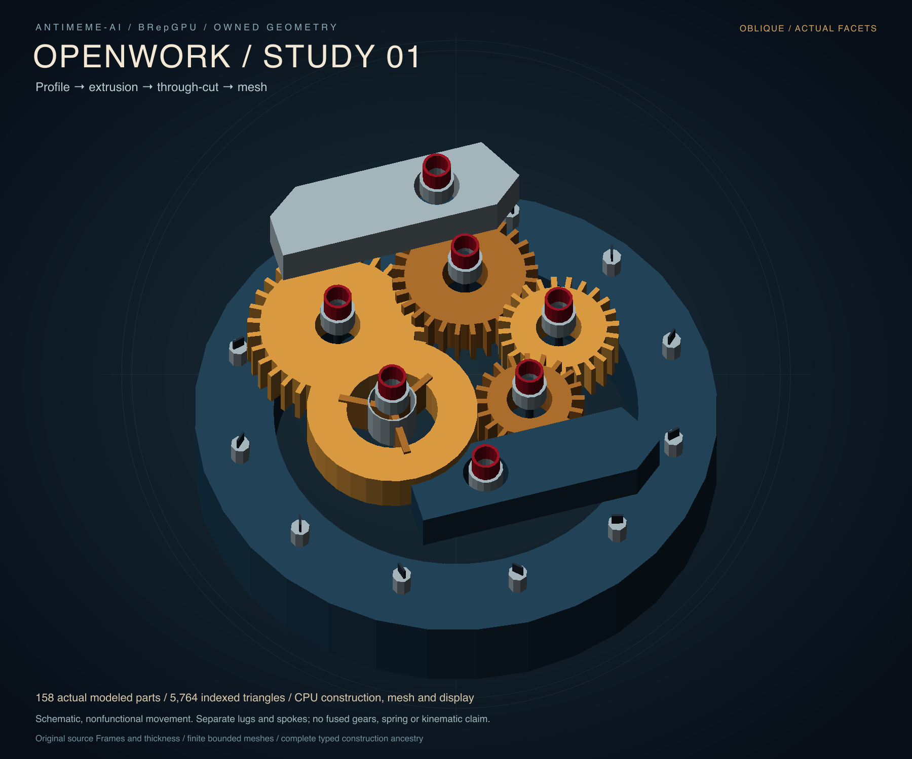](results/watch-2026-10-15/REPORT.md)

**Openwork study 01:** an original watch-inspired assembly built from 158 actual
modeled solids. Its 23 pierced parts consume the real
[profile → extrusion → bore → mesh chain](docs/FEATURE_BORE.md), with complete
ordered ancestry back to their original outlines and cutters. The 5,764-triangle
scene is schematic and nonfunctional; tooth-like lugs and spokes are separate
solids. Construction, meshing and these views run on CPU.
[Images, source/history exports and scoped costs](results/watch-2026-10-15/REPORT.md) ·
[Target and design notes](docs/WATCH_TARGET.md).

**Current mesher development:** an owned
[cached adaptive subdivision design](docs/ADAPTIVE_MESHER_DESIGN.md), with
[a concrete delivery plan](docs/ADAPTIVE_MESHER_PLAN.md), is now primary.
We study NVIDIA USD/BRep and the wider literature for stronger numerical,
cache, trim and GPU algorithms. CPU and P100 will execute the same source-linked
operation, with cold and declared cache-reuse costs reported separately.
The design is under implementation-unit review; no new adaptive mesh or GPU
speedup is claimed yet. The complete OM10 render remains pending.

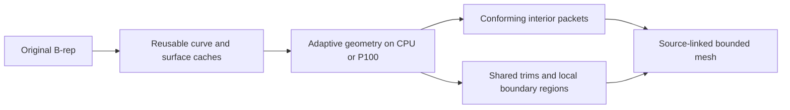

Earlier work on the supplied real OM10 movement delivered an owned
[C++20 direct constrained Delaunay constructor](docs/DIRECT_CDT.md):
alternating-cut initial triangulation, randomized constraint recovery, compact
indexed topology and filtered exact metric predicates. An **8,192-site forced
recovery** call takes **0.326–0.337s** on one CPU across three seeds, recovering
more than8,000 crossed edges; the old ear-plus-Python-Lawson worker is censored
at30s. Exact independent qualification is timed separately. The
[107-observation report](results/direct-cdt-2026-10-16/REPORT.md) retains all
outcomes, setup costs and the remaining quadratic many-hole admission cost.
These are CPU sampled-domain calls; GPU CDT remains future work.


Explicit imported-mesh direct mode now constructs and independently qualifies
all **438 main-plate faces and191,688 triangles** at unchanged quality:
**208.258s construction**, then **169.985s independent qualification** on one CPU.
The [complete-part report](results/main-plate-direct-2026-10-16/REPORT.md) retains
the earlier qualifier timeout and the exact ranked-sweep replacement. The earlier
[native ear results](results/native-face-domain-2026-10-16/REPORT.md) remain
available, including the main-plate300s construction censor. The full OM10
render remains pending.

We are taking an intentional **breadth-first pass**: deliver a narrow, usable,
independently qualified beachhead in each major theme, then return to strengthen
it. The [theme map and first-pass sequence](docs/ACCELERATION_ROADMAP.md#breadth-first-delivery-policy)
cover body data, integration, curves/trims, meshing, pair discovery, intersections,
classification, arrangements, solid operations, features and GPU topology.
Body snapshots, part-level sampling/normals and conservative surface-pair
discovery are delivered, along with complete analytic face intersections and
their coupled spatial/two-UV representations. GPU edge-use adjacency and its
mate/face-neighbor reader are delivered too. Exact material classification and
finite rectangular-face contacts and complete bounded planar arrangements are
delivered on CPU. Complete shared-edge meshes for the canonical box, cylinder
and holed plate are now delivered too, with exact source construction and bounded
rounded output. The [carrier interchange beachhead](docs/INTERCHANGE.md) now reads
actual foreign ASCII USD BRep surfaces into owned CPU/P100 patches with original
face/chart identities and explicit unsupported outcomes. Trims remain uninterpreted.
An owned [through-bore Boolean with complete source history](docs/BOOLEANS.md)
is now delivered. [Convex-profile extrusion](docs/EXTRUSION.md),
[full profile revolution](docs/REVOLUTION.md), a [complete box-edge fillet](docs/FILLET.md)
and [signed analytic offset](docs/OFFSET.md) are delivered.
The planned breadth sweep is complete. The [stocktake and proposed next tranche](docs/POST_BREADTH_ROADMAP.md)
cover result meshing, composable history, external qualification and measured
runtime ownership. Actual extrusion/bore composition is now delivered; external
adapters and runtime/language study remain. The [post-watch roadmap proposal](docs/POST_WATCH_ROADMAP.md)
connects required CPU references, measured preparation/runtime work, real edits
and GPU topology construction in the next broad cycle. The first
[native C++20 ownership unit](docs/NATIVE_FACE_DOMAINS.md) now handles exact
sampled-face crossing and triangulation in imported meshing, with an explicit
Python reference path and selected external geometry cases. General modeling
support remains a separate goal.

[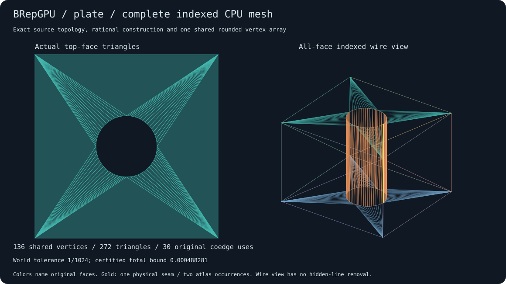](docs/MESHING.md)

[Mesh API and source/chord contract](docs/MESHING.md) ·
[Actual geometry and CPU caller costs](results/meshing-2026-10-15/REPORT.md).
The continuing trophy subject is [NCSX](docs/NCSX_TROPHY_BRIEF.md), with the
operator-provided engineering reference pack acquired for comparable iterations.
[GPU setup/residency and integration notes](docs/RETURN_PASS.md) are queued
after the broad-pass big rocks.
That return pass also investigates whether Python belongs in the delivered
system at all, and in which role.

[External community qualification is mandatory before alpha](docs/ALPHA_QUALIFICATION.md).
Development can continue while those suites are incomplete; required missing,
unsupported, skipped or failing cases cannot count as green. The
[OCCT, CGAL and oracle audit](papers/README.md#external-oracles-and-alpha-qualification)
records the remaining full-suite gap. Selected NVIDIA trim and Manifold polygon
inputs now exercise our native face-domain output with independent exact
boundary/incidence/embedding checks; this first cohort does not complete alpha
qualification.

[NVIDIA USD/BRep CPU reference timings are required for every README scenario](https://github.com/antimeme-ai/BRepGPU/issues/63).
Complete the OM10 watch comparison first, then backfill all advertised scenarios
with comparable scopes and explicit unsupported or failed reference outcomes.

BRepGPU is an early research and engineering project working toward a solid
modeling kernel whose geometry and topology operations run on GPUs. The first
target is NVIDIA P100: FP64 geometry on CUDA 12, with an owned implementation.

A boundary representation retains surfaces, curves, trims and their connections.
That makes a cylinder an editable cylinder, with a display mesh derived from it.
Getting those connections right is as important as evaluating surfaces quickly.

Five owned GPU stages are implemented: **batched rational patch jets**,
**resident seeded surface projection**, **automatic conservative patch discovery**,
**conservative surface-pair discovery**, and **edge-use adjacency construction/reading**,
with native C++ CPU/CUDA backends and a standard-library Python
adapter. Discovery removes supplied UV seeds and returns a certified
squared-distance bracket with separate precision, coverage and budget flags.
Both cards pass exact geometry, ownership and device memory checks.

An owned body consumer now samples **boxes, cylinders and a plate with one
through-hole**, retaining shared boundaries, trim loops, chart identity and
oriented normals. CPU body/trim/normal work uses the existing native evaluator.

Exact CPU face sections now return circles, clipped arcs, generator segments,
tangencies and isolated contacts for the supported planar/cylindrical body
family. A CPU/CUDA consumer evaluates both source surfaces along those curves.

The repository also retains a CPU modeling benchmark of NVIDIA's
[USD BRep / SMLib](https://github.com/NVIDIA-Omniverse/usd-brep) and a reproduced
tessellation failure. Those reference measurements are separate from the owned
BRepGPU evaluator.

[Acceleration roadmap](docs/ACCELERATION_ROADMAP.md) ·
[First-iteration design](docs/ITERATION_1_DESIGN.md) ·
[Resident projection API](docs/ITERATION_2.md) ·
[Automatic discovery API](docs/ITERATION_3.md) ·
[Surface-pair API](docs/PAIR_DISCOVERY.md) ·
[Analytic face intersections](docs/INTERSECTIONS.md) ·
[GPU adjacency and mate reader](docs/ADJACENCY.md) ·
[Exact material and face contact](docs/CLASSIFICATION.md) ·
[Exact planar arrangements](docs/ARRANGEMENTS.md) ·
[Owned through-bore Boolean and history](docs/BOOLEANS.md) ·
[Owned convex-profile extrusion](docs/EXTRUSION.md) ·
[Owned full profile revolution](docs/REVOLUTION.md) ·
[Owned box-edge fillet](docs/FILLET.md) ·
[Owned signed analytic offset](docs/OFFSET.md) ·
[Topology IDs and packed snapshots](docs/TOPOLOGY.md) ·
[Qualified P100 CUDA toolchain](docs/CUDA_TOOLCHAIN.md)

CUDA 12.8.1 is installed in an isolated prefix on the initial execution host.
Both 16 GB P100s run native `sm_60` product code. The CPU core loads independently
of CUDA; explicitly selecting CUDA loads the optional backend.

## Extrusion results now become complete meshes

Actual convex-profile extrusion results now feed an exact planar CPU mesher,
retaining original profile trims, shared boundaries, per-corner UV and complete
source history. The triangle, six-sided and16-sided examples yield8/20/60triangles;
actual output rounding is bounded against the submitted world tolerance.

[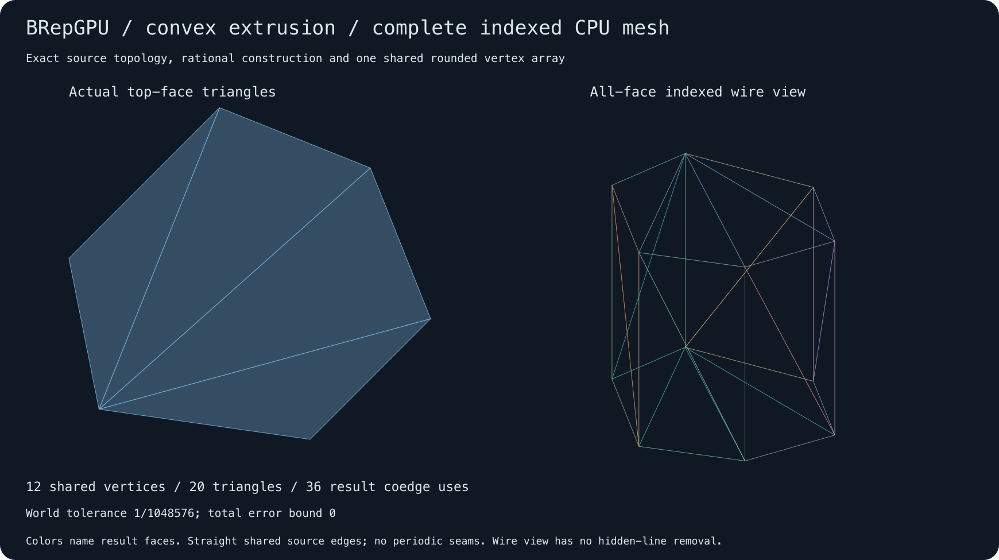](docs/EXTRUSION_MESHING.md)

[API and direct geometry checks](docs/EXTRUSION_MESHING.md) ·
[Actual outputs and scoped CPU costs](results/extrusion-mesh-2026-10-15/REPORT.md).
Ten direct and48 affected compatibility methods pass. Testing stops after the
bounded obligations and reviewed actual callers; external alpha work remains.

## Boolean results now become complete meshes

The actual owned through-bore Boolean now feeds a dedicated CPU mesher, retaining
its original carriers, trimmed cutter UV, shared physical boundaries and complete
source history. The refined unit result has264 shared vertices and528 triangles;
construction plus full indexed/history consumption measured220.970ms median.
Boolean construction, independent qualification and export are reported separately.

[](docs/CUT_MESHING.md)

[API and source/error contract](docs/CUT_MESHING.md) ·
[Actual mesh, qualification and scoped costs](results/cut-mesh-2026-10-15/REPORT.md).
This closes the first post-breadth connection. Feature-result meshing and operation
composition remain separate work; community qualification still gates alpha.

## Feature construction: signed analytic offsets

An actual cylinder now offsets inward or outward into a closed owned solid,
with exact changed cap/wall carriers and complete source history. Sharp
intersection joins preserve two rim circles and the wall's distinct seam uses.
Original-surface normal feet expose extensions outside the original trimmed faces.

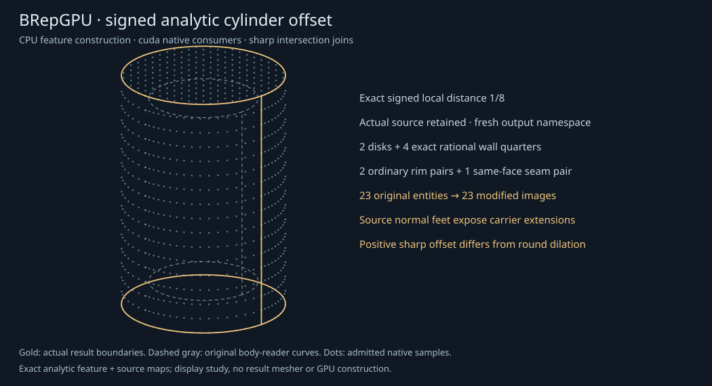

All 23 original entities have precise modified images. CPU constructs the feature;
CPU/both-P100 consumers evaluate its carriers and read actual adjacency. Inward
results equal erosion in this family; positive sharp joins differ from rounded
Euclidean dilation. [API/support](docs/OFFSET.md) ·
[Qualification, complete costs and explicit reference disagreements](results/offset-2026-10-15/REPORT.md).
This completes the planned extrusion/revolution/fillet/offset breadth sequence.
Broader geometry, external community qualification and measured integration work remain.

## Feature construction: a complete source-edge fillet

One selected vertical edge of an actual owned box now rounds into a closed solid.
The six original plane carriers retain their control and parameter bits; exact
cap arcs, shortened side trims and a rational circular band close the boundary.
Two complete tangent contact rails preserve both original and blend UV maps.

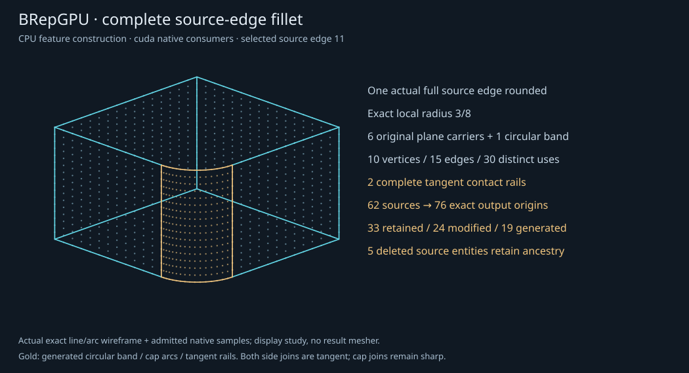

All four original vertical edges are supported. The result has 10 vertices,
15 edges, 30 distinct uses and complete ancestry from 62 source entities to
76 output origins. CPU constructs the feature; CPU/both-P100 native consumers
sample its carriers and read actual adjacency. Caps meet the band sharply.
[API/support](docs/FILLET.md) · [Qualification, foreign comparisons and complete costs](results/fillet-2026-10-15/REPORT.md).
The [signed offset](docs/OFFSET.md) completes the planned feature breadth sequence.

## Feature construction: a full profile revolution

An actual off-axis convex profile now revolves into a closed solid with exact
rational surfaces, material membership, and complete source history. Each
original vertex generates a ring; each original edge generates one swept face
with four rational charts. Physical seams retain two distinct uses on that face.

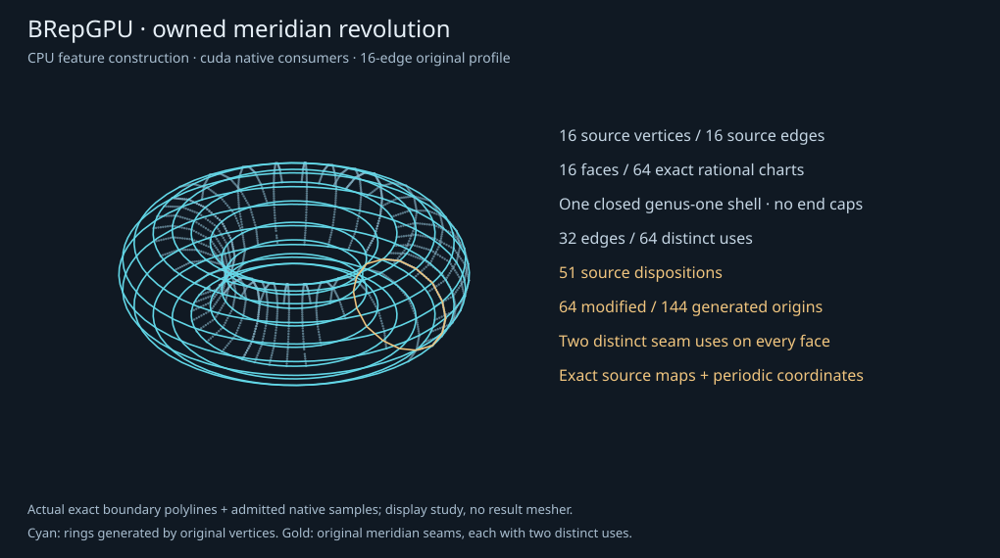

The example has 16 faces, 64 charts and a genus-one shell, with complete ancestry
from 51 source entities to 208 output origins. CPU constructs the feature;
CPU/both-P100 consumers evaluate actual geometry, oriented normals and adjacency.
[API/support](docs/REVOLUTION.md) · [Qualification and costs](results/revolution-2026-10-15/REPORT.md).
The first foreign triangle agrees on bounds and boundary witnesses; its volume
comparison remains outside the declared limit and is recorded as a failure.
[Box-edge fillet](docs/FILLET.md) and [signed offset](docs/OFFSET.md) are also delivered.

## Feature construction: an actual profile extrusion

Strict convex polygon profiles now extrude into owned closed solids, with two
translated cap images for every source entity and explicit generated side history.
Original edge/vertex identities determine the shared boundaries; exact affine
source maps preserve cap translations, intrinsic parameters and orientation.

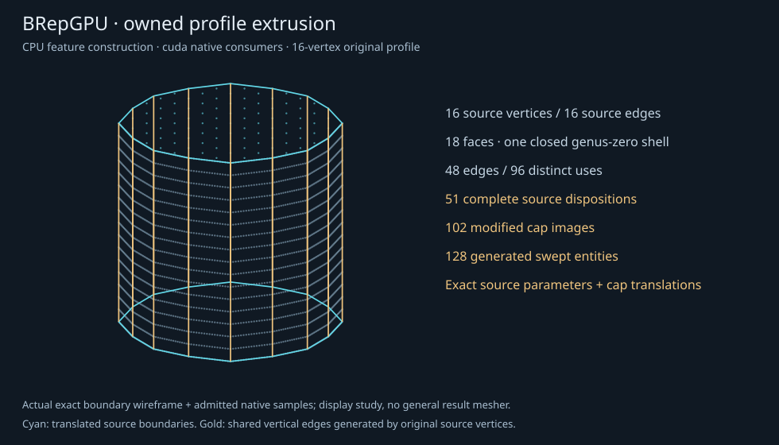

The 16-sided example has 18 faces, 48 edges, 96 uses and complete history from 51 source
entities to 230 output origins. CPU constructs the feature; CPU/both-P100 native
consumers sample its carriers and read actual adjacency. Independent integer-
square-root intervals qualify non-axis unit normals; tiny edges and 32-vertex
profiles have direct fleet cases. [API/support](docs/EXTRUSION.md) ·
[Qualification, foreign comparisons and complete costs](results/extrusion-2026-10-15/REPORT.md).
[Box-edge fillet](docs/FILLET.md) and [signed offset](docs/OFFSET.md) are also delivered as separate feature units.

## Owned solid operations: a through-bore cut with history

A box minus a strictly through-cylinder now becomes an owned closed solid from
actual intersections, cap arrangements and material decisions. The result keeps
its original surface carriers, two annular caps and an inward-facing cutter
wall. Typed history covers **all 85 input entities and all 81 output origins**,
including cropped seam ranges and jointly generated rims.


CPU constructs the Boolean; CPU/P100 sampling and adjacency consume the result.
Independent checks cover whole rational boundary maps, oriented manifold topology,
exact material queries and complete six-kind history. The same-sized NVIDIA
reference cut also agrees on volume, bounds and boundary witnesses.
[API and supported family](docs/BOOLEANS.md) ·
[Qualification and complete operation costs](results/boolean-2026-10-15/REPORT.md).
Feature construction continues; GPU Boolean construction and broader contact cases remain.

## Planar arrangements: exact regions, holes and shared boundaries

Rectangular faces now split into complete regions using axial cuts and separated
interior circle sections. Every region has ordered outer/hole loops, shared
opposite edge uses, exact source parameters and closed-region lookup. Each
circle stays one closed edge while retaining all four original source pieces.

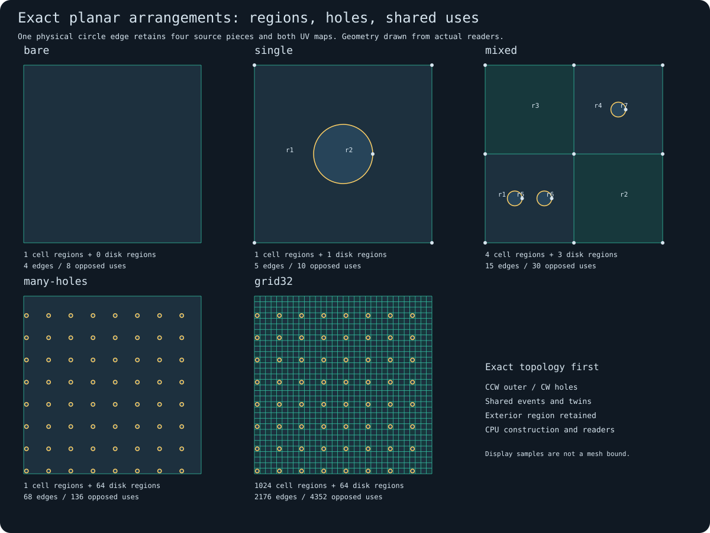

The large CPU case emits **1,088 bounded regions and 4,352 opposed uses**.
Median construction takes **471ms**; construction plus every graph/curve/region
reader takes **2.40s**. Independent checking is a separate **10.57s** cost.
Qualification passed **72 tests** with one existing GPU-only skip and **eight
assertion-killed mutants**. Full exact graphs and source maps are exported for
all five recipes. GPU construction, general circle overlay and broader Boolean assembly
remain separate work.
[API](docs/ARRANGEMENTS.md) · [Full results and scope](results/arrangements-2026-10-14/REPORT.md)

## Exact material regions and finite-face contact

The owned box, cylinder and one-hole plate now answer exact inside/boundary/
outside queries, retaining every incident boundary face. Rectangle-face pairs
return complete point, segment or area contacts with both original UV maps;
crossing, boundary touch, overlap and whole-face coincidence stay distinct.
This is exact CPU construction; curved-trim overlap and GPU placement remain
separate work.

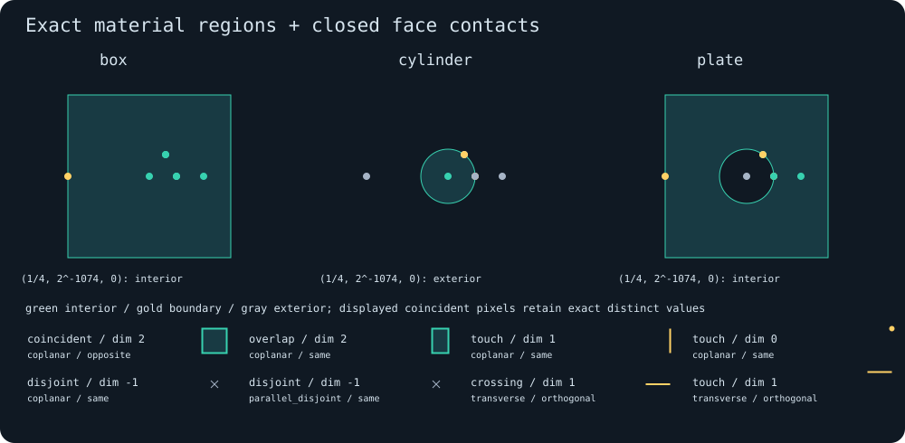

A cylinder-rim point offset by the smallest positive binary64 subnormal is
exterior; the corresponding point on the plate is interior. Exact arithmetic
preserves that distinction even when the drawing pixels coincide. Qualification
passed **61 new/compatibility tests** and **seven focused assertion-killed
mutants**. Complete reused medians for 12,288 points are **365–490ms** across
the three solids; 512 contact requests take **147ms**, with wide variability.
Preparation and independent checking are separate published costs.
[API](docs/CLASSIFICATION.md) · [Full results and scope](results/classification-2026-10-14/REPORT.md)

## GPU topology: construct adjacency, preserve the seam

GPU count/scan/fill builds packed edge-to-coedge rows, then an actual reader
returns unique opposed mates and their owning faces. The cylinder seam keeps
both uses on one face. Stable entity identity stays separate from storage slots;
independent permutations preserve the typed result.

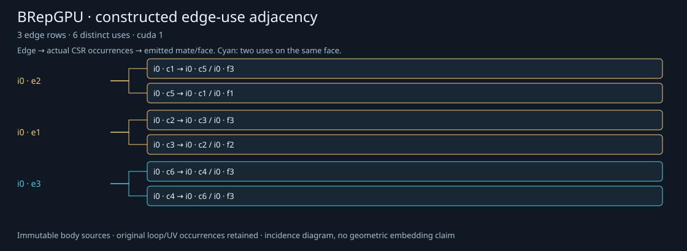

CPU1/CPU24 and both P100s pass **ten direct adjacency tests per placement**.
Both cards pass device memory and recoverable failure/restoration checks with
**zero errors/leaks**. Native host sanitizers pass; **eight actual CPU/CUDA/Python
production mutants** are caught. All **120 exported uses and diagram labels**
pass independent signed-source, loop/UV, CSR and mate/neighbor checks.

For **491,520 edges / 983,040 uses**, count+scan+fill+native-reader host spans are
about **17.6–17.7× faster ordered and 11.4–11.6× faster shuffled than CPU24**. Those
scopes exclude allocation/transfers/cleanup. Complete native ordered storage
favors CPU1: **8.2 ms versus about 17 ms GPU**. Shuffled native medians are
**19.4 ms CPU24 versus 21.8/15.3 ms P100**, with overlapping ranges on the faster
card. Full typed Python traversal remains **4–5 seconds**, with no established
complete-caller gain. Repeated plates are separate topology occurrences at the
same coordinates, rather than one complicated solid.

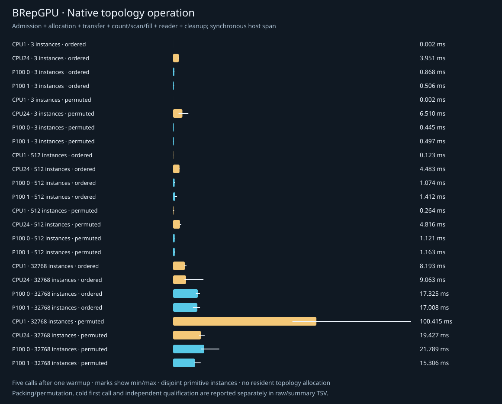

```sh
PYTHONPATH=python python3 examples/build_adjacency.py --recipe cylinder \
  --order permuted --backend cuda --device 0 \
  --library-path build/topology-release/libbrepgpu_topology.so \
  --output-directory results/local-topology
```

[API and construction scope](docs/ADJACENCY.md) ·
[24 matched cases, cold costs and full timing scopes](results/adjacency-2026-10-14/REPORT.md) ·
[Research and bibliography](papers/README.md#gpu-edge-use-adjacency-beachhead) ·
[Round-two notes](papers/2026-10-14-adjacency-round2-notes.md).
Native bulk consumption, resident buffers and integration follow the broad-pass
big rocks. Radial ordering, topology editing and Boolean construction remain future.

## Exact sections and both surface representations

One request constructs the complete intersection of two supported CLOSED faces.
Exact algebra retains trim contacts, boundary curves, seams and connected
components; chart occurrences share explicit physical span IDs. This is CPU
construction, followed by a measured two-sided CPU/P100 consumer.

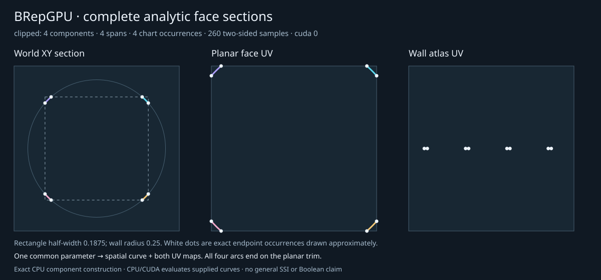

CPU1/CPU24 and both P100s passed **17 direct tests per backend**, including
irrational endpoints, subnormal near-tangency, generators/points, extreme
frames, actual source provenance and cleanup failures. Both cards ran under
Compute Sanitizer with **zero errors/leaks**; five production mutants were
caught. All **1,040 exported paired samples / 2,080 native rows** passed
independent original-control, graph, request, binary-source and SVG checks.

For **32,776 supplied native rows**, P100 evaluation host spans take
**0.11–0.13 ms versus 1.9–2.0 ms CPU24: about 15–17.5×**. Full reused consumers
take **2.3–2.5 seconds on every backend**; CPU row construction and exact grades
dominate, so **no complete-consumer speedup is established**. Exact component
construction is 13–20 ms; preparing 16,388 exact sample candidates costs 27–32 s.
These are separate timing scopes. GPU setup/residency and bulk native consumption
remain [round-two notes](docs/RETURN_PASS.md) after broad-pass big rocks.

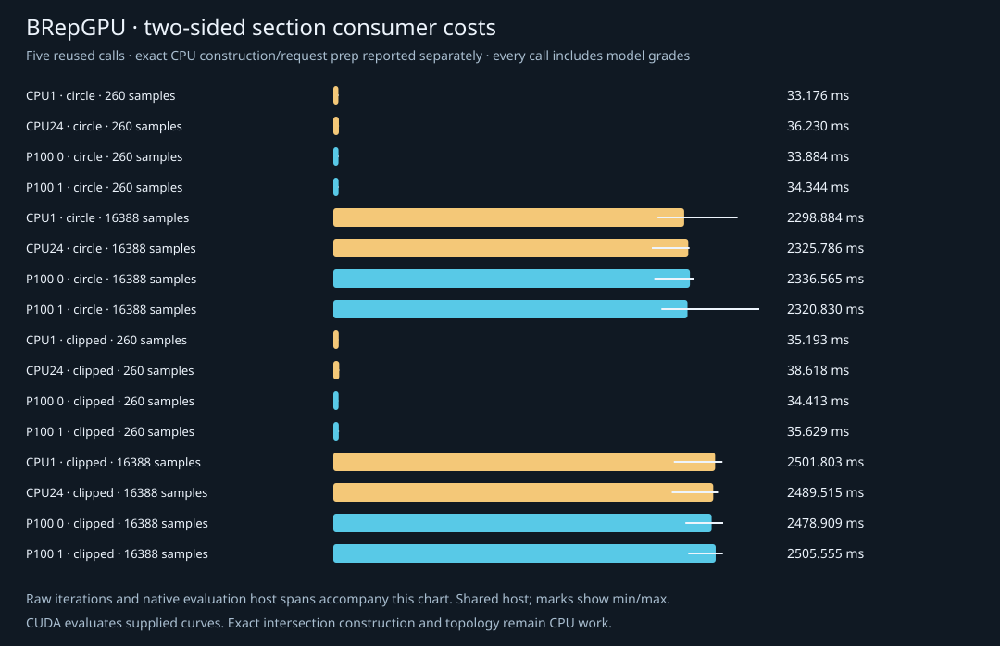

```sh
PYTHONPATH=python python3 examples/intersect_faces.py --recipe clipped \
  --backend cuda --device 0 --library-path build/pair-release/libbrepgpu.so \
  --output-directory results/local-section
```

[API and scope](docs/INTERSECTIONS.md) ·
[Exact qualification and matched CPU/P100 costs](results/intersections-2026-10-14/REPORT.md) ·
[Research and bibliography](papers/README.md#analytic-intersection-beachhead) ·
[Journal](journal/) · [Return-pass research notes](papers/2026-10-14-intersection-round2-notes.md).
General SSI, imported/tilted intersection inputs and broader Boolean assembly remain
future; the exact planar arrangement beachhead is a separate delivered operation.

## Resident surface-pair shortlist

CPU-built bounds enclose each whole carrier chart in a common world frame.
Resident CPU/CUDA indexes emit deterministic paged masks; decoded survivors
retain their exact body, face and chart identities. Touching remains, including
zero-width boxes. Explicit coverage distinguishes a terminal suffix from a
complete traversal. Survivors are candidates for later intersection work.

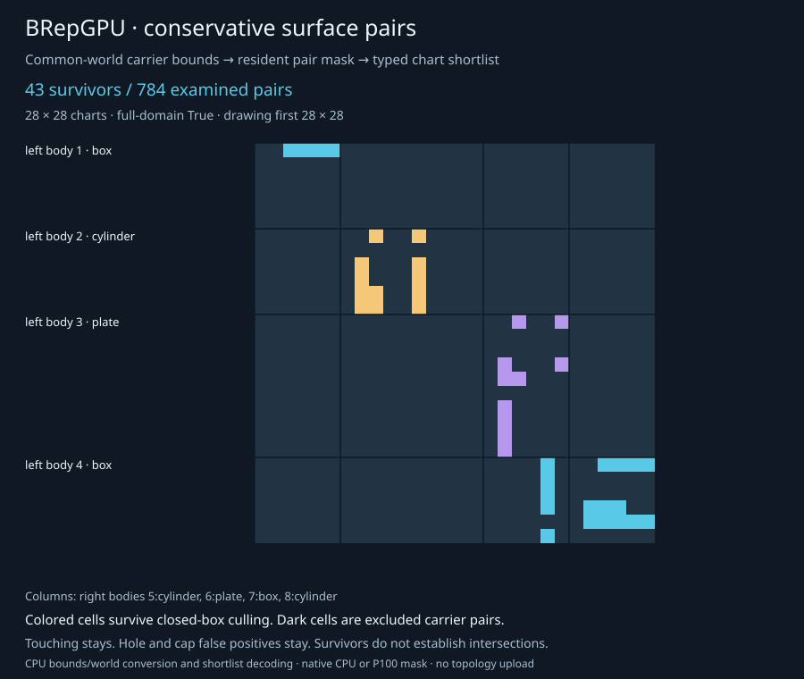

For **128 bodies per side**, the operation examines **879,840 chart pairs** and
retains **1,823 survivors**. Complete reused shortlist medians, including mask
download, cleanup and Python decoding, are **9.63 ms CPU24 versus 7.78/6.92 ms
on P100: 1.24–1.39×**. CPU1 wins the tiny scene; cold preparation favors CPU.
Bounds/world conversion and output decoding stay on CPU. Geometry/index reuse
and GPU setup/teardown are recorded for the later integration/performance pass.

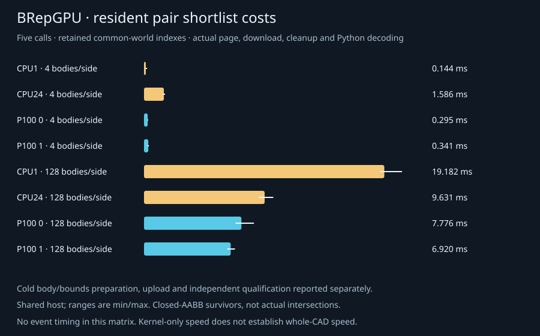

Both P100s passed **68 focused family tests** under Compute Sanitizer with zero
errors/leaks. **60 native ASan/UBSan checks**, eight actual older-binary
compatibility cases and four caught production mutants cover lifetime/failure
paths. All **15,024 exported pair bits** passed independent original-control,
world-bound, mask and source checks. This operation excludes carrier chart
pairs; it does not establish intersections, trimmed-face contact or Booleans.

```sh
PYTHONPATH=python python3 examples/discover_pairs.py --backend cuda --device 0 \
  --size 4 --library-path build/pair-release/libbrepgpu.so \
  --output-directory results/local-pairs
```

[API](docs/PAIR_DISCOVERY.md) · [Results, cold costs and full scopes](results/pairs-2026-10-14/REPORT.md) ·
[Reviewed design](docs/PAIR_DISCOVERY_DESIGN.md) · [Broad-phase literature](papers/2026-10-14-pair-literature.md).

## Body-aware samples and normals

One immutable body snapshot retains faces, shared edges/coedges, holes and the
two uses of a cylindrical seam. Quarter patches remain charts of one face.
The runnable caller gathers exact trim-admitted UVs, evaluates one native
first-jet batch and emits XYZ/normals with complete source identity.

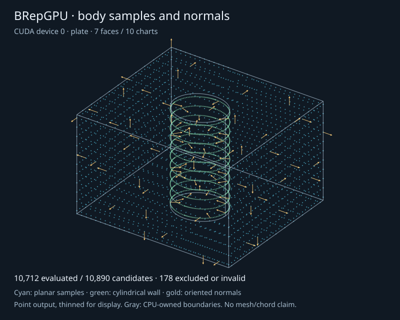

All **14,358 candidate records and 13,996 evaluated witnesses** passed independent
exact-input checks. CPU1/CPU24 and both P100s passed nine direct tests; each P100
ran under Compute Sanitizer with zero errors/leaks. Four production host-code
mutants were caught. The point output includes explicit rejected rows and raw
UV/control/table records; no mesh or Boolean claim is implied.

The **24-case complete-caller comparison** exposes the next performance limit:
for 41,536 drilled-plate samples, reused wall is about **853 ms CPU24 versus
874–878 ms on P100**. CPU normal/row construction dominates despite faster
GPU evaluation; no end-to-end win is established here. This working beachhead
now lets the breadth-first pass move to another theme.

```sh
PYTHONPATH=python python3 examples/sample_body.py --shape plate --backend cuda \
  --device 0 --resolution 33 --output-directory results/local-body
```

[API and explicit library selection](docs/BODY_SAMPLING.md) ·
[All results, ranges and timing scopes](results/body-2026-10-14/REPORT.md) ·
[Reviewed design](docs/BODY_SAMPLING_DESIGN.md).

## Automatic bounds and discovery

Locate a candidate on a named untrimmed rational patch without a supplied seed.
An immutable dyadic hierarchy retains original patch/chart identity. Resident
queries compare three owned literature-informed methods: **AABB**, **26-DOP
support slabs**, and **rational Bernstein squared-distance bounds**. Original
input interval arithmetic certifies the candidate upper; ordinary rounded XYZ
remains descriptive.

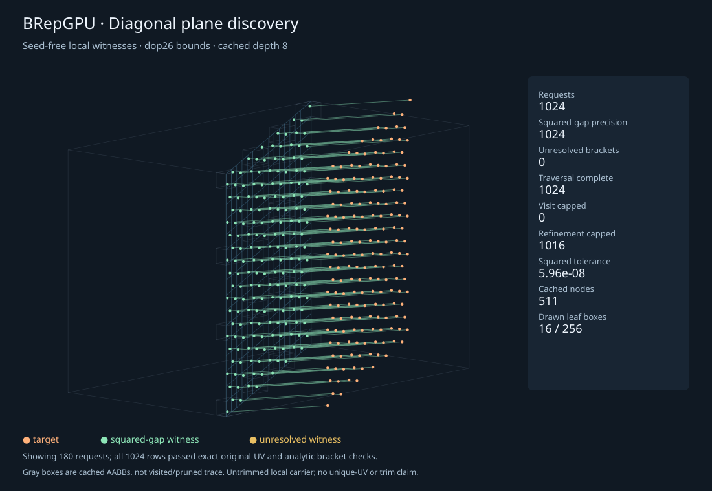

The actual caller passed exact checks for **24,576 returned witnesses** across
CPU24 and both P100s. This diagonal 26-DOP batch meets all 1,024 requested
squared gaps. The finer curved clouds retain valid unresolved brackets at
depth8: stronger bounds and deeper trees are resource/precision choices.
Gray boxes in the graphic are cached enclosures, rather than a traversal trace.

All three methods passed **309 exact-input rows and 11,415 exported nodes per
backend**. Each P100 passed the full 58-test suite under Compute Sanitizer with
zero errors and zero leaked device allocations. Actual older binaries remain
compatible, and direct geometry checks caught nine production numerical mutants.
For 65,536 coarse cylinder queries with Bernstein bounds, each P100 takes about
**35 ms resident versus 1.26 s on CPU24: 36×**, or **29–30× including native
query upload, download and consumption**. Seven samples; all rows meet the gap.
These repeated targets align with tree boundaries; finer off-grid cases remain
unresolved at depth8. [444 completed CPU1/CPU24/P100 comparisons and methods](results/discovery-2026-10-14/REPORT.md).
[Qualification receipts](results/discovery-2026-10-14/QUALIFICATION.md) ·
[Caller, TSVs and graphics](docs/DISCOVERY_CLOUD.md) ·
[Reviewed design](docs/ITERATION_3_DESIGN.md).

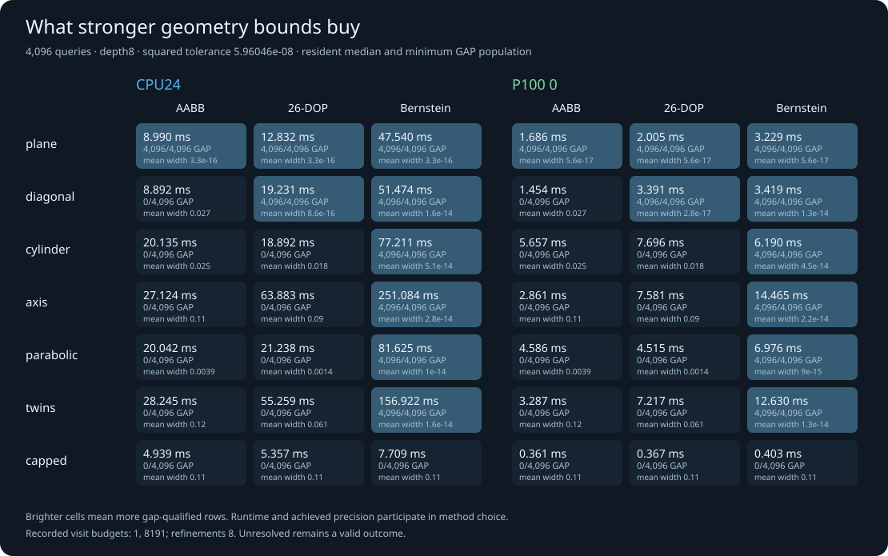

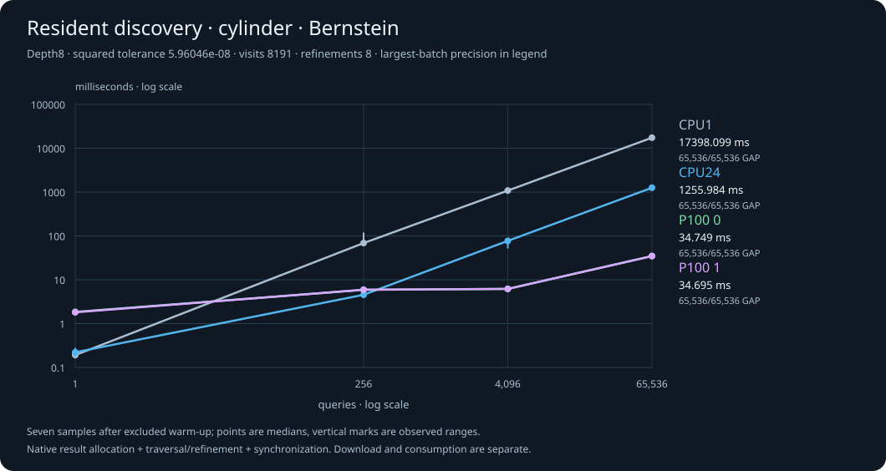

```sh
PYTHONPATH=python python3 examples/discover_cloud.py --backend cpu \
  --shape cylinder --mode bernstein --output-directory results/local-discovery
```

Use the [build and explicit library selection](docs/ITERATION_3.md) first.
This operation bounds squared distance within one supported local carrier;
trims, cross-patch selection, intersections and solid topology remain later work.

## Resident surface projection

Refine a batch of provided seeds against untrimmed rational patches in one native
call. Output includes UV, position, squared distance, projected-gradient residual,
accepted updates, evaluation counts, and rank/curvature flags. Stationarity is
an explicit first-order contract: a saddle can be stationary, and another seed
can find a closer candidate. Global nearest points, trims and topology remain
later operations.

For 1,048,576 nonlinear cylinder projections, median native timings are:

| Backend | Resident projection | Prepared host-to-host |
| --- | ---: | ---: |
| CPU, 24 requested workers | 229.73 ms | 227.46 ms |
| P100, device 0 | 25.27 ms | 87.58 ms |
| P100, device 1 | 25.27 ms | 77.35 ms |

About **9.1× resident and 2.6–2.9× including native input/upload and download**
against this CPU implementation. Seven samples on a shared host; the columns
time separate calls and their medians are not additive. Tiny batches favor CPU1
in this matrix.
[All 144 qualified cases, ranges, exact oracles and methods](results/projection-2026-10-14/REPORT.md).

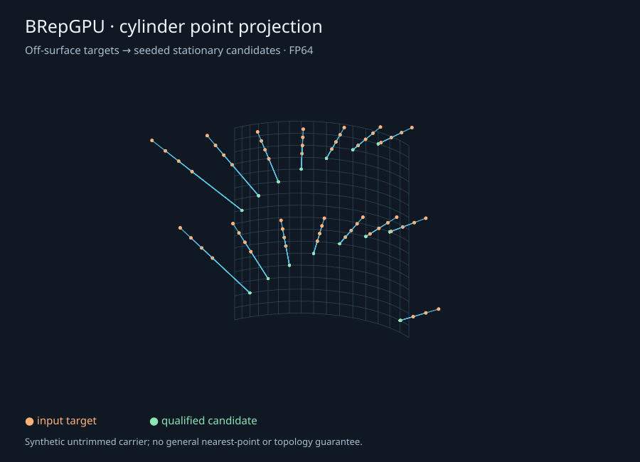

The actual caller projects independently constructed cylinder and polynomial
point clouds, checks exact geometry and known solutions, and exports input/output
records and individual caller costs.
[Usage and contract](docs/ITERATION_2.md) ·
[Reviewed design](docs/ITERATION_2_DESIGN.md) ·
[CPU and both-P100 qualification, measurements and artifacts](results/projection-2026-10-14/REPORT.md).

After the build below:

```sh
PYTHONPATH=python python3 examples/project_cloud.py --backend cpu \
  --shape cylinder --output-directory results/local-projection
```

## First GPU measurement

For 1,048,576 full-jet bicubic queries on one patch, median native timings are:

| Backend | Resident evaluation | Prepared host-to-host |
| --- | ---: | ---: |
| CPU, 24 requested workers | 111.50 ms | 168.98 ms |
| P100, device 0 | 6.11 ms | 85.21 ms |

That is about **18× for resident evaluation and 2.0× including native input/upload and
download** against this 24-worker CPU implementation. Tiny batches favor CPU.
Seven samples on a shared host; context initialization and Python packing are
outside these native timers. [Both GPUs, raw samples, qualification and methods](results/iteration1-2026-10-13/REPORT.md).

## Run the first owned stage

Linux x86-64, CPython 3.12, CMake 3.28 and a C++17 compiler:

```sh
cmake -S . -B build/release -DCMAKE_BUILD_TYPE=Release
cmake --build build/release --parallel 4
PYTHONPATH=python python3 examples/sample_patch.py --backend cpu \
  --output-directory results/local-sampler
```

[CUDA build, qualification and benchmark commands](docs/ITERATION_1.md) ·
[Measured results](results/iteration1-2026-10-13/REPORT.md) ·
[Reviewed implementation plan](docs/ITERATION_1_PLAN.md)

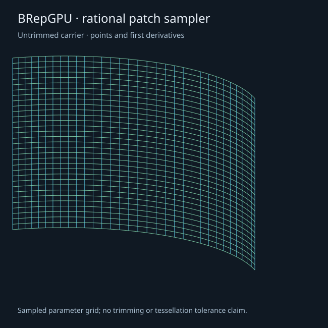

The sampler exports qualified points, a parameter grid and exact input/query
metadata. It supports a rational cylinder and a polynomial bicubic carrier.
The numerical stage operates on untrimmed patches; intersections, trims and
solid topology are subsequent roadmap stages.

## CPU modeling reference

**16 of 19 workloads met their declared geometry checks** with USD BRep 1.0.0.
The baseline covers primitives, booleans, sweeps, fillets, bicubic surface
evaluation, closest points, tessellation and USD interchange.

Median wall time from five fresh-input samples after one excluded warmup, pinned
to one logical CPU on a dual Xeon E5-2697 v2 machine:

| Workload | Median | Range |
| --- | ---: | ---: |
| One through hole | 4.16 ms | 4.02–4.32 ms |
| 16-hole plate | 77.33 ms | 76.12–87.03 ms |
| 64-hole plate | 472.46 ms | 470.57–479.60 ms |
| Single-edge circular fillet | 4.51 ms | 4.49–4.78 ms |
| Curved model USD export and import | 4.77 ms | 4.62–5.48 ms |

Hole workloads time sequential subtraction of prepared cylinders. Setup and
geometry checks are outside the timed regions; the USD workload includes file
I/O. These are exploratory public-API measurements on a shared host. CPU clock,
SMT sibling activity and filesystem cache were not controlled.

[Full results and sample data](results/cpu-2026-10-13/REPORT.md) ·
[Benchmark methods](docs/CPU_BENCHMARK.md) ·
[Runnable driver](benchmarks/cpu/benchmark.py)

## A correctness finding

The three unqualified workloads are sphere tessellations. For a radius-10 sphere
with both angular criteria disabled, points on emitted triangles exceed the
requested chord tolerance:

| Requested maximum distance | Observed witness distance |
| ---: | ---: |
| 0.2 | 0.220275 |
| 0.05 | 0.057393 |
| 0.01 | 0.014526 |

The kernel reports successful tessellation. The benchmark retains a triangle,
a point on that triangle and its barycentric coordinates, so the discrepancy can
be checked against the analytic sphere. These are witnesses, not measured global
maximum errors. The finding is specific to this release and these settings.

[Reproduction and witnesses](docs/TESSELLATION_FINDING.md)

## How selective acceleration becomes a kernel

The intended architecture gives each accelerated stage reusable data and error
contracts. Geometry starts in contiguous buffers with stable entity identities;
GPU work produces bounded results or explicit unresolved cases. Topology can
initially be assembled on the CPU while the numerical pipeline develops.

| Stage | Useful deliverable | What it builds toward |
| --- | --- | --- |
| Geometry storage and evaluation | Batched FP64 points and derivatives | Shared device representation and CPU reference contracts |
| Bounds and geometric queries | Seeded projection and automatic conservative patch discovery delivered; pair/trim queries next | Work queues for irregular geometry |
| Approximation and meshing | Complete shared-edge CPU meshes for canonical box/cylinder/plate, with world error bounds and preserved hole/seam | Wider trim families and native/GPU placement |
| Surface intersections | Curves in 3D and both surfaces' parameter domains | Complete intersection branches and consistent trims |
| Face splitting and classification | Boundary pieces selected by Boolean operations | Device topology construction with shared edges |
| Solid assembly and features | Narrow solid operations and independently scoped extrusions, revolutions, fillets and offsets; features can precede Booleans | A progressively broader GPU modeling kernel |

The first implemented prototype supports positive-weight rational
Bézier patches through bidegree (3,3), with FP64 positions and first/second
derivatives on a P100. Analytic polynomial and exact rational cylinder fixtures
qualify the results, alongside an independent CPU reference. Both resident-data
and transfer-inclusive timings matter. Tiny loops,
tangent contacts, periodic seams and coincident surfaces enter the design early.

The [first design](docs/ITERATION_1_DESIGN.md) specifies the local coordinate
and weight envelope, finite-corpus error grades, input ownership and failure
contracts. The [narrow carrier adapter](docs/INTERCHANGE.md) now reads actual
single-span ASCII USD BRep records with source provenance. General NURBS span
extraction, imported trims/solids and wider interchange remain future work.

## Import supported reference carriers

```sh
PYTHONPATH=python python3 examples/import_carriers.py \
  --input data/interchange/mouse.usda --backend cuda --device 0 \
  --library-path build/pair-release/libbrepgpu.so \
  --output-directory results/local-interchange/mouse
```

[Scope and CPU commands](docs/INTERCHANGE.md) ·
[Foreign source, actual reference comparisons and complete costs](results/interchange-2026-10-15/REPORT.md).
This converts two of the foreign model's four NURBS carriers; the multispans are
explicitly unsupported and every trim remains uninterpreted. No new dependency.

## Run the CPU baseline

Linux x86-64, CPython 3.12, glibc 2.34 or newer:

```sh
python3.12 -m venv .venv
.venv/bin/python -m pip install --only-binary=:all: --no-deps \
  --require-hashes -r benchmarks/cpu/requirements.txt
CUDA_VISIBLE_DEVICES= .venv/bin/python benchmarks/cpu/benchmark.py \
  --output results/local-cpu
```

The driver chooses an available logical CPU by default; use `--cpu N` to select
one. Use a fresh output directory. A run exits nonzero when any workload fails
qualification, while preserving the report and completed samples. The published
baseline includes such failures deliberately.

## Research and contributions

The first three frumentarii reports cover GPU numerical geometry,
intersection/topology machinery and geometric correctness oracles.
[Research and bibliographies](papers/README.md) ·
[Projects to inspect](papers/PROJECTS.md) · [Open work](ISSUES.md).

The [Wafer / GPU MODE code study](papers/2026-10-14-wafer-gpu-mode-study.md)
and [conservative discovery studies](docs/ITERATION_3_STUDY.md) informed the
third operation. The [strong-bound design study](papers/2026-10-14-discovery-strong-bounds-design.md)
turns computational-geometry literature into owned DOP and Bernstein methods,
with exact independent cache/witness oracles and explicit cost/precision
comparisons. Pinned sources, bibliographies and restoration commands are retained.
The [off-grid extrusion study](papers/2026-10-14-offgrid-separated-bounds-study.md)
explains a measured Bernstein relaxation and proposes a tighter separated bound;
implementation and hardware value remain future work.

The [CUDA mode-specialization experiment](results/discovery-modes-2026-10-14/REPORT.md)
passed exact geometry and output identity checks. Smaller compiled kernels did
not meet the measured performance criterion; the qualified dynamic kernel is
retained. All timings, including reversed-order cases and regressions, are public.

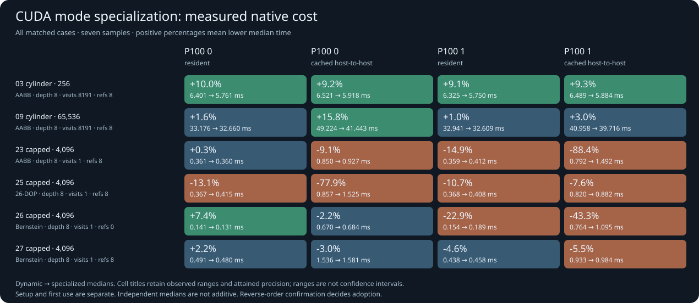

Useful contributions include small analytic fixtures, difficult intersection
cases, relevant papers, and independently reproducible findings. State what the
case should produce and how that expectation is known.

Owned code is [MIT licensed](LICENSE). NVIDIA USD BRep and other reference
projects retain their own licenses. Collecting or benchmarking a reference does
not select it as a production dependency.
