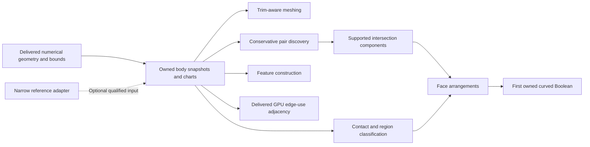

# Deliver useful acceleration while building a GPU B-rep kernel

The planned breadth sweep is complete. The [post-breadth stocktake and proposed
next tranche](POST_BREADTH_ROADMAP.md) distinguish delivered capabilities from
deferred composition, result meshing, external qualification and runtime work.
The first selected connection, [actual through-bore result meshing](CUT_MESHING.md),
is delivered. Remaining units still need their own reviewed designs/plans; no
shipping-language change is selected.

Alpha requires the applicable [external community qualification](ALPHA_QUALIFICATION.md)
to pass. Development continues breadth first with incomplete external coverage
visible; narrow local model tests and selected mutant kills cannot satisfy that
release gate. Community replay and independent-kernel adapters remain open.

Design direction, updated 2026-10-15. The operator selected an intentional
breadth-first pass: establish a working beachhead in each major theme before
returning to deepen individual capabilities. Scope is narrow; correctness is
not relaxed. This roadmap assigns no calendar dates or unmeasured speedups.
The owned [patch evaluator](ITERATION_1.md), [resident seeded projection](ITERATION_2.md)
and [automatic conservative patch discovery](ITERATION_3.md) are implemented.
The first [body snapshot and sampling/normal consumer](BODY_SAMPLING.md) is
also implemented and independently qualified on CPU and both P100s.
The [surface-pair beachhead](PAIR_DISCOVERY.md) adds common-world carrier culling
and retained typed identities, with CPU/P100 complete-shortlist measurements.
The [GPU adjacency beachhead](ADJACENCY.md) adds owned CPU/P100 edge-use CSR
and a seam-preserving mate/face reader with retained typed occurrence identity.
The [exact CPU classification beachhead](CLASSIFICATION.md) adds material
membership and complete finite rectangular-face contact with both source UVs.
The [CPU arrangement beachhead](ARRANGEMENTS.md) now constructs complete grid/
separated-circle regions, holes and shared uses with original source maps.
Their reviewed designs/plans define the qualified support
contracts; the [topology design](TOPOLOGY.md) explains how subsequent solid
operations avoid pointer-defined identity.

## Breadth-first delivery policy

A beachhead is a runnable operation on a declared input family, with an
independent correctness oracle, usable outputs, explicit unsupported/unresolved
results and measured complete-caller costs. A study, layout sketch or attractive
render does not complete a beachhead. CPU execution is a valid first placement
where it establishes semantics; GPU placement and supported geometry are tracked
separately. CUDA beachheads still target the qualified P100 toolchain.

After a beachhead works and has been reviewed, qualified and published, move to
an uncovered theme. Return early only to fix a correctness defect or remove a
demonstrated dependency blocking another beachhead. Broader geometry, tighter
bounds, additional optimizations and generalized robustness go into the return
pass. This policy does not require every theme to finish before repairing a bug.

Use the same small owned body corpus where the contracts fit: a box, a cylinder
and a plate with one separated through-hole, then a multi-hole plate. These are
fixtures for several independent operations, rather than a claim that one
successful part establishes general B-rep correctness. A narrow reference
adapter is a separate input path; general import must not block owned fixtures.

| Major theme | First working beachhead | Direct correctness claim | Return pass |
| --- | --- | --- | --- |
| Numerical geometry | Delivered rational patch jets and seeded projection | Exact-input geometry/derivative and declared stationarity checks | Wider degrees/weights, extraction, solver strength and tuning |
| Bounds and geometric queries | Delivered seed-free named-patch distance brackets and resident conservative chart-pair culling in a common world frame | Valid brackets; exact original-control/world enclosure and closed-box bit truth over whole carrier domains, explicit page coverage and retained identity | Cross-face trimmed proximity, sparse-scene pruning, off-grid strengthening and traversal scheduling |
| Body storage and identity | Delivered CPU-built immutable packed box/cylinder/one-hole-plate snapshots and sampling/normal caller | Exact analytic/control identities, typed references, oriented loops, shared edge/coedge occurrences, declared frames and source correspondence | Incremental edits, persistent naming, broader body families and normal/row performance |
| Model integration and interchange | Delivered strict static ASCII USD BRep subset to owned single-span rational carriers, complete original face/use outcomes and reproducible records; trims uninterpreted | Positions/derivatives agree under the established parameter map; trim preservation is checked separately and never inferred from carrier conversion | General NURBS extraction, wider import/export and cross-session identity |
| Curves, trims and charts | Delivered line/closed-circle boundaries, planar faces with a hole and a cylindrical seam with distinct uses for the canonical body fixtures | Exact submitted-UV trim membership, loop closure and complete spatial-edge/UV identities | General trim curves, additional charts, poles and difficult parameterizations |
| Approximation and meshing | Delivered exact CPU shared-edge canonical box/cylinder/plate meshes with bounded rounded output | Complete chordal-domain coverage, two-sided world error, preserved hole/seam/source identity and exact/rounded closed manifold embedding | General adaptive rational meshing, quality and native/GPU placement |
| Surface intersections | Delivered plane/cylinder intersection components, including closed circles and boundary-clipped arcs, with one spatial and both UV representations | Every expected component in the admitted family is present, with bounded geometric correspondence | General transverse rational pairs, small loops and singular branch discovery |
| Predicates, contacts and region classification | Delivered exact CPU material membership for all three owned solids and complete rectangular-face crossing/touch/disjoint/overlap/coincidence | Exact submitted-value truth, every incident face ID, complete closed contact corners and both original UVs; unsupported curved trims explicit | Algebraic witnesses, curved tangent contacts, near-coincidence and certified accelerator filters |
| Face arrangements and topology construction | Delivered exact CPU rectangular grid plus separated interior circle sections, complete cell/disk/exterior regions and multi-hole boundaries | Complete source-domain region bijection, directed source ranges/maps, ordered loops/twins, all closed incident regions, exact witnesses/UV areas; no coordinate welding | Clipped/tangent/overlapping curves, source holes, general arrangements and cross-face Boolean assembly |
| Solid operations and history | Delivered owned box-minus-through-cylinder Boolean, assembled on CPU from actual events/arrangements with complete six-kind history | Material membership, closed supported solid topology, boundary correspondence and input-to-output history; failures preserve inputs | More Boolean operations, interacting cutters and difficult contacts |
| Feature construction | Delivered strict convex-profile extrusion, full off-axis revolution and complete box-edge circular fillet and signed sharp-cylinder offset | Expected analytic surfaces, joins, material and topology for each explicitly admitted feature family | General profile sweeps, fillets, offsets and interacting features |
| GPU topology and residency | Delivered owned count/scan/fill of edge-use CSR and an actual mate/face-neighbor reader; per-call device storage | Same semantic adjacency and identities as CPU construction across scheduling; complete-caller timing and transfer accounting | Resident arrangements/Booleans, compaction, incremental updates and queue tuning |

Each row is a theme, not one oversized implementation assignment. Rows naming
several operations are delivered as separate conceptual units. In particular,
these narrow extrusion/revolution/fillet/offset families do not imply general feature support; analytic contact
fixtures do not establish complete general tangent surface intersection.
Numerical geometry, single-patch bounds, pair culling, the narrow body/trim/chart
consumer, complete analytic plane/wall intersections, GPU edge-use adjacency
and exact material/rectangular-face classification, bounded planar arrangements
and complete canonical trim-aware meshes, carrier interchange and the first
owned Boolean/history, convex-profile extrusion, full off-axis revolution and a
complete box-edge fillet and signed sharp-cylinder offset are delivered. This
completes the planned feature breadth sequence. Every broader family still needs
its own researched design, reviewed plan, implementation and qualification.

## First pass across the themes

Begin with the body snapshot, its required curve/trim/chart semantics and the
sampling/normal caller as one integrated design unit. Advance conservative pair discovery and
the narrow reference adapter independently when their input contracts are
ready. Meshing, analytic intersection and feature fixtures can then use the
same owned geometry without waiting for a general importer or Boolean engine.
Planar arrangements can start with independently constructed analytic arcs,
without waiting for a general surface-intersection operation. Extrusion of a
validated profile can precede Boolean construction.
Contact/classification and face arrangements supply the next solid-operation
dependencies. A small GPU adjacency construction can run as soon as its CPU
semantics and reader exist; it does not wait for every Boolean stage to migrate.

Only implement prerequisites needed by the next consumer. For example, the
first immutable body reader needs complete shared-boundary meaning, but does
not need an incremental editor. A plane/cylinder intersection needs a complete
answer for its admitted family, but not a general rational intersection solver.
Meshing needs actual trim coverage and a shared-edge protocol; classifying a
few sampled UV points cannot stand in for either.

The immutable body snapshot and part-level sampling/normal consumer are now
[implemented, qualified and measured](../results/body-2026-10-14/REPORT.md).
They establish canonical body/trim/chart data, with independent exact-input
checks on 14,358 actual caller records and 24 CPU/P100 cost comparisons. CPU
normal/row construction dominates; no whole-caller gain is established against
CPU24. That performance opportunity goes into the return pass. Conservative
surface-pair discovery is now [delivered](../results/pairs-2026-10-14/REPORT.md):
879,840 chart pairs reduce to 1,823 survivors; complete cached shortlist medians
are 9.63 ms CPU24 versus 6.92–7.78 ms P100. CPU1 wins tiny cases and cold setup
favors CPU. Complete analytic closed plane/wall intersections are now
[delivered](../results/intersections-2026-10-14/REPORT.md), with exact components,
spatial/bothUV maps and a qualified CPU/P100 consumer. Native large-row evaluation
is about15–17.5 times faster on P100, while full consumption remains CPU bound
at2.3–2.5s and exact request preparation costs27–32s. Continue the remaining feature beachheads;
broader SSI or integration tuning does not displace them. GPU adjacency now
constructs and reads packed edge-use CSR without pointer-defined identity;
compaction, editing, resident arrangements and Booleans remain return-pass work.
Exact material/rectangular-face classification is now
[delivered](../results/classification-2026-10-14/REPORT.md), with closed contacts,
all supporting source faces and complete world/bothUV loci. Bounded face
arrangements are also [delivered](../results/arrangements-2026-10-14/REPORT.md),
including shared exact circle/line boundaries and complete regions/holes.
Complete canonical [trim-aware meshing](MESHING.md) is now delivered on CPU.
The [carrier interchange beachhead](INTERCHANGE.md) is now delivered: actual
foreign single-span rational surfaces become owned patches with complete source
face/use identity and explicit unsupported carriers. Exact source/native geometry,
foreign scalar correspondence and complete CPU/P100 costs are published. Trims
remain uninterpreted; this does not import a solid or complete general USD/STEP
exchange. The [owned Boolean/history beachhead](BOOLEANS.md) now constructs a
closed through-bore result using actual source sections/arrangements and complete
input/output origins. Its CPU/P100 consumers and same-sized foreign comparisons
are [qualified and measured](../results/boolean-2026-10-15/REPORT.md).
The [owned extrusion](EXTRUSION.md) now turns actual convex profiles into complete
closed solids with exact affine ancestry and qualified CPU/P100 consumers.
The [owned full revolution](REVOLUTION.md) adds complete curved periodic
geometry, source ancestry and same-face seams, qualified on CPU/P100 consumers.
The [box-edge fillet](FILLET.md) adds exact rounded cap closures, original-plane
trim maps, complete ancestry and two tangent contact rails. The [signed analytic
offset](OFFSET.md) completes the feature sequence with sharp-joined curved solids
and exact original-carrier normal feet, including explicit source extensions.
The first planned theme beachheads are present; return-pass priorities must retain
the distinction between general geometry coverage, required community oracles
and measured integration opportunities.
At the operator's explicit
direction, [GPU setup/teardown, scene residency and integration polish](RETURN_PASS.md)
are notes for AFTER the broad-pass big rocks. They are not an active tuning lane
and do not replace the theme sequence.
Investigate whether Python belongs in the delivered system, and its role,
after the breadth sweep as explicitly requested; current wrappers are an
implementation state, not a settled product architecture.
The off-grid separated-bound proposal remains a return-pass experiment until a
consumer shows that its precision or cost blocks a required output.

## Product and architecture

Start with a native numerical geometry service that Python can call in batches.
Grow it into device-resident queries, then complete intersection and topology
operations. Each stage must deliver a runnable operation with independently
qualified output, an honest end-to-end measurement, and usable failure results.

Placement and coverage are separate axes. We can expand the supported geometry
while some topology runs on CPU, and migrate established operations to GPU
without changing their output semantics. A supported narrow operation is useful
before general NURBS solid modeling is complete.

| Delivery | What a user can do | Machinery retained for later stages | Direct qualification and value measurement |
| --- | --- | --- | --- |
| 0 — existing CPU characterization | Reproduce primitives, holes, sweeps, fillets, surface queries and a curved USD round trip | Analytic fixtures, saved geometry, declared timing regions and concrete failed outputs | Published 16/19 qualified workloads; three sphere chord-tolerance witnesses. Exploratory API timings, not a GPU ranking |
| 1 — batched numerical geometry, implemented | Evaluate positive-weight low-degree rational patches and their first/second derivatives through Python or native calls; reuse uploaded geometry | Owned contiguous geometry, CPU/CUDA backends, explicit statuses, resident buffers, patch/face/chart provenance | Analytic and exact binary-input rational oracles; native CPU comparison and host-to-host/resident timing across batch sizes; publish crossover or lack of crossover |
| 2 — resident seeded projection, implemented | Refine provided seeds against supported local untrimmed patches and download first-order box-stationary or unresolved candidates | Bounded local solver, resident patch/query snapshots, compact candidates/status/rank/curvature/work counters, retained provenance and shared CPU/CUDA lifetime handling | 104 independently qualified projection rows per backend; actual native/public/memory checks. Compare CPU1/CPU24 and each P100 with named resident/host/Python costs; no minimum/global-distance guarantee |
| 3a — automatic conservative patch discovery, implemented | Submit targets without UV seeds and obtain candidate witnesses plus squared-distance brackets on named untrimmed local patches | Outward homogeneous subdivision; reusable packed dyadic hierarchy; AABB, 26-DOP and rational Bernstein caches; original-input witness upper; separate precision/coverage/budget flags | Exact CPU/both-P100 cache/witness and coverage oracles, actual memory/compatibility/mutation checks and 24,576 actual caller witnesses; 444 native CPU1/CPU24/P100 cost/precision comparisons, including controlled off-grid inputs |
| Body beachhead — implemented | Sample supported box/cylinder/one-hole-plate faces with exact trim labels, oriented normals and source identities | CPU immutable packed body records, shared line/circle edges, coedge/loop/chart relationships and one common body frame | Nine direct tests on CPU1/CPU24/both P100s; zero device sanitizer errors/leaks; four host-code mutants killed; 14,358 independently checked caller records and 24 complete-caller comparisons |
| Pair beachhead — implemented | Discover conservative carrier chart pairs over immutable body scenes in a common world frame | Exact outward world bounds; resident CPU/CUDA bit pages, explicit coverage and retained typed sources | 13 direct pair cases, 60 native sanitizer cases, 68 focused family tests per P100, preserved-binary/mutation checks and eight measured complete-shortlist cases |
| 3b — bounded approximation | Produce error-bounded meshes for a declared carrier/face family | Reuse conservative bounds; add adaptive subdivision scheduling, shared-edge sampling and trim-aware face data | Actual approximation bound, edge agreement and mesh embedding checks. A fast preview grid is a different output contract |
| 4 — regular surface intersection | Obtain all branches, including interior closed loops, in a declared transverse family with established regularity/separation bounds, with matching spatial and both UV curve representations | Branch/event graph, domain provenance, subdivision exclusions, coupled fitting and seam treatment | Known component counts/connectivity, residual bounds and coverage of the remaining domain; unestablished assumptions or unresolved boxes fail the complete operation. Finite sampling or one successful Newton path cannot establish completeness |
| 5 — first owned curved Boolean, narrow cut implemented | Construct the supported strict through-bore difference on CPU, with complete source history; broader cut/fuse/intersect remain | Per-face arrangements, region classification, shared edge/coedge identities, transactional candidate body and history | Material membership, expected components/cavities, geometric correspondence and supported manifold topology; measure complete modeling tasks including CPU work |
| 6 — GPU topology construction | Keep established Boolean stages resident and emit packed adjacency on GPU | Count/scan/fill, event grouping, arrangement construction, classification and snapshot publication | Semantic geometry/topology preserved across scheduling and compaction; actual end-to-end benefit on modeling workloads |
| 7 — broader coverage and features | Extend regularity/separation coverage to tighter transverse loops, tangencies, coincidence and additional seams/poles, and broaden independently scoped sweeps/fillets/offsets | Stronger predicates and bounds, chart/overlap semantics, feature construction on the same geometry/topology model | A direct oracle for each new family; unsupported/unresolved cases remain visible. Add features in an order informed by measured workload value |

## How we select the next delivery

The numbered delivery rows above describe architectural dependencies and
existing evidence, rather than a requirement to exhaust one row before touching
another. The breadth-first theme table governs work selection. Prefer an
uncovered theme whose immediate dependencies are available, complete one
coherent operation, and publish it. Optimize an established theme when measured
consumer costs justify the return pass, or when it blocks another delivery.

Measure where complete tasks spend time before claiming a modeling win. A useful
numerical unit can serve sampling or fitting without accelerating the existing
hole-cut benchmark. The 77 ms 16-hole result cannot be advertised as accelerated
until a delivered path actually changes that task and passes its geometry checks.

Within the query/meshing stages, prioritize the consumer with both a real caller
and a strong oracle. Seeded bulk point projection now consumes both derivative orders with iterations
resident on device. Automatic named-patch discovery now supplies conservative
distance brackets and explicit unresolved precision/coverage outcomes without
provided seeds. It does not enumerate all minimizers or resolve imported frames,
cross-patch selection and trims. Bounded tessellation is another strong value target, given the published
reference failure. Its topology/trim obligations make it a larger unit than a
surface sampler. Profiling can change their order.

Track first-use latency, prepared host-to-host operation latency, resident latency,
preprocessing amortization and fallback separately. Native CPU scalar and
explicit multicore measurements use the same outputs and precision. The
existing scalar Python benchmark remains an application comparison; it cannot
stand in for native arithmetic throughput. Small batches may favor CPU.

Success means the supported operation is usable and measured. A GPU implementation
that loses at the tested batch sizes is still a useful result if it states that
limit and identifies the next consumer; it is not called a speedup.

## Integration with existing CAD

SMLib remains an experimental reference and source of task fixtures. Its public
Boolean API does not expose an evaluator callback or an API for injecting our
intersection graph. The initial accelerator therefore runs alongside that kernel
through explicit data adapters. Replacing a scalar Python loop can improve that
caller's batch operation; it does not replace SMLib's internal Boolean work.

Its C++ B-spline APIs expose control nets, weights, degrees and knots. Python's
surface API currently exposes scalar evaluation and domains, rather than that
complete extraction interface. An optional experimental adapter must materialize
and qualify a supported carrier before emitting owned patch data. It must never
pass SMLib pointers or borrowed objects into our core.

The existing plate has planar and cylindrical carriers and is a useful adapter
target. Face bounding UV rectangles do not identify the trimmed face interior.
Analytic cylinder angles can differ nonlinearly from NURBS parameters. Preserve
the actual returned parameterization and its identity, and check positions and
derivatives before claiming correspondence. General knot extraction and trimmed
face modeling are later owned capabilities, not implicit iteration-1 promises.

The first [owned reference carrier adapter](INTERCHANGE.md) now reads a strict
static ASCII subset of actual USD BRep exports, accepting only single clamped
rational spans within the qualified numerical envelope. A full lexer/type tree
rejects unsupported scene semantics rather than scraping arrays. No reference
library is imported by the normal converter. All source faces/uses survive and
trims remain uninterpreted. General native extraction and additional formats
remain future work.

## Programming stack

| Layer | Proposed implementation | Purpose |
| --- | --- | --- |
| Core and CPU geometry | Owned C++17, standard library, native records and binary buffers | Native batched baseline, ownership, algorithms and validation |
| GPU backend | Owned CUDA C++, pinned CUDA 12 toolchain, real `sm_60` machine code | P100 FP64 geometry and later data-parallel topology |
| Language boundary | Owned versioned C ABI, checked handles and explicit array lengths | Keep C++ exceptions, STL layout and device pointers out of callers |
| Python | Thin standard-library `ctypes` wrapper, `array`/memoryview data | Experiments, fixture construction, batch calls and adapters |
| First body placement | Owned immutable Python records and packed binary tables; CPU trims/normals | Qualified canonical body reader consuming existing native jets; general native/device body placement remains later work |
| Build | CMake; CPU library independent of an optional CUDA library | CPU-only development and explicit GPU loading |
| Reference experiment | Isolated USD BRep runtime and optional reference adapter | Comparisons and extraction, without making it a product dependency |

`pybind11`, NumPy, Warp, OCCT, SISL and other libraries are study references or
possible later proposals; none is newly adopted by this design. A library proposal
must explain its benefit and cost to the operator before adoption. CUDA is the
requested execution/toolchain platform; the isolated CUDA 12.8.1 setup is now
[installed and qualified on both P100s](CUDA_TOOLCHAIN.md).

## Source-grounded inputs and next work

The [reference map](../papers/REFERENCE_IMPLEMENTATIONS.md) supplies entry points.
The numerical, runtime and acceleration/topology source-study reports under
`papers/` record the inspected assumptions and failure behavior. In particular,
existing array exports and dense maps teach useful layout patterns while still
retaining pointer-defined identity or borrowed geometry.

All three numerical deliveries followed researched designs, adversarial plan/code
review and supported-host qualification. The [projection design](ITERATION_2_DESIGN.md)
and [accepted plan](ITERATION_2_PLAN.md) record the local-candidate boundary; the
[projection results](../results/projection-2026-10-14/REPORT.md) carry measured
claims. The [discovery design](ITERATION_3_DESIGN.md) and
[qualified operation](ITERATION_3.md) add three owned literature-informed bounds
and exact original-input certificates; preprocessing, cache memory and achieved
precision participate in method choice. Later rows remain proposed work:
bounded approximation, trimmed proximity, complete intersections and solid/topology
construction. Provenance and explicit identity are retained; none of the three
numerical operations mutates topology.
