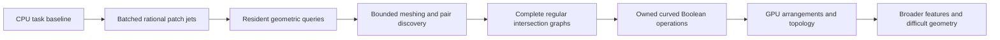

# Deliver useful acceleration while building a GPU B-rep kernel

Design direction, 2026-10-13. This roadmap sequences useful operations and the
machinery they leave behind. It assigns no calendar dates or unmeasured speedups.
The owned [patch evaluator](ITERATION_1.md), [resident seeded projection](ITERATION_2.md)
and [automatic conservative patch discovery](ITERATION_3.md) are implemented.
Their reviewed designs/plans define the qualified support
contracts; the [topology design](TOPOLOGY.md) explains how subsequent solid
operations avoid pointer-defined identity.

## Product and architecture

Start with a native numerical geometry service that Python can call in batches.
Grow it into device-resident queries, then complete intersection and topology
operations. Each stage must deliver a runnable operation with independently
qualified output, an honest end-to-end measurement, and usable failure results.

Placement and coverage are separate axes. We can expand the supported geometry
while some topology runs on CPU, and migrate established operations to GPU
without changing their output semantics. A supported narrow operation is useful
before general NURBS solid modeling is complete.

| Delivery | What a user can do | Machinery retained for later stages | Direct qualification and value measurement |
| --- | --- | --- | --- |
| 0 — existing CPU characterization | Reproduce primitives, holes, sweeps, fillets, surface queries and a curved USD round trip | Analytic fixtures, saved geometry, declared timing regions and concrete failed outputs | Published 16/19 qualified workloads; three sphere chord-tolerance witnesses. Exploratory API timings, not a GPU ranking |
| 1 — batched numerical geometry, implemented | Evaluate positive-weight low-degree rational patches and their first/second derivatives through Python or native calls; reuse uploaded geometry | Owned contiguous geometry, CPU/CUDA backends, explicit statuses, resident buffers, patch/face/chart provenance | Analytic and exact binary-input rational oracles; native CPU comparison and host-to-host/resident timing across batch sizes; publish crossover or lack of crossover |
| 2 — resident seeded projection, implemented | Refine provided seeds against supported local untrimmed patches and download first-order box-stationary or unresolved candidates | Bounded local solver, resident patch/query snapshots, compact candidates/status/rank/curvature/work counters, retained provenance and shared CPU/CUDA lifetime handling | 104 independently qualified projection rows per backend; actual native/public/memory checks. Compare CPU1/CPU24 and each P100 with named resident/host/Python costs; no minimum/global-distance guarantee |
| 3a — automatic conservative patch discovery, implemented | Submit targets without UV seeds and obtain candidate witnesses plus squared-distance brackets on named untrimmed local patches | Outward homogeneous subdivision; reusable packed dyadic hierarchy; AABB, 26-DOP and rational Bernstein caches; original-input witness upper; separate precision/coverage/budget flags | Exact CPU/both-P100 cache/witness and coverage oracles, actual memory/compatibility/mutation checks and 24,576 actual caller witnesses; 444 native CPU1/CPU24/P100 cost/precision comparisons, including controlled off-grid inputs |
| 3b — bounded approximation and pair discovery | Produce error-bounded meshes for a declared carrier/face family and filter large surface-pair sets | Reuse conservative bounds; add adaptive subdivision scheduling, shared-edge sampling, trim-aware face data and candidate pairs | Actual approximation bound, edge agreement and mesh embedding checks; every known intersecting pair survives culling. A fast preview grid is a different output contract |
| 4 — regular surface intersection | Obtain all branches, including interior closed loops, in a declared transverse family with established regularity/separation bounds, with matching spatial and both UV curve representations | Branch/event graph, domain provenance, subdivision exclusions, coupled fitting and seam treatment | Known component counts/connectivity, residual bounds and coverage of the remaining domain; unestablished assumptions or unresolved boxes fail the complete operation. Finite sampling or one successful Newton path cannot establish completeness |
| 5 — first owned curved Boolean | Cut/fuse/intersect a narrow analytic/low-degree solid family; topology may initially be assembled on CPU | Per-face arrangements, region classification, shared edge/coedge identities, transactional candidate body and history | Material membership, expected components/cavities, geometric correspondence and supported manifold topology; measure complete modeling tasks including CPU work |
| 6 — GPU topology construction | Keep established Boolean stages resident and emit packed adjacency on GPU | Count/scan/fill, event grouping, arrangement construction, classification and snapshot publication | Semantic geometry/topology preserved across scheduling and compaction; actual end-to-end benefit on modeling workloads |
| 7 — broader coverage and features | Extend regularity/separation coverage to tighter transverse loops, tangencies, coincidence and additional seams/poles, then sweeps/fillets/offsets | Stronger predicates and bounds, chart/overlap semantics, feature construction on the same geometry/topology model | A direct oracle for each new family; unsupported/unresolved cases remain visible. Add features in an order informed by measured workload value |

## How we select the next delivery

Measure where complete tasks spend time before claiming a modeling win. A useful
numerical unit can serve sampling or fitting without accelerating the existing
hole-cut benchmark. The 77 ms 16-hole result cannot be advertised as accelerated
until a delivered path actually changes that task and passes its geometry checks.

Within the query/meshing stages, prioritize the consumer with both a real caller
and a strong oracle. Seeded bulk point projection now consumes both derivative orders with iterations
resident on device. Automatic named-patch discovery now supplies conservative
distance brackets and explicit unresolved precision/coverage outcomes without
provided seeds. It does not enumerate all minimizers or resolve imported frames,
cross-patch selection and trims. Bounded tessellation is another strong value target, given the published
reference failure. Its topology/trim obligations make it a larger unit than a
surface sampler. Profiling can change their order.

Track first-use latency, prepared host-to-host operation latency, resident latency,
preprocessing amortization and fallback separately. Native CPU scalar and
explicit multicore measurements use the same outputs and precision. The
existing scalar Python benchmark remains an application comparison; it cannot
stand in for native arithmetic throughput. Small batches may favor CPU.

Success means the supported operation is usable and measured. A GPU implementation
that loses at the tested batch sizes is still a useful result if it states that
limit and identifies the next consumer; it is not called a speedup.

## Integration with existing CAD

SMLib remains an experimental reference and source of task fixtures. Its public
Boolean API does not expose an evaluator callback or an API for injecting our
intersection graph. The initial accelerator therefore runs alongside that kernel
through explicit data adapters. Replacing a scalar Python loop can improve that
caller's batch operation; it does not replace SMLib's internal Boolean work.

Its C++ B-spline APIs expose control nets, weights, degrees and knots. Python's
surface API currently exposes scalar evaluation and domains, rather than that
complete extraction interface. An optional experimental adapter must materialize
and qualify a supported carrier before emitting owned patch data. It must never
pass SMLib pointers or borrowed objects into our core.

The existing plate has planar and cylindrical carriers and is a useful adapter
target. Face bounding UV rectangles do not identify the trimmed face interior.
Analytic cylinder angles can differ nonlinearly from NURBS parameters. Preserve
the actual returned parameterization and its identity, and check positions and
derivatives before claiming correspondence. General knot extraction and trimmed
face modeling are later owned capabilities, not implicit iteration-1 promises.

## Programming stack

| Layer | Proposed implementation | Purpose |
| --- | --- | --- |
| Core and CPU geometry | Owned C++17, standard library, native records and binary buffers | Native batched baseline, ownership, algorithms and validation |
| GPU backend | Owned CUDA C++, pinned CUDA 12 toolchain, real `sm_60` machine code | P100 FP64 geometry and later data-parallel topology |
| Language boundary | Owned versioned C ABI, checked handles and explicit array lengths | Keep C++ exceptions, STL layout and device pointers out of callers |
| Python | Thin standard-library `ctypes` wrapper, `array`/memoryview data | Experiments, fixture construction, batch calls and adapters |
| Build | CMake; CPU library independent of an optional CUDA library | CPU-only development and explicit GPU loading |
| Reference experiment | Isolated USD BRep runtime and optional reference adapter | Comparisons and extraction, without making it a product dependency |

`pybind11`, NumPy, Warp, OCCT, SISL and other libraries are study references or
possible later proposals; none is newly adopted by this design. A library proposal
must explain its benefit and cost to the operator before adoption. CUDA is the
requested execution/toolchain platform; the isolated CUDA 12.8.1 setup is now
[installed and qualified on both P100s](CUDA_TOOLCHAIN.md).

## Source-grounded inputs and next work

The [reference map](../papers/REFERENCE_IMPLEMENTATIONS.md) supplies entry points.
The numerical, runtime and acceleration/topology source-study reports under
`papers/` record the inspected assumptions and failure behavior. In particular,
existing array exports and dense maps teach useful layout patterns while still
retaining pointer-defined identity or borrowed geometry.

All three numerical deliveries followed researched designs, adversarial plan/code
review and supported-host qualification. The [projection design](ITERATION_2_DESIGN.md)
and [accepted plan](ITERATION_2_PLAN.md) record the local-candidate boundary; the
[projection results](../results/projection-2026-10-14/REPORT.md) carry measured
claims. The [discovery design](ITERATION_3_DESIGN.md) and
[qualified operation](ITERATION_3.md) add three owned literature-informed bounds
and exact original-input certificates; preprocessing, cache memory and achieved
precision participate in method choice. Later rows remain proposed work:
bounded approximation, pair/trim queries, complete intersections and solid/topology
construction. Provenance and explicit identity are retained; none of the three
numerical operations mutates topology.
