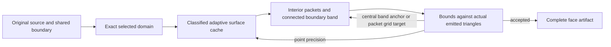

# Native cached-adaptive trimmed faces

The third native mesher checkpoint connects shared physical boundaries to a
complete selected-face mesh. Native C++ owns source recovery, exact domain
classification, connectivity and publication. CPU or P100 executes the surface
evaluations, subdivisions and facet-bound batches. Python authors external
fixtures and reads actual outputs; it supplies no production geometry callback.



The construction follows the pinned NVIDIA cache/trim studies and the wider
literature, with owned topology, arithmetic and numerical scheduling. Read the
[construction plan](adaptive-trimmed-construction-plan.md),
[numerical plan](adaptive-trimmed-numerics-plan.md) and
[runtime plan](adaptive-trimmed-runtime-plan.md) for exact source revisions,
assumptions, owned derivations and oracle choices.

Interior packets retain common hanging-side schedules. Their union stays fixed
within a boundary generation; a connected CPU CDT fills the remaining domain,
including holes and reversed source-loop traversal. Exact UV is distinct from
the actual binary64 XYZ being emitted. Physical boundary aliases share one XYZ
authority. Persistent packet/component identities allow unchanged facets to keep
their accepted bounds while changed facets are evaluated again.

Each bound applies to the actual affine triangle. Virtual cache-leaf clips carry
that SAME affine map, rather than fresh surface points. Original rational
`N-WL` bounds and analytic bounds can tighten cached bilinear bounds. Arithmetic
uncertainty requests a more precise evaluation; a proved point-construction
floor requests a higher point tier. An unchanged physical-boundary floor returns
unresolved. Failing band facets receive central points in their actual parent
triangle, independent of the numerical clipping partition. Failed packet facets
force an interior grid target into the same adaptive cache.

Preparation now uses a packet's known leaf directly. A boundary-band triangle
contained in one original source span first runs the existing CPU/P100 source
bound on its whole actual triangle. Only unresolved or cross-span bands pay for
exact virtual cache-leaf clipping; failed facets retain those pieces for the
same floor and refinement paths. The [scheduling plan](adaptive-trimmed-lazy-work-plan.md)
and [journal](../journal/2026-10-17-adaptive-trimmed-lazy-work-plan.md) record the
finite source-reader and CPU/P100 checks. No whole-watch speedup follows from
those checks.

The current face profile uses original UV as the construction chart. It admits
reconstructed selected boundaries and authoritative raw line images whose
complete chosen chain has the same exact image. Different parameter clocks can
share that image. General curved authoritative-domain maps, alternate charts,
whole imported components, assembly publication and the watch comparison remain
later dependencies. Position bounds do not establish normal-angle or feature
preservation bounds. This checkpoint does not complete external alpha suites.

## Run an authored face

On the qualified Linux Clang18.1.3 profile:

```sh
cmake -S native/mesher -B build/mesher \
  -DCMAKE_CXX_COMPILER=clang++-18 -DCMAKE_BUILD_TYPE=Release
cmake --build build/mesher --target brepgpu-adaptive-trimmed -j
PYTHONPATH=python python3 -B tests/native_adaptive_trimmed_caller.py \
  build/mesher/brepgpu-adaptive-trimmed context/trimmed-demo \
  --family weighted --threads 4 --positional-mm .01 --positional-mm .005
```

The output directory must be new. The fixture driver runs the native executable,
then independently checks complete boundary incidence, positive full-domain
coverage, actual XYZ and whole-facet error against the original authored source.
The seven fixed cases are tiny-hole plane,16holes, reversed loops, authoritative
line images with different clocks, bowl, weighted rational and saddle.

For P100, enable `BREPGPU_MESHER_ENABLE_CUDA`, build
`brepgpu_mesher_adaptive_cuda`, and add `--cuda-module` with the resulting shared
library path and `--device 0` or `1` to the fixture driver. This executes the same
native face caller with real device geometry and facet-bound batches.

For a saved owned source, invoke `brepgpu-adaptive-trimmed --help`; the caller
requires explicit original definition/face IDs, positional and node-source
allowances, worker count and a new output directory. SourceStore spatial values
are already millimetres; original units metadata does not rescale them again.

The first [matched CPU1/CPU4/both-P100 observation](../results/adaptive-trimmed-2026-10-17/REPORT.md)
retains all56 queries, complete process costs, stage/work/transfer counters and
actual mesh views. It also lists the planned caller ports still outstanding.

## Output and timing scopes

Every completed query writes paired `query-N.bgacrv` and `query-N.bgatrm` files,
plus `queries.tsv` and `timings.tsv`. Publication happens only after completion;
failure publishes no partial face. BGACRV wire2 retains explicit whole-use line
images without relabelling them as per-parameter bounds. BGATRM wire1 retains
original evaluator roots, exact metric/UV, source occurrence bindings, actual
XYZ, directed loops, persistent packet/component identities and indexed facets.
Packet rows retain prepared panels and full split paths; transient cache slots
are private. Mixed domain policy is described by each original use record.

The public `FaceTrimSession` API provides begin/step, boundary requests and
replacement, immutable result leases, release, cancel and close. Readable host
results survive session close. Surface and construction work have explicit
budgets; construction accounting includes the retained domain classifier.

Stage timings separate source preparation, device open, complete shared-boundary
construction, complete face construction, writing and close. Query rows expose
classification, packet, region, bound and anchor durations; source work, cache
hits, precision, transfers and memory are cumulative within the process.
Upload/download counts mean host RAM to/from GPU memory, including protocol
traffic, not network transfer to a compute server. Independent reader time is
outside the native operation. The second quality reuses the process/session and
numerical cache but constructs a fresh quality-dependent boundary and face.
