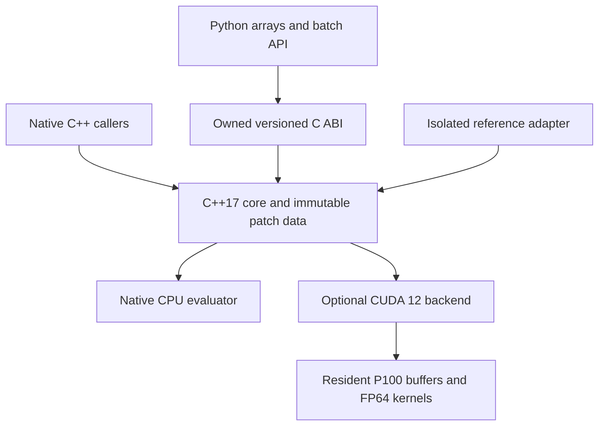

# Iteration 1: an owned batched rational patch evaluator

Reviewed design, 2026-10-13. This design describes the first native
CPU/CUDA delivery. It does not describe existing GPU product code or a measured
speedup. [Roadmap](ACCELERATION_ROADMAP.md) · [Topology](TOPOLOGY.md).

## Useful output

Deliver a batch API that evaluates supported rational Bézier patches, returning
positions and requested first/second derivatives, with reusable uploaded data
and explicit per-query failures. A Python caller replaces thousands of scalar
binding calls with one batch call. Native consumers use the same owned patch
data. The delivery publishes correctness results and the CPU/GPU crossover
across batch sizes, including transfer costs.

This is a numerical geometry operation on untrimmed carriers. It neither edits
a solid nor makes existing SMLib booleans use CUDA. A preview sampling caller can
use its points; a chord-tolerance mesh requires the later bounded meshing stage.

## Stack and boundaries



Use C++17 and CMake. The CPU core does not link CUDA; an optional CUDA shared
library is loaded only when requested. Build real `sm_60` machine code with a
pinned CUDA 12 compiler and a supported host compiler. The hardware inventory
found two P100 PCIe 16 GB devices and a compatible R580 driver. CUDA 12.8.1
has now been installed in an isolated prefix: nvcc 12.8.93 compiled C++17
`sm_60` code, and both P100s ran the direct FP64 setup probe successfully.
[The setup record](CUDA_TOOLCHAIN.md) documents component hashes and the unchanged driver.

Python uses standard-library `ctypes.CDLL`, with explicit `argtypes`/`restype`,
checked handles and one call per batch. Python does not own geometric algorithms
or execute a callback for each query. `ctypes` releases the GIL during native
calls, so native lifetime/concurrency rules must stand independently of it.
No pybind11, NumPy or other new binding/numerical dependency is selected.

The CPU core is the sole public C ABI and owns one runtime-handle registry.
The CUDA plugin supplies backend functions through a separately named internal
versioned factory/function table; it does not export another copy of the public
handle API or maintain a colliding registry. Validate plugin ABI, table byte size,
capabilities and device support before publishing a CUDA context. Keep the plugin
loaded until its objects and destructors have finished. CPU import/capability
queries do not eagerly load that plugin or any CUDA runtime library.

The first CUDA artifact dynamically links the pinned shared CUDA runtime in the
isolated prefix; loader search/RPATH is explicit and checked. CPU library loading
does not depend on that prefix. Initial native support is Linux x86-64; Python
version support is CPython 3.12, with wider host packaging a later task.

## Planned Python shape

Illustrative API, to be implemented under the reviewed plan:

```python
from array import array
from brepgpu import Engine

with Engine(backend="cuda", device=0) as engine:
    with engine.create_patch_set(local_patch_records) as patches:
        with engine.create_query_set(
            patches,
            patch_slots=array("I", [0, 0]),
            uv=array("d", [0.25, 0.5, 0.75, 0.5]),
        ) as queries:
            with engine.evaluate(queries, order=2) as result:
                jets = result.download()  # Owned host arrays, local coordinates.
                jets.require_ok()
```

`local_patch_records` supplies the typed degree/control/provenance records below.
The same query set can be evaluated repeatedly without re-uploading inputs;
each evaluation returns a distinct result. Selecting `backend="cpu"` uses the
native CPU path. There is no silent backend fallback.

## Patch and query contract

The numerical kernel accepts a rectangular rational Bézier patch with degrees
`p,q` in `0..3`. Controls are homogeneous `(Ax,Ay,Az,W)`, ordered `i*(q+1)+j`:
first index in the first parameter direction, second index in the second.
Exactly `(p+1)*(q+1)` controls are required. Every component is finite.

The initial numerical envelope uses local Cartesian controls in `[-1,1]^3`
and weights in `[1,256]`, expressed as `abs(Ak)<=W`. Input parameters `(s,t)`
are normalized to `[0,1]^2`, including endpoints. No extrapolation, implicit
clamping, negative/zero weight or arbitrary knot vector is accepted. A patch
that violates the envelope is rejected before publication of the patch set.

This local envelope is deliberate. A caller/adapter can supply an explicit
coordinate frame and parameter map, but normalizing controls, restoring world
coordinates and converting derivatives are separately named transformations.
They have their own rounding and timing costs. The core cannot infer a source
cylinder's angle parameterization from a UV bounding box.

Patch metadata carries degree, homogeneous-control offset/count, parent face ID,
source snapshot revision, parameterization identity and source UV rectangle.
Source lineage includes the complete body/kind/entity/revision tuple from the
topology design; a numeric face ID or revision alone is not globally unique.
Unknown source lineage is explicitly absent. It does not claim trim membership.
The source rectangle maps normalized patch coordinates to the declared returned
NURBS chart; it must not be mislabeled as an original analytic chart.

Queries contain a patch slot plus normalized `(s,t)`. Request order is preserved.
Choose derivative order once per batch: 0, 1 or 2. Output contains respectively
`S`; `S, Ss, St`; or `S, Ss, St, Sss, Sst, Stt`, plus one status per request.
Cartesian derivatives of rational patches may have nonzero second order even
when the homogeneous polynomial degree is one.

For an affine source parameter rectangle, convert derivatives using its widths:
`Su=Ss/du`, `Sv=St/dv`, `Suu=Sss/du²`, `Suv=Sst/(du*dv)`, `Svv=Stt/dv²`.
For a Cartesian frame `X=origin+scale*S`, positions use that affine map and all
derivatives gain the `scale` factor. Nonlinear chart conversions need the full
chain rule and are outside this transformation helper. Conversion checks
the following narrower envelope and never silently clamps: scale and both UV
widths in `[2^-20,2^20]`, finite frame origins with component magnitudes at most
`2^40`, and finite local input jets within the declared magnitude bounds. Values
outside this envelope return unsupported conversion. Compute factors as
`scale/du`, `scale/dv`, `(scale/du)/du`, `(scale/du)/dv`, `(scale/dv)/dv` and
check the resulting arithmetic. This envelope keeps these intermediate factors
away from overflow/underflow. Position translation and component multiplication
still incur rounding; report conversion error separately. Finite inputs and
finite outputs alone are insufficient: `du*du` can overflow while the final
correct world derivative is finite. Wider exponent support is a later explicit
adapter extension, not silently accepted in this iteration.

## Numerical algorithms and accuracy meaning

The native CPU path evaluates Bernstein basis/derivative sums directly. The
first CUDA candidate uses tensor de Casteljau with homogeneous derivative jets.
Both recover Cartesian derivatives from the homogeneous values. Keeping their
execution structures different helps comparison; independent exact/analytic
oracles remain the qualification mechanism.

For homogeneous `H=(A,W)`, evaluate the requested jet and recover:

```text
S   = A / W
Ss  = (As  - Ws*S) / W
St  = (At  - Wt*S) / W
Sss = (Ass - Wss*S - 2*Ws*Ss) / W
Sst = (Ast - Wst*S - Ws*St - Wt*Ss) / W
Stt = (Att - Wtt*S - 2*Wt*St) / W
```

Degree-zero derivative nets contribute exact zero homogeneous derivatives;
quotient recovery still determines the Cartesian result. Validate every output
component for finiteness and require a positive finite evaluated denominator.
Do not substitute a fake denominator, fabricated coordinate or zero normal.
Normal regularity is a consumer property; a singular chart can still have valid
position/derivative outputs.

Use binary64 throughout, explicit FMA where its semantics are intended, and
disable unsafe reassociation/fast math. The CUDA interpolation primitive is
`fma(t,b,fma(-t,a,a))`, preserving finite endpoints without first rounding `b-a`.
Use direct quotient divisions initially; a shared reciprocal is a separately
qualified optimization. CPU compilation disables implicit contraction and
unsafe math; CUDA disables implicit contraction while retaining the explicit
FP64 FMA intrinsics. The initial local-coordinate corpus has
these max componentwise absolute-error qualification targets against exact
calculations over the actual binary64 inputs:

| Output order | Target | Exact component magnitude bound in the input envelope |
| --- | ---: | ---: |
| Position | `2^-40` (about `9.1e-13`) | 1 |
| First derivatives | `2^-30` (about `9.3e-10`) | 2,304 |
| Second derivatives | `2^-20` (about `9.5e-7`) | 3,552,768 |

These are empirical qualification targets, not a theorem for every admissible
input or bounds emitted with every result. The positive-weight local envelope
provides the stated magnitude bounds; quotient recovery amplifies arithmetic
error more at higher orders. Each corpus request must meet its output grade;
violations fail qualification and retain the offending input/output. World and
source-UV conversion error is reported separately, including translation error.
An order-2 request must meet `E0` on position, `E1` on first derivatives and `E2`
on second derivatives; the looser second-order budget does not apply to every
returned field. The conversion helper's local-input magnitude checks allow the
corresponding qualification margin above each exact bound, without treating
that margin as a certified enclosure.

An `ok` request means input/range checks and arithmetic completed under this
contract; it does not mean a certified interval, valid trim membership, regular
normal or valid solid. Later conservative culling needs an additional bound
contract and cannot reuse estimated coordinates as certified exclusions.

Start with one query per CUDA thread and a simple launch configuration. Control
storage is packed four-double records. Results use component-major arrays so
downstream kernels can read only the required fields. Defer patch grouping,
shared control tiles and constant-storage optimization until register/spill,
memory and batch measurements identify a concrete benefit. The 2026 LTCS paper
is a performance design input, not a selected library or trusted harness.

## Native storage, C ABI and ownership

Use immutable patch sets, immutable uploaded query sets and owned result handles.
The patch set provides contiguous records/controls; query storage contains
`uint32` patch slots and interleaved binary64 `(s,t)`. Native typed arrays are
the internal model; there is no JSON geometry, internal serialization or IPC.

Create a query set against a specific patch set. It retains that immutable patch
set's identity/revision and native ownership; its dense slots cannot be rebound
to another same-sized patch set. `evaluate(query_set, order)` uses that bound
patch set and context. Results retain the query set and therefore its patch
metadata/snapshot. Closing a public patch/query handle prevents new operations
through that handle while existing dependent objects retain their allocations.
Context close invalidates all public children. Report this retained storage in
memory measurements rather than pretending a closed handle immediately frees
data still needed by a result.

The registry owns live public objects; each child retains its immutable
dependencies and a context owner. The context tracks child handle IDs, not
strong child pointers, avoiding a context/child ownership cycle. Close revokes
the public IDs under the operation/registry protocol and releases resources in
dependency order after admitted calls finish.

For `N` requests and `K=1,3,6` vector components, Cartesian output is packed as
`[(component*3+axis)*N+request]`, plus `uint32` statuses. Thus the full Cartesian
jet is 144 bytes/request before status. A bicubic control net is 512 bytes.
Checked size arithmetic rejects allocation/stride overflow before allocation.

The C ABI exports version/capability information, context creation/close,
patch/query creation/close, evaluate, result metadata/download and result close.
Query creation names its exact patch-set handle; evaluation names the query set.
Its exported functions accept POD scalars, explicit element/byte lengths and
caller buffers. STL types, exceptions and device addresses never cross it.
An exception becomes a batch error and fills a caller-owned diagnostic record.

Initial ABI support is native-endian x86-64, IEEE binary64, fixed-width
`uint32_t`/`uint64_t` fields and the platform C calling convention. Each POD
descriptor/diagnostic carries ABI version and byte size, checked before its
payload fields are accessed. Array pointers must meet the declared element
alignment; lengths are explicit element counts, and byte extents use checked
arithmetic. Zero-length buffers may have null pointers and are never dereferenced.
The owned C header is the authoritative layout; ctypes declares the same layout
and verifies descriptor sizes when loading the ABI. An incompatible library
fails at load/capability checking, not halfway through an evaluation.

Runtime handles are checked integer IDs of an explicit kind, associated with
one context. Stale, wrong-kind, foreign-context or closed handles fail before
launch. The registry retains native ownership for an in-progress call; IDs are
not reused. This is runtime allocation management, distinct from
[topological identity](TOPOLOGY.md).

Creation copies host inputs into owned storage. Buffers are borrowed only during
that synchronous call, never retained as borrowed Python or reference-kernel
memory. `array('d')` and `array('I')` are the first wrapper inputs; validate their
actual item sizes, native endianness, contiguity and length. Incompatible or
read-only buffer inputs require an explicit copy path or rejection. Callers
must not mutate borrowed buffers while a GIL-released native call uses them.

The high-level wrapper first packs/copies caller input into private arrays and
keeps those private owners alive across the native call. The native creation
path checks structural lengths, snapshots the bytes, then validates and uploads
that same owned snapshot. It does not validate mutable caller controls and copy
different bytes later. Raw C callers retain the explicit no-mutation/no-resize
contract during borrowing; arbitrary external writer threads are not made safe
by the GIL. Download fills new
Python-owned arrays rather than exposing a view whose native allocation can be
freed underneath it. NumPy interoperability can later use its buffer interface
without making NumPy an initial runtime dependency.

Each context owns one execution stream and serializes its operations. Handle
lookup promotes ownership under the short registry lock, releases that lock,
then acquires the context operation lock. It rechecks context OPEN and the
handle's public validity after acquiring the operation lock, before reading
payload or launching. Close uses the same ordering. Never hold the registry lock
while waiting for a context operation lock; publication/revalidation may briefly
take the registry lock while already holding the context lock. This prevents
lookup-before-close races and a registry/context deadlock. Public
calls synchronize that stream before returning; completing `evaluate` does not
download a resident result. `download` explicitly transfers into owned host
arrays. Uploading geometry/queries once and re-evaluating uses resident data.
Every native CUDA entry saves the calling thread's current device, selects the
context's device, performs its owned-stream work, and restores the prior device
before returning where the runtime remains healthy. This applies to creation,
upload, evaluation, download and cleanup; device selection is thread-local and
cannot be inherited from the context-creation thread. Failure to restore device
selection is reported without masking an earlier operation failure.
Publish a successful handle/host output only after stream completion and
successful restoration of the prior device. A restoration failure is classified
before publication; creator/evaluator output handles remain zero, and download
publishes no successful host arrays. The final poison-state/publication check
also occurs before success is exposed.
No callbacks, user streams, multi-GPU dispatch or asynchronous public API are
part of this iteration. Either P100 can be selected explicitly.

Close is explicit and idempotent in Python. Context close waits for an in-flight
operation, prevents new ones and invalidates its child handles. Failed resource
creation leaves no handle and cleans partially allocated resources. The native
caller contract still requires valid readable/writable pointers for the stated
lengths; the ABI cannot make arbitrary forged C pointers safe.

## Failure behavior

| Failure | Behavior |
| --- | --- |
| Unsupported/invalid patch metadata, controls, lengths or size overflow | Reject patch/query creation with a batch error; leave existing objects intact |
| Bad patch slot, nonfinite query or normalized parameter outside `[0,1]` | Per-request failure; requested numeric components are NaN, request ordering retained |
| Invalid evaluated denominator or nonfinite arithmetic output | Per-request arithmetic failure; no successful geometry claim |
| Creation/evaluation allocation, launch, copy or completion error | Batch failure; output handle remains zero; retain input objects for diagnosis/explicit retry where safe |
| Download capacity/type/alignment/handle rejection | Write nothing; resident result remains valid |
| Download allocation/copy/completion error after validation | The host destination is unusable and may contain partial writes; Python publishes no host arrays. Retain the resident result only while the runtime/context is healthy; fatal errors invalidate all CUDA results |
| CUDA backend/toolkit/runtime absent or incompatible device | Explicit backend-unavailable error; CPU operation remains usable; no silent fallback |
| Fatal device execution error such as illegal address | Mark CUDA backend unusable for this process, invalidate results and require process restart; do not auto-reset/retry |
| Adapter can't establish supported carrier/parameter correspondence | Return unsupported/unresolved extraction, preserving reference input and diagnostic lineage |

Every non-`ok` request fills all requested Cartesian fields with NaN, including
arithmetic failures after some finite components were computed. Status remains
mandatory; NaN filling does not substitute for checking it. Unsupported output
orders are structural errors before result allocation.

Fatal CUDA state is process-wide in the owned core. Publish the poison state
under the same short registry/publication lock used for successful result
publication, and recheck it before returning CUDA operation success. No other
context may publish a usable CUDA result after poison wins that ordering. CPU
objects and already completed downloaded host arrays remain usable; future CUDA
calls fail until process restart. Null/short diagnostic storage yields an
explicit status without out-of-bounds writes or a second exception; diagnostics
may be absent, but the status is never absent. Cleanup errors are recorded
without replacing the original operation error.

Partial per-request success is represented explicitly; it is not a batch error.
`evaluate` completes runtime checks but need not transfer per-query statuses to
host. The resident status array belongs to the result and every subsequent
consumer must check it. `download` returns jets/statuses together; a named
all-success convenience raises on any failed query before offering geometry as
an all-success batch. Failed evaluation publishes no result even if a temporary
device buffer contains partial or stale writes. A failed download follows the
separate lifetime rule above. Product-required validation/copy/completion belongs in operation
timing. The benchmark's external truth oracle is timed separately.

## Input adapters and first demonstration

Owned analytic generators produce a plane, asymmetric polynomial bicubic,
rational quarter-cylinder, and a nonuniformly weighted bilinear patch. They are
enough to run CPU/CUDA and provide a reproducible material first delivery.
The demonstration evaluates a dense parameter grid in one call and returns
points/jets with the selected coordinate convention. It is a carrier sampler,
not a trim-aware or chord-qualified tessellator.

For the published CPU fixture, normalize its control net explicitly into the
local cube and compare the result against the analytic map in that normalized
frame. A known recipe for the hole plate can also generate owned plane/cylinder
carriers for sampling, with recipe lineage rather than falsely claiming imported
face identity. The optional actual-reference adapter below is a separate task.

An optional experimental C++ SMLib adapter is separate from the product core.
It reads public degrees/knots/control data and can split a copy at existing knot
boundaries. It accepts only verified single-span clamped positive-weight patches
through degree 3 and preserves actual returned domain/chart metadata. It checks
positions and parameter derivatives against the reference for correspondence;
that comparison qualifies extraction, not the native evaluator's geometry.
Finite sampling of that correspondence is diagnostic, not a whole-patch error
bound. A source-parameter or trimmed-face guarantee requires a separate bound or
an explicit limitation to the sampled points. The adapter's imported patch is
numerically qualified against its actual copied controls; it does not inherit
reference trim/topology correctness.

SMLib copying/splitting can adjust knots, and `TrimWithDomain` can change interior
parameterization. Analytic cylinders have nonlinear angle-to-NURBS maps. Do not
assume a copied carrier preserves every parameter or use UV bounding rectangles
as trimmed interiors. If binary C++ integration is unavailable, the owned
analytic demonstration still ships; record the adapter as unsupported instead
of hiding it behind an ad hoc USD parser or adding another kernel dependency.

## Direct qualification and measurements

| Mechanism | Faults attacked |
| --- | --- |
| Analytic polynomial bicubic and exact rational cylinder jets | Axis/control ordering, endpoints, quotient and chain-rule errors |
| Exact Bernstein/quotient calculations over the actual binary64 input using host integer ratios | Arithmetic error against represented input, including cancellation and nonuniform weights |
| Weighted bilinear patch with nonzero second rational derivatives | Incorrectly zeroing Cartesian second derivatives by polynomial degree |
| Common weight scaling, affine transforms and subdivision with stated rounding/derivative scaling | Representation-dependent geometry and domain conversion mistakes |
| Empty/singleton/odd/shuffled/mixed-degree batches, invalid inputs and handle lifetime cases | Dropped/reordered results, stale outputs, buffer bounds and ownership faults |
| Native memory tooling and P100-supported CUDA checking | Actual invalid host/device access and leaks; separate from geometric truth |

The exact rational oracle uses the actual input doubles, not pre-rounded author
values mistaken for the supplied data. Preserve worst component errors and
offending controls/queries, and do not relax targets after an observed failure.
No finite-difference-only or CPU-parity-only correctness claim is made.

The small qualification matrix covers all 16 degree pairs from `0..3`, all three
output orders, constant/unit and asymmetric controls, weights at 1 and 256,
cancellation, singular charts, endpoints and their inward `nextafter` neighbors.
Include invalid outward neighbors, nonfinite values and unknown patch slots.
Exact dyadic fixture components can require exact equality where the specified
arithmetic permits it. The tests exercise meaningful omitted/sign/scaling/order
faults; they do not build a second system to certify the oracle harness.

The [numerical source study](../papers/2026-10-13-first-iteration-numerical-study.md)
derives an additional exact bilinear fixture: Cartesian controls `(i,j,ij)` and
weights `1+i+j`. At `s=t=1/2`, it has dyadic exact six-jet values, including
nonzero rational pure second derivatives. This is an especially small witness
against confusing polynomial degree with the degree of rational derivatives.

Sweep `N=0,1,32,256,4096,65536,1048576` when memory permits; one versus many
patches; coherent versus shuffled access; orders 0/1/2. Report native scalar CPU,
explicit CPU thread counts, Python batch and scalar reference API separately.
Measure initialization/allocation, upload, resident evaluation, download,
normalization/conversion and full caller wall time with proper synchronization.
Public resident-input re-runs reuse patch/query buffers but allocate a new owned
result on every evaluation. Its allocation, native checks, launch, synchronization
and handle publication remain in that public latency. Prior results remain
unchanged and readable. Cleanup of old results occurs outside the next timed
call and is reported separately; retained memory is measured. Private kernel-only
experiments may reuse preallocated output buffers, with an equivalent CPU setup,
but they are labeled components and cannot replace public resident latency.
Host-to-host re-runs include copies and required checks. GPU events report a
component, not the complete operation.

Run a small owned C++ executable using the same buffers for native CPU/GPU
comparisons, and a Python demonstration for the actual boundary. Publish samples,
environment/precision settings, qualification outcomes, bytes moved and failed
outputs. Do not derive a speedup from the existing scalar Python surface timing.

## Completion and following work

The delivery is complete when the native CPU/CUDA API and Python batch caller
run on the selected P100, direct fixtures meet the reviewed targets, malformed
requests/lifetime/device failures have their stated outcomes, and measured
host-to-host/resident results explain where this operation helps or loses.
No Boolean acceleration or general topology coverage is implied.

After design review, write and adversarially review an implementation plan that
owns the evaluator, runtime boundary and meaningful oracle harness as complete
units. The next consumer is batched inverse evaluation with bounded outcomes;
it can use resident jets without transferring 144 bytes per query at every step.

The numerical, runtime and topology/roadmap reviewers re-read the integrated
changes. All initial findings are resolved at this design's scope; it is ready
for implementation planning. Future bounded queries, SSI and Boolean operations
need their own supported-family designs and reviews.

| Review | Direct concerns resolved |
| --- | --- |
| [Numerical](../papers/2026-10-13-iteration-1-numerical-review.md) | Adapter exponent range, control packing, supported-degree corpus, cumulative error grades, failed-query contents and allocation-inclusive timing |
| [Runtime](../papers/2026-10-13-iteration-1-runtime-review.md) | Download outcomes, device selection, close admission, private snapshots, ABI/plugin ownership and result publication |
| [Topology/roadmap](../papers/2026-10-13-iteration-1-topology-roadmap-review.md) | Spatial versus occurrence identity, exact patch binding, curve correspondence, transverse loop coverage, namespaces and extraction claim scope |

## Source studies

- [Numerical algorithms, contracts and direct fixtures](../papers/2026-10-13-first-iteration-numerical-study.md).
- [Host/device boundary and hardware](../papers/2026-10-13-first-iteration-runtime-study.md).
- [Reference integration and topology](../papers/2026-10-13-acceleration-roadmap-study.md).

## Subsequent carrier-interchange delivery

The later breadth-first [interchange unit](INTERCHANGE.md) implements an explicit
strict static ASCII USD BRep subset reader with a lexer, typed immutable records
and whole-file rejection of unsupported scene syntax. Actual foreign source
carriers and separate reference outputs qualify that path; no ad hoc array
scraping, SMLib pointer access or new dependency was used. General native SDK
extraction and imported trim/solid support remain future, as scoped above.
