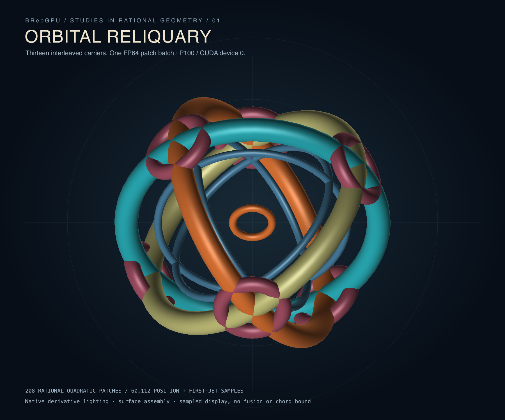
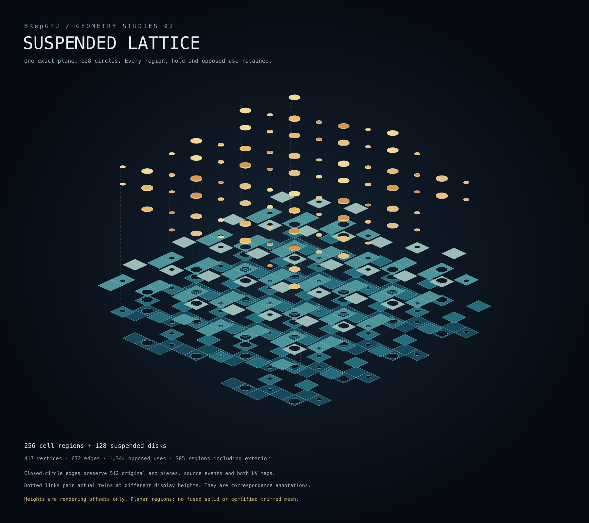

# Geometry trophy candidates

The continuing goal object is now [NCSX](NCSX_GOAL_OBJECT.md), with a
source-based P100 study and a preserved scene for future comparisons.

The two earlier reproducible visual studies of the operations implemented so far. Both use
owned geometry on the fleet, with source inputs and direct geometric checks.
Download the PNGs for sharing; the saved SVGs include labels at full resolution.

## 01 — Orbital reliquary



Thirteen independent rational torus carriers, interleaved into an armillary
sculpture. The existing C++/CUDA evaluator sampled 208 quadratic tensor-product
patches on P100 device0: 60,112 positions and both first derivatives. Native
first jets supply the lighting normals. An owned display depth buffer handles
surface crossings; its raster is embedded in the labeled SVG.

Every returned sample was checked against independent exact rational torus
formulas at the submitted parameters. Maximum position error: 5.52e-17;
maximum first-derivative error: 1.70e-16. All chart seams agree in position and
oriented unit normal. These are separate surface carriers, with no fused-solid,
trim-aware mesh or chord-tolerance claim.

[PNG](../assets/trophies/orbital.png) · [SVG](../assets/trophies/orbital.svg) ·
[Actual inputs, outputs and qualification](../results/trophies-2026-10-14/orbital/REPORT.md) ·
[Owned caller and renderer](../examples/trophy_surface.py)

## 02 — Suspended lattice



One exact CPU arrangement of a 16×16 grid and 128 separated circle sections.
Its 256 cell regions and 128 disk regions are lifted into an exploded sculpture.
Every hole follows its actual loop word; fine dotted annotations connect actual
opposed uses of the same graph edge. All heights are display offsets over the
original plane. No extruded or fused solid is constructed.

The complete graph has 417 vertices, 672 edges and 1,344 opposed uses. The
existing independent arrangement model qualified the complete region graph;
1,321 closed-region queries and 9,408 displayed source-bound curve samples
were consumed and checked. Original arc pieces, events and both UV maps remain
in the exports. The finite display sampling carries no geometric error bound.

[PNG](../assets/trophies/arrangement.png) · [SVG](../assets/trophies/arrangement.svg) ·
[Actual graph, source maps and qualification](../results/trophies-2026-10-14/arrangement/REPORT.md) ·
[Owned caller and renderer](../examples/trophy_arrangement.py)

## Reproduce

Run geometry on the fleet from the repository root. No new dependencies or
native rebuilds are needed when a qualified core/CUDA plugin already exists.
Choose a new output directory for the arrangement caller.

```sh
export PYTHONPATH=python
export BREPGPU_LIBRARY=build/pair-release/libbrepgpu.so
python3 examples/trophy_surface.py --backend cuda --device 0 \
  --output-directory results/local-trophies/orbital
python3 examples/trophy_arrangement.py \
  --output results/local-trophies/arrangement
```

Both callers write SVGs. The orbital caller also writes its transparent native-
sample geometry raster and raw jets. For the published PNGs, the already installed
standalone rsvg-convert2.62.1 rasterized each final SVG at its declared dimensions:

```sh
rsvg-convert -w 1800 -h 1500 -o orbital.png results/local-trophies/orbital/orbital.svg
rsvg-convert -w 1800 -h 1600 -o arrangement.png results/local-trophies/arrangement/artwork.svg
```

These are geometry demonstrations, without timing or whole-CAD speedup claims.
The [mandatory alpha qualification](ALPHA_QUALIFICATION.md) remains incomplete;
rendered images do not establish community-suite conformance.
