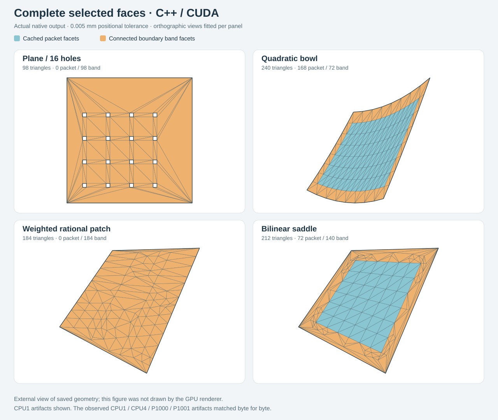

# First complete selected faces: native CPU and P100

The native caller now constructs complete selected trimmed faces, including
holes, shared physical XYZ, interior packets and a connected boundary band.
**28 processes /56 queries pass the original-source readers.** CPU1,CPU4 and
both P100s emit byte-identical boundary and face artifacts for every matched
source/quality. These small complete operations favor CPU in this observation.

This is the first authored selected-face delivery. It does not complete all
preselected caller families, imported components, assembly publication or OM10.
NVIDIA USD/BRep CPU has not been run on these new scenarios. External community
alpha qualification remains incomplete.

[](../../assets/adaptive-trimmed/faces.svg)

The external orthographic views show actual CPU1 .005mm output. Blue denotes
cached packet facets; orange denotes connected boundary-band facets. Each panel
fits its own camera scale without height exaggeration. This figure is not output
from the GPU renderer.

## Fixed cohort and scope

Revision `4b67f3ddf718bdcddfc9e9f73bc82a99e67e2c53`; Linux Release Clang18.1.3,
C++20, CUDA12.8.1/sm60. Hardware: two Xeon E5-2697v2 processors,12 cores each,
48 logical CPUs; two PCIe Tesla P10016GB GPUs, driver580.178.04. CPU modes use
one/four workers; P100 modes use one host worker. No competing qualification
was scheduled during this serial cohort. OS/file caches and clocks were not
controlled. There is one observation per process, with no confidence interval.

Every fresh process requests .01 then .005mm, with node-source allowance1e-10mm.
The second query retains source/numerical caches but constructs a fresh
quality-dependent boundary and face. CLI memory/depth/node defaults are shared.
The seven sources were fixed before the retained run: plane/tiny hole,16holes,
reversed loops, authoritative raw line image with a different parameter clock,
bowl, positive weighted rational surface and saddle.

| Source | Final sites | Final triangles | CPU1 process | CPU4 process | P1000 process | P1001 process |
|---|---:|---:|---:|---:|---:|---:|
| Plane, tiny hole |8|8|0.019s|0.020s|0.315s|0.328s|
| Plane,16 holes |68|98|0.138s|0.145s|0.451s|0.428s|
| Reversed loops |8|8|0.017s|0.019s|0.268s|0.368s|
| Authoritative line clocks |8|8|0.021s|0.025s|0.305s|0.461s|
| Bowl |137|240|0.417s|0.434s|0.826s|0.730s|
| Weighted rational |107|184|3.352s|3.331s|3.652s|3.601s|
| Saddle |109|212|0.970s|1.000s|1.346s|1.319s|

Process wall is spawn through native exit: decode, source preparation, session/device
setup, both complete shared boundaries/faces, writes and close. Independent
reader/hash-comparison time starts afterward. It is not included in this table.
Full precision, source-container and executable/module hashes are retained in
[processes.tsv](processes.tsv). Fixture source metadata deliberately uses an
authored tag; actual container SHA256 is recorded separately.

## What the output checks establish

The existing external readers consume original source and actual BGACRV/BGATRM
bytes. Original loop/use incidence supplies the expected boundary. The same
exact positive-chain/incidence reader checks full selected-domain coverage,
holes, used sites and protected edges. Actual boundary XYZ/key/revision matches
the shared physical authority. Independent original POWER/rational formulas
bound the actual affine facets; virtual subdivisions retain that SAME affine
map. Physical triangle noncollapse is checked separately.

All56 queries pass. All42 nonbaseline matched queries have equal complete
BGACRV/BGATRM bytes, decoded records and canonical exact-UV/XYZ/oriented-facet
connectivity. Backend equality checks deterministic placement; original-source
readers establish geometry. The14 CPU1 rows are comparison baselines.
[queries.tsv](queries.tsv) contains both scopes and equality flags.

Separate finite numerical qualification covers27 original-source CPU/P100
cases, including maximal cubic-by-cubic source bounds with36 degree7 residual
coefficients, analytic frames/scales, skinny/displaced affine triangles and
exact plane equality. The SAME real-work reader checks37 clipped pieces across
10 actual parent facets. Scoped ASan/UBSan/leaks, CPU4 TSan, configured actual-
source static analysis and source reviews pass; P100 memcheck of the new p3q3
operation reports zero errors. Actual lifecycle tests exercise cancellation,
stale work, no partial result and work-cap refusal. Relevant prior patch and
shared-curve callers also pass. There was no new mutation/certification campaign.

Full-caller C0/hanging spans, periodic seams, multiple outer regions and the
remaining planned failure ports are still pending. Their existing direct/unit
checks are not counted as completed full-face caller qualification. General
curved authoritative-domain maps and alternate charts remain later capabilities.

## Where time and work go

The weighted case exposes the current cost clearly:

| Scope | CPU1 | CPU4 | P1000 | P1001 |
|---|---:|---:|---:|---:|
| First complete face |0.664s|0.666s|0.700s|0.658s|
| Second complete face |2.655s|2.628s|2.625s|2.619s|
| Device open |—|—|0.241s|0.234s|
| Session close |<0.001s|<0.001s|0.037s|0.037s|

The bound stage accounts for approximately95% of the combined complete-face
time. That timer includes exact work preparation, packing, numerical execution,
fallback and polling; it does not isolate host clipping from device arithmetic.
The same two queries produce7,682 cumulative virtual pieces and635 original-
source triangle tasks for the final184-triangle face. Finer cached numerical
partitions can therefore create much more host work than the emitted mesh.

P100 executes real geometry:322 surface point evaluations,315 surface bound
records and314 control restrictions in this weighted process, plus actual
facet-bound batches. Source-task counts are separate from node-bound counts.
Both P100 runs transfer3,092,648 bytes host→device and281,168 bytes device→host,
including shared-boundary traffic. These are memory transfers, not server-network
traffic. Run reservation peaks are6.95MB CPU1,275.65MB CPU4 and8.57MB P100;
worker scratch reservations contribute to CPU4. These are metered reservations,
not process RSS or CUDA context/driver memory. Detailed counters are in
[queries.tsv](queries.tsv);476 native stage rows are in [stages.tsv](stages.tsv).

A concrete next scheduling contender is to run the existing original-source
whole-facet task before creating numerical-leaf clips when the facet fits one
original span. This could avoid virtual work for direct accepts; original-span
crossings still require source partitioning. It has not been implemented or
measured. Remaining component/publication dependencies precede a tuning campaign.

## Failure found during integration

The original BAND refinement chose a point in the first virtual clip piece.
As the numerical tree refined, that piece could shrink near a triangle corner
while the actual large triangle remained poorly approximated. Weighted and
saddle callers exhausted exact work. One weighted development run failed after
101.834499s; this was not a published controlled comparison revision.

Bounded diagnostics ruled out giant input fractions and found true original-
function centroid errors above tolerance in59 of100 sampled failed source tasks.
The revised rule chooses a dyadic point centrally in the actual failing parent
triangle, with barycentric coordinates at least1/6, retains prior anchors and
splits its containing cache leaf. A targeted test failed on the old placement
and passes on the replacement. This central condition bounds direct-star child
areas, not general CDT diameter or eventual termination. Work-scope enforcement
was also corrected during integration. This is a repaired failure, not a speedup
ratio. The failed observations and rejected hypotheses remain in the journal.

## Reproduce

Build the native executable and optional CUDA module on the qualified profile,
following [the operation guide](../../docs/ADAPTIVE_TRIMMED_FACES.md). On a
two-P100 machine, write a new observation under ignored context so the retained
published tables stay intact:

```sh
PYTHONPATH=python python3 -B scripts/benchmark_native_trimmed.py --run \
  --executable build/mesher/brepgpu-adaptive-trimmed \
  --module build/mesher/libbrepgpu_mesher_adaptive_cuda.so \
  --raw-dir context/trimmed-reproduction/raw \
  --results-dir context/trimmed-reproduction/tables \
  --revision "$(git rev-parse HEAD)"
```

The driver preserves raw inputs/output under ignored context and refuses to
overwrite prior observations. It invokes the same readers after native timing,
then writes the three tracked TSVs. The source digest/configuration and exact
binary hashes in those tables describe this run; the provided revision names
the source archive used to build them.

After the observation finishes, draw the saved output without reevaluating any
carrier or constructing geometry:

```sh
python3 -B scripts/visualize_native_trimmed.py \
  --input context/trimmed-reproduction/raw \
  --output context/trimmed-reproduction/faces.svg
```
