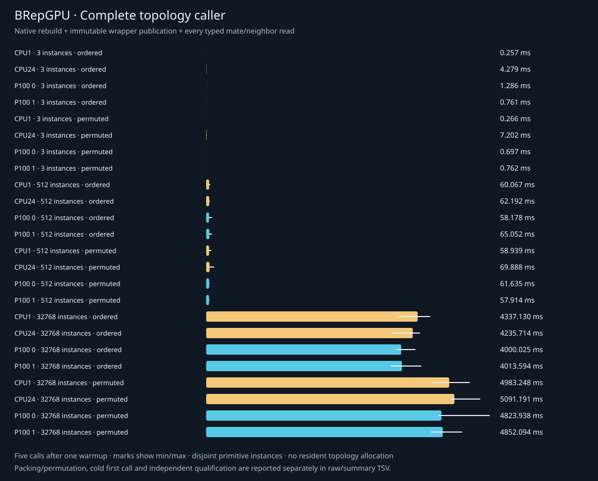

# GPU edge-use adjacency: exact output and complete costs

Owned CPU/P100 count/scan/fill now constructs edge-to-coedge CSR, followed by an
actual mate/face-neighbor reader. The cylinder seam retains two distinct uses on
one face. Typed source occurrences survive independent slot permutations.

The GPU construction/reader stages are faster on the large batch, but allocation,
transfer, cleanup and Python consumption matter. **Ordered storage favors CPU1.
Shuffled storage gives one P100 a lower native median than CPU24; their ranges
overlap. No complete Python-caller speedup is established.** This working
beachhead advances the broad pass; integration/residency tuning stays deferred.

[API](../../docs/ADJACENCY.md) · [design](../../docs/ADJACENCY_DESIGN.md) ·
[plan](../../docs/ADJACENCY_PLAN.md) · [literature](../../papers/README.md#gpu-edge-use-adjacency-beachhead) ·
[round-two notes](../../papers/2026-10-14-adjacency-round2-notes.md).

## Declared operation

Inputs contain E edge sources, F face sources, C coedge sources and three compact
C-element arrays: edge slots, face slots and orientation signs. Source identity
is instance/body/revision/kind/entity; kind is supplied by the typed table.
Results own offsets[E+1], members[C], kinds[E], mates[C], neighbors[C]. Rows
retain every occurrence once, in unspecified order. Original directed loop/UV
provenance remains in the immutable CPU snapshots.

The native reader consumes the constructed rows. Two opposed uses yield distinct
mates and the other use's face, including the same face. Zero/one/multiple uses
and orientation conflicts have explicit classifications and no invented mate.
Generic same-face pairing does not itself prove a geometric seam. No radial
ordering, topology editing, Boolean construction, geometric welding or whole-
solid manifoldness claim is made.

CPU1 uses direct uint32 counters. CPU24 uses atomic count/fill, a serial prefix
scan and fresh bounded worker groups for count/fill/reader. GPU uses an owned
256-lane recursive exclusive scan, atomics and a post-fill reader on one stream.
All phase clocks are synchronized host spans, including launch/synchronization;
there are no kernel-only CUDA-event measurements. Separate ABI5 does not change
old ABI1–4 handles or libraries. Every CUDA call allocates/uploads/frees anew; CPU has zero device transfer.

## Direct qualification

| Placement | Direct scope | Result |
| --- | --- | --- |
| CPU1 | 10 new + 39 existing body/pair/intersection tests | 49 run, one existing GPU-only skip; 9.589s process |
| CPU24 | 10 new adjacency tests | Pass; 1.484s process |
| P1000 | 10 new under Compute Sanitizer | Pass; 2.123s, zero errors/leaked bytes |
| P1001 | 10 new under Compute Sanitizer | Pass; 2.493s, zero errors/leaked bytes |
| Native CPU1/24 | ASan/UBSan/LSan, admission and recoverable faults | Pass, no diagnostics |
| Native P1000/1 | Guarded faults + Compute Sanitizer + actual distinct-device restoration | Pass, zero errors/leaked bytes |

[Unittest scope](qualification.tsv), [native scope](native-qualification.tsv),
[qualified sources](qualified-sources.tsv), [binaries](qualified-binaries.tsv).

Independent truth enumerates original coedges into a typed relation dictionary;
it does not reproduce native histogram/prefix/fill. Literal primitive loops check
complete signed edge/coedge/face projection, hole flags and exact UV occurrences.
Tests cover every reader class, empty arrays, repeated/mixed instances, independent
storage permutations, crowded rows, ownership, invalid sources/references and a
65,539-edge uneven recursive-scan fixture with empty interior/tail rows. Native
checks add aligned/unaligned/null/aliased/overflowing extents, preflight no-writes,
65,537-edge dense recursion and a 65,537-use hot row.

Tooling injects host/device allocation refusal, partial CPU worker launch,
post-upload/scan/reader failures and cleanup/restore reports. It verifies primary
failure retention, withheld timings, actual recoverable cleanup and healthy
retry. Distinct-device probes observe restoration after real calls and injected
failures. Cleanup-report injection occurs after actual cleanup; this is not an
observed cudaFree or driver failure. Fatal driver recovery is not qualified here.

All **eight production mutants** earned actual AssertionError kills after healthy
baselines: two CPU membership/neighbor changes; five actual CUDA fill, recursive
prefix, neighbor, same-face-label and sign-conflict changes; one public Python
mate-identity change. Compile failures, crashes and native status failures receive
no credit. [Actual mutants](mutations.tsv), [controller review](../../papers/2026-10-14-adjacency-qualification-code-review.md).

Four real callers export **60 edges, 32 faces, 120 coedges and 36 loops**, including
four same-face seams and eight closed ring edges. Saved binary CSR/reader arrays,
all source/loop/UV records and all 120 diagram labels pass independent review.
These are separate occurrence/geometry roles: equal ring endpoints do not erase
cap/wall uses, and same-face seams do not collapse coedges.
[Artifact review](../../papers/2026-10-14-adjacency-caller-artifact-review.md).

## Matched cost campaign

24 serial fresh-process cases: mixed box/cylinder/plate; 512 plates; 32,768 plates;
ordered and globally permuted edge/face/coedge storage; CPU1/CPU24/P1000/P1001.
Each case has a first call, one excluded warmup and five timed calls, with actual
native CSR/reader output followed by every Python typed use/mate/neighbor lookup.
All seven outputs per case are independently checked outside caller timing.
The matrix stores aggregate quality/timings rather than every large output
array: all168 outputs were qualified on the fleet. Offline binary/SVG
reconstruction applies to the four saved callers.
There are 120 timed calls, 168 qualified results, 2,544 raw timing rows and 720
summary rows. Source/library hashes remain unchanged before/after every worker
and the campaign. No other owned copying, build, test, mutant or profiling work
overlapped measured workers.

Large cases have **E=491,520, F=229,376, C=983,040**. They repeat one original plate
snapshot at the same coordinates as topologically separate batch occurrences.
They are neither a spatially separated assembly nor one complex solid. The
permuted cases scatter every typed table globally while preserving identity.
GPU devices are measured independently, without distributing work across cards.

The host has two Xeon E5-2697v2 CPUs (24 physical/48 logical cores), two P100 PCIe
16GB cards, driver580.178.04, CUDA12.8.1/nvcc12.8.93, g++13.3.0, CMake3.28.3,
Python3.12.3 and glibc2.39. CPU24 requests24 workers without affinity control.
The CMake global cached architecture52 is not the topology target architecture:
target property and compiler flags select **60-real**, and cuobjdump confirms an
embedded sm_60 cubin. Preserve both facts in [environment](benchmark/environment.tsv)
and [actual architecture](benchmark/actual-cuda-architecture.tsv).

### Large native operation: milliseconds, median [min,max]

This includes admission, context, allocation, upload, count/scan/fill/reader,
download and cleanup, before Python publication/traversal.

| Storage | CPU1 | CPU24 | P1000 | P1001 |
| --- | ---: | ---: | ---: | ---: |
| Ordered | 8.193 [7.638,9.409] | 9.063 [7.995,21.265] | 17.325 [15.959,18.780] | 17.008 [13.873,18.841] |
| Globally permuted | 100.415 [83.586,166.782] | 19.427 [18.142,22.115] | 21.789 [19.612,32.357] | 15.306 [14.981,19.341] |

On shuffled storage the P1001 native median is **21% lower than CPU24's**
(CPU24/P1001=1.27), while
P1000 is slower. P1001/CPU24 ranges overlap. Relative to serial CPU1, the two GPU
native medians are 4.6–6.6× lower; that is not the best-CPU comparison. Ordered
CPU1 wins. Do not summarize these placements as a universal GPU topology gain.

The four construction/reader host spans, summed **per iteration before taking
the median**, are:

| Storage | CPU1 | CPU24 | P1000 | P1001 |
| --- | ---: | ---: | ---: | ---: |
| Ordered | 5.584ms | 5.572ms | 0.317ms | 0.315ms |
| Globally permuted | 97.826ms | 16.219ms | 1.419ms | 1.397ms |

This is about17.6–17.7× ordered and11.4–11.6× shuffled versus CPU24 for those named
stages. [Derived per-sample sums](benchmark/construction-reader-stages.tsv)
come from the original raw rows, not sums of phase medians. Initialization is
placed differently: CPU sentinel/count initialization is in allocation; GPU
count zeroing and reader sentinels are in count/reader. Full native total is the
like-for-like operation cost. No isolated kernel or complete-modeling speedup
is inferred from the stage table.

### Large complete caller: seconds, median [min,max]

This includes native work, host output allocation/immutable publication and every
actual typed adjacency/mate/neighbor lookup; independent qualification is separate.

| Storage | CPU1 | CPU24 | P1000 | P1001 |
| --- | ---: | ---: | ---: | ---: |
| Ordered | 4.337 [3.928,4.592] | 4.236 [3.820,4.383] | 4.000 [3.913,4.289] | 4.014 [3.790,4.409] |
| Globally permuted | 4.983 [4.642,5.405] | 5.091 [5.018,5.618] | 4.824 [4.764,5.815] | 4.852 [4.613,5.248] |

Ranges overlap across CPU/GPU. Python source traversal dominates: ordered medians
3.98–4.32s, permuted4.79–5.06s. Immutable publication alone takes4.5–5.5ms.
The wrapper returns owned bytes; it does not silently use a CPU model's mates
in place of the native reader output. The traversal sum is a consumption marker;
independent source/byte truth supplies correctness.

Tiny mixed scenes favor CPU1: native about0.0022ms and full0.257–0.266ms, versus
P100 native0.445–0.868ms and full0.697–1.286ms. Medium15,360-use full medians span
roughly58–70ms, with no consistent GPU win. Native CPU1 remains the faster medium
placement at0.123/0.264ms ordered/permuted versus P100 about1.1–1.4ms.

### Setup, validation and bytes

Large packing takes8.1–9.1s; global permutation adds7.8–8.5s. Cold-to-first full
consumer is12.3–13.4s ordered and21.3–22.4s permuted, measured after process
imports. The first library build call costs15–17ms CPU/280–460ms GPU ordered;
permuted30–101ms CPU/279–423ms GPU. These are cold observations, not five-repeat
medians. Independent initial literal qualification costs15.9–16.7s ordered and
21.8–23.5s permuted, outside cold-to-first and reused caller timing. Each repeated
result's independent qualification has median10.5–11.4s ordered/14.7–16.1s permuted,
also outside measured full caller. Those validation costs are not erased.

Each large GPU call uploads **11,796,480 bytes** and downloads **15,728,644 bytes**.
The formulas are12C and8E+12C+4; source identity/geometry/loops/UV upload is zero.
These are host/device payloads, excluding launch metadata, scratch traffic and
driver staging, not network traffic. Calls use pageable host buffers. Large GPU
upload medians are3.8–3.9ms ordered; shuffled P1000 observes8.53ms versus P1001
3.90ms. Download medians5.0–6.4ms and allocation/cleanup around1.7–2.0ms each
consume far more than the native construction stages. No NUMA or hardware cause
is assigned to the transfer difference without a focused future measurement.

[All raw rows](benchmark/raw.tsv) · [medians/ranges](benchmark/summary.tsv) ·
[source pins](benchmark/sources.tsv) · [measured binary](benchmark/binaries.tsv).
The measured release library is
`37ff97b5586dfdf869e828657a44ab2c40a029e2c02468e1f8aa4c1c7e1a3900`.
Protected earlier pair/discovery libraries retain their archived hashes.

Native bulk consumption, retained topology buffers/workers, placement policies
and alternative scans go to the return pass. They do not displace uncovered
classification, arrangements, meshing, interchange, solid-operation or feature
beachheads. The first topology result is usable now; broader semantics need
separate researched operations and independent truth.
