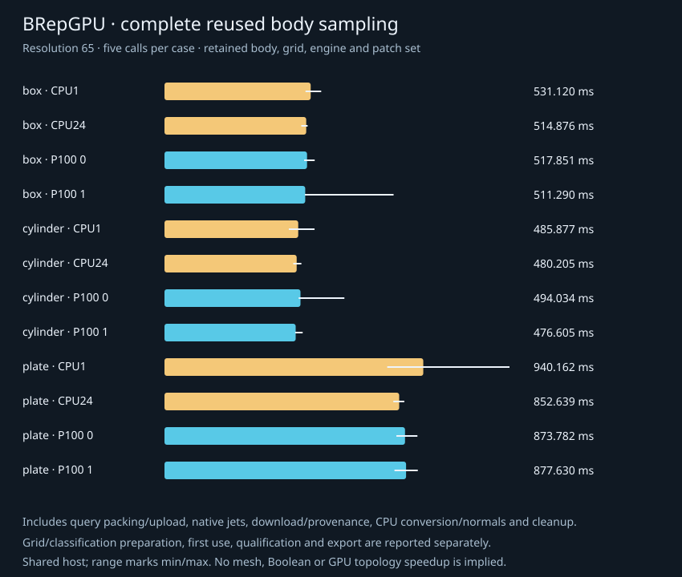

# First body beachhead: owned snapshots and qualified face samples

Owned box, cylinder and one-hole plate snapshots now connect the numerical
service to bodies with shared edges/coedges, trim loops, chart identity and a
periodic seam. Body construction, exact trim classification and normal/row
consumption run on CPU Python; one existing native C++/CUDA first-jet batch
evaluates the admitted carriers. Native source, ABI, core and plugin are unchanged.

This is a runnable read-only body consumer. The plate is constructed analytically,
not produced by an owned Boolean. Outputs are points/normals, not a mesh, imported
model, general trim engine or GPU topology operation.

## Actual caller outputs

| Caller | Candidates | Evaluated | Rejected | Exact boundary rows | Maximum XYZ error | Maximum normal component error |
| --- | ---: | ---: | ---: | ---: | ---: | ---: |
| CPU24 box, resolution17 | 1,734 | 1,734 | 0 | 384 | 0 | 0 |
| P1001 cylinder, resolution17 | 1,734 | 1,550 | 184 | 174 | 1.385e-17 | 1.322e-16 |
| P1000 plate, resolution33 | 10,890 | 10,712 | 178 | 1,094 | 1.385e-17 | 1.322e-16 |

All **14,358 candidate records / 13,996 evaluated witnesses** passed independent
exact-input analytic checks. Original UV bits, every trim/native label, XYZ,
oriented normals and complete typed source identities remain in samples.tsv.
PLY, immutable body tables and original control/patch/frame records are retained.
[Box](caller/cpu-box/RECIPE.md) · [Cylinder](caller/cuda-1-cylinder/RECIPE.md) ·
[Plate](caller/cuda-0-plate/RECIPE.md).

Gray curves are CPU-owned boundaries. Cyan/green points and gold arrows are
actual evaluated outputs, thinned for display. A display-only SVG group reduces
the geometry extent to avoid caption overlap; sample/qualification/timing data
are unchanged. The current caller emits the same display grouping.

Body graphs have (vertices,edges,faces,loops,coedges) counts box (8,12,6,6,24),
cylinder (2,3,3,3,6), plate (10,15,7,9,30). A wall remains one face with four
native charts. Its seam has two opposed uses of one edge on that same face.
The hole-sensitive plate Euler characteristic is 0; V-E+F alone gives 2.

Trim labels describe the exact submitted binary64 UV. The plate's circular hole
has no representable dyadic UV boundary witnesses; its symbolic spatial-edge/UV
map represents that boundary independently. Rounded mapped UV retains its actual
trim label. Chart joins are not invented body edges, and repeated sample points
are per-face/chart outputs rather than a unique-point mesh.

Actual cold sampling / export-inclusive caller observations were box 45.79/272.53 ms,
cylinder 539.68/752.91 ms and plate 688.29/2146.55 ms. Counts differ, so these are not
backend comparisons. Cold includes preparation/setup/output/cleanup; full export
adds exact qualification and all artifacts through SVG/recipe, excluding final
timing-file emission. [Each phase](caller/cuda-0-plate/timings.tsv) is retained.

## Complete reused caller measurements

24 cases: three bodies, resolutions17/65, CPU1/CPU24/P1000/P1001. Each fresh case
process has one cold observation, exact initial qualification, one excluded
warmup and five reused calls. All cases completed. The field contains
**1,248 raw phase observations and 384 phase summaries**.

Median actual returned-call wall at resolution65, milliseconds:

| Body | Candidate/evaluated rows | CPU1 | CPU24 | P1000 | P1001 |
| --- | ---: | ---: | ---: | ---: | ---: |
| Box | 25,350 / 25,350 | 531.12 | 514.88 | 517.85 | 511.29 |
| Cylinder | 25,350 / 23,318 | 485.88 | 480.21 | 494.03 | 476.60 |
| Plate | 42,250 / 41,536 | 940.16 | 852.64 | 873.78 | 877.63 |

**No end-to-end gain is established against CPU24.** The native evaluate call
for plate65 is 2.558 ms on CPU24 versus 0.454/0.495 ms on the P100s, but CPU normal
and immutable row construction dominate. That phase accounts for 84.7–93.2%
of actual wall on the 60 resolution65 calls, calculated from matched raw calls,
not by adding or dividing independent phase medians.

Plate65 actual returned-call min/max ranges are CPU1 809.17–1253.34ms,
CPU24 831.45–871.11ms, P1000 842.44–918.85ms and P1001 835.46–920.22ms.
Five shared-host fixed-order samples are descriptive, without statistical
confidence or controlled-clock/affinity claims. One box/P1001 sample was 832.24 ms;
it remains in the raw data and displayed range.

The primary timer wraps sampler.sample through returned batch publication.
It retains the body, classified grid, Engine and uploaded PatchSet while
including new query packing/upload, native evaluation, Python download/provenance,
host conversion, normal/scatter and child cleanup. Internal reused_wall_ms ends
through child cleanup. Preparation, first use, exact qualification and export
are separate. CPU24 changes native evaluator workers, not Python stages.

At plate65 the CUDA payload is 830,720 input bytes and 3,156,736 jet/status output
bytes per call, plus 1,696 bytes of geometry upload once per PatchSet. The
body adjacency tables stay on CPU. Download additionally copies host source
metadata and conversion/output assembly creates host buffers. These are local
RAM/VRAM payloads, not network traffic or total Python memory traffic.

[Raw phases](benchmark/raw.tsv) · [All medians/ranges](benchmark/summary.tsv) ·
[Methods](benchmark/METHODS.md) · [Source hashes](benchmark/sources.tsv) ·
[Actual native binaries](benchmark/binaries.tsv).

## Qualification and implementation review

CPU1/CPU24 and both P100s each passed all nine new direct tests. Each P100 ran
under Compute Sanitizer: zero errors and zero leaked device allocations.
[Qualification outcomes](qualification.tsv). The suite covers full canonical
carrier/control identities, exact trim adversaries, packed-table decoding,
shared boundaries/loop orientations, normals, frame extrema, source/gather/scatter,
request caps, empty/selected inputs, foreign snapshots and closed lifetimes.

Review found that child cleanup could replace the primary error. The direct test
failed on actual native wrappers before the sampler-only fix, then passed with
the same primary error object, both handles consumed and a healthy retry.
The native core/wrapper was not changed. Full corrected suites are clean.

Four actual production host-code mutants were killed by independent assertions:
hole membership, normal orientation, internal-chart boundary labeling and scatter
order. The unmutated nine-test CPU baseline passed. Private copies never overwrote
product/native baselines; [mutations](mutations/mutations.tsv) and
[source/core identities](mutations/source-manifest.tsv) are public.

[Body topology review](../../papers/2026-10-14-body-code-topology-review.md) ·
[Oracle review](../../papers/2026-10-14-body-code-oracle-review.md) ·
[Sampler review](../../papers/2026-10-14-body-sampler-code-review.md) ·
[Caller review](../../papers/2026-10-14-body-caller-runtime-review.md) ·
[Tooling review](../../papers/2026-10-14-body-tooling-runtime-review.md) ·
[Caller artifact review](../../papers/2026-10-14-body-caller-artifact-review.md) ·
[Performance artifact review](../../papers/2026-10-14-body-performance-review.md).

No source copying, build, qualification or other owned performance work overlapped
the serial matrix. Actual qualified native core 3515b86d… and plugin 8a6a861c…
remain unchanged. The shared dual-Xeon/P100 host and pinned toolchain are the same
as the earlier numerical studies; no system CUDA/driver change was made.

## Where the breadth-first pass goes next

This establishes a working body-data/trim/chart consumer. Normal/row construction
and broader body support are return-pass opportunities. The next uncovered
operation is conservative multi-patch pair discovery in a common body frame,
followed by independently scoped intersection, meshing, arrangement, feature and
GPU topology beachheads. A faster distance bound is not the automatic successor.

[API and caller](../../docs/BODY_SAMPLING.md) ·
[Breadth-first roadmap](../../docs/ACCELERATION_ROADMAP.md).
