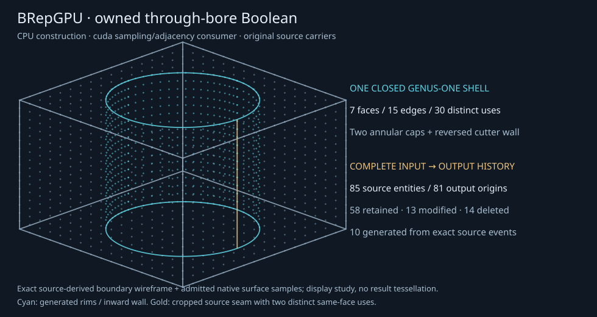

# Owned through-bore Boolean and complete source history

2026-10-15. The owned CPU operation constructs a regularized closed box-minus-
through-cylinder solid from the actual two input snapshots, their exact face
sections, cap arrangements and material decisions. CPU/P100 sampling and edge-use
adjacency consume the result. No GPU Boolean construction or whole-operation
GPU speedup is established. [API/support](../../docs/BOOLEANS.md),
[design](../../docs/BOOLEAN_DESIGN.md), [plan](../../docs/BOOLEAN_PLAN.md).

## Geometry and history

All cases have identical original XYZ frame origins and cutter scale twice box
scale. Recipes are unit(origin0, scale1), small(origin(2,−3,1), scale1/4), and
large(origin(−4,2,−1), scale2). These are scaled/translated geometry recipes,
not different topology sizes or larger batches. The box-local hole radius is1/2;
the existing canonical plate's radius 1/4 would be the wrong output.

Original six box plane carriers and four cutter wall carriers retain every
control/UV/frame bit with fresh output Lineage. Only wall trim changes to original
V[1/4,3/4] and its material sense reverses. The separate CutSolid has 10 vertices,
15 edges, 30 coedges, 9 loops, 7 faces, 10 charts and one closed oriented genus-one shell.
Two cap holes give Euler10−15+7−2=0. Shared physical edges and the same-face seam's
two distinct uses come from source events/maps; coordinates are not welded.

Typed history covers all 85 input subshapes:58 retained, 13 modified, 14 deleted.
All81 output entities have reverse origins, including 10 generated entities jointly
supported by actual source faces/events. Cropped source seam ranges, original
wall UV bands and orientation are explicit. A late construction failure preserves
both inputs/prior results; native consumer failure returns no partial batch and
supports healthy retry with the same retained result/Engine.

## Qualification

| Unit | Actual fleet outcome |
| --- | --- |
| Whole CPU construction/history | 8 direct methods passed0.806s |
| Native sampler/ownership | 8 methods each on CPU1/CPU24/P1000/P1001:0.517/0.529/2.030/3.472s |
| Independent complete result/samples/topology | 10 methods each on CPU1/CPU24/P1000/P1001:9.059/8.972/9.119/9.861s |
| Existing body/intersection/arrangement/classification/adjacency/runtime | 75 methods on CPU:74passed,1existing CUDA-only skip,11.368s; that CUDA device-restoration method then passed separately0.546s |

These are 26 new methods across their applicable placements, rather than distinct
geometric families per repetition. Every result qualifier checks complete literal
face domains, exact whole-quarter spatial/both-UV polynomial identities, oriented
loop/link manifold structure and the entire original-history model. It also reads
49 material support/offset queries and 140 exact/actual-float trim queries. Native
sampling qualification uses the original source carrier at actual copied UV,
not CPU parity. Permuted native topology inputs must retain actual mate/neighbor
and same-face seam identity. Direct falsified graph/history/source/sample records
and late exceptions exercise named fault classes; no broad mutation claim is made.

A real integrated run caught an incorrect demand for a finite unprofiled native
kernel timer. The sampler now follows the existing ABI: known flags, NaN when
unprofiled, finite nonnegative kernel_ms only when profiled. All direct placement
greens followed that correction. No native rebuild or dependency was introduced;
the five existing core/CUDA/topology binary hashes remain unchanged.

Every one of 48 campaign callers independently qualified all 2,890 requested rows:
2,712 admitted and 178 explicitly rejected. No fallback, invalid admitted status,
missing mate or unresolved topology row occurred. Largest observed component
errors across those callers were 4.43e-16 for world position and
1.32e-16 for oriented unit normal, versus declared limits 2^-36 and 2^-30.
The source/native hashes and raw query/graph/history/CSR records are saved per case.
[Independent source review](../../papers/2026-10-15-boolean-oracle-semantics-review.md)
and [actual artifact review](../../papers/2026-10-15-boolean-unit-artifact-semantics-review.md)
retain scopes and findings.

## Complete operation costs

One excluded warmup and three measured **fresh processes** for every recipe/
placement: 48 total runs, 36 measured observations in 12 cells. Process freshness
does not imply isolated clocks or cold filesystem caches. Shared x86_64 Linux,
Python 3.12.3, CPU requested 1/24 threads, two Tesla P100-PCIE 16GB, driver 580.178.04;
existing CUDA 12.8.1/sm60 binaries. No simultaneous project GPU jobs or clock pinning.

Useful wall starts after source operand preparation and includes CPU difference,
exact material/edge/UV/history consumption, request preparation, Engine setup,
patch/query uploads, evaluation/download/source conversion/oriented rows, Engine
cleanup, topology packing/library load, ABI5 construction and actual CSR mate/
neighbor reading. Native/query/source/backend/status checks are inside that wall.
Imports/process launch, operand preparation, independent qualification, rendering/
artifact writes and the foreign experiment are outside it. Raw child-process
wall includes all child work plus launch/wait and is separately retained.

| Recipe | Placement | Median complete ms | Measured range ms | CPU cut median ms |
| --- | --- | ---: | ---: | ---: |
| unit | CPU1 | 180.908 | 171.886–300.136 | 56.783 |
| unit | CPU24 | 270.094 | 184.884–324.627 | 55.485 |
| unit | P1000 | 790.901 | 690.569–959.859 | 56.568 |
| unit | P1001 | 1278.801 | 1165.325–1384.577 | 56.684 |
| small | CPU1 | 179.104 | 169.890–181.243 | 55.579 |
| small | CPU24 | 408.835 | 180.883–424.739 | 83.197 |
| small | P1000 | 838.043 | 685.421–852.704 | 57.669 |
| small | P1001 | 1257.719 | 1208.062–1603.267 | 58.316 |
| large | CPU1 | 174.576 | 169.760–217.366 | 55.027 |
| large | CPU24 | 182.772 | 177.291–200.108 | 60.205 |
| large | P1000 | 710.412 | 680.920–768.575 | 60.002 |
| large | P1001 | 1256.376 | 1159.494–1526.539 | 64.212 |

CPU1 has the smallest median in every recipe. All observed P100 complete-call
ranges are slower than the corresponding CPU1 ranges. The unit recipe illustrates
where time goes (individual phase medians, **not additive**):

| Unit phase, ms | CPU1 | CPU24 | P1000 | P1001 |
| --- | ---: | ---: | ---: | ---: |
| CPU difference outer wall |56.783|55.485|56.568|56.684|
| Exact request preparation |47.613|52.879|46.018|45.337|
| Engine setup |2.235|2.451|272.909|561.780|
| Sampling and row consumption |59.709|140.552|60.774|57.446|
| Engine cleanup |0.017|0.026|41.840|84.197|
| Separate adjacency build |0.236|5.390|246.308|460.278|
| Independent qualification, outside useful wall |824.041|863.656|695.981|937.134|

The separate synchronous topology API owns another per-call device setup; it
is not resident continuation of the sampling Engine. Exact host request and
normal/row work are material costs. No isolated GPU kernel speedup is inferred:
the sampling evaluate_ms field is wrapper wall with profiling disabled. Internal
construction total_ms ends immediately before CutResult metadata publication;
the outer cpu_difference wall includes the complete returned operation. Nested
construction/sample/adjacency phases overlap their enclosing wall spans.

[Raw 48 observations](costs/raw.tsv), [summary](costs/summary.tsv),
[scope](costs/scope.tsv), [controller pin](costs/sources.tsv) and per-case costs
remain available. [Caller/reference source review](../../papers/2026-10-15-boolean-caller-runtime-review.md)
and [performance review](../../papers/2026-10-15-boolean-performance-runtime-review.md)
retain review dispositions. No tuning, Python rewrite or session integration was
started; these are notes for the explicitly deferred return pass.

## Like-sized foreign comparison

The separately installed optional USD BRep 1.0.0 experiment creates identical
original box/cylinder dimensions, consumes copies in difference and checks the
original reference inputs remain unchanged. Actual returned reference volume,
tight bounds, manifold status and 146 closest-point queries per recipe agree
with the qualified owned geometry:90 exact edge witnesses and56 spread actual
native face-interior samples. Volume relative acceptance is 1e-8, bounds component
limit 1e-8×scale and boundary distance/residual limit 1e-7×scale.

| Recipe | Absolute reference/analytic volume difference | Largest boundary residual | Witness queries |
| --- | ---: | ---: | ---: |
| unit | 4.01e-10 | 2.73e-16 | 146 |
| small | 4.3e-11 | 4.44e-16 | 146 |
| large | 2.46e-08 | 9.93e-16 | 146 |

[Unit comparison](reference-unit/comparison.tsv),
[small comparison](reference-small/comparison.tsv),
[large comparison](reference-large/comparison.tsv) retain actual residuals,
source artifact hashes and separately timed reference work. The unit inputs came
from the separately saved [first CPU caller](caller-unit/recipe.tsv); scaled
inputs came from measured CPU1 r1 cases. There was no subprocess warning/error.
No public reference material classifier/history comparison was established;
the experiment does not certify owned history or compare representation IDs.

## Remaining breadth and release work

Feature construction remains, as separate extrusion/revolution/fillet/offset
units. General/off-axis/partial/tangent/coincident Booleans, result meshing,
persistent naming/history composition and GPU construction remain future.
[Return-pass notes](../../papers/2026-10-15-boolean-round2-notes.md) preserve
opportunities without displacing breadth. GPU residency/setup polish, Python's
shipping role and matched NCSX render timing remain deferred.

Applicable external community corpus replay/adapters remain incomplete and
non-green under the mandatory [alpha contract](../../docs/ALPHA_QUALIFICATION.md).
This supported local operation and foreign comparison do not authorize alpha or
waive any missing external case/adapter.
