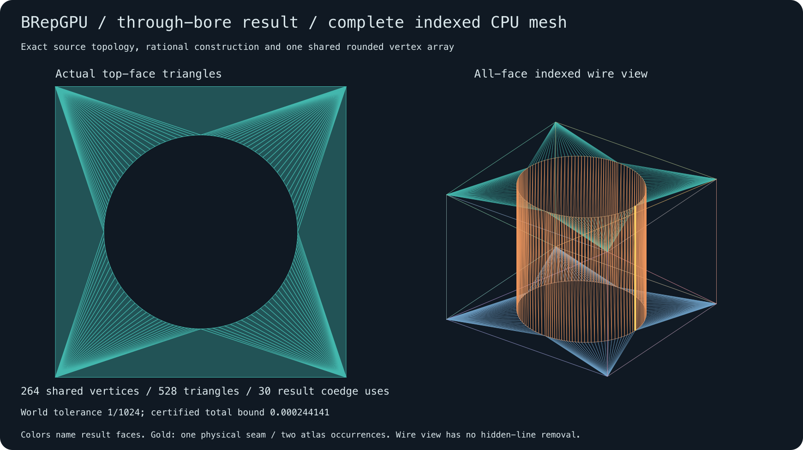

# Actual owned Boolean result → complete bounded mesh

The first post-breadth connection meshes the actual strict through-bore
`CutResult`, retaining its original operands, sections, arrangements, selections
and complete typed history. It emits a closed indexed triangle shell, rather
than a wireframe/sample cloud or reconstructed factory plate. CPU exact
construction and indexed/history consumption require no native library, CUDA
call, device transfer or new dependency.



The left view draws actual top-face triangles around the open bore. The right
view draws every face without hidden-line removal. Both use the saved shared
rounded array; gold marks the physical seam whose two source uses remain distinct.
This is a bounded meshing connection, not general Boolean/feature meshing.

## Source geometry, topology and approximation

The unchanged owned difference admits a same-origin box and twice-scale cylinder.
Its hole radius is1/2 in box-local units; the factory plate's radius is1/4.
The new API consumes original result curves, loops, coedge maps and carriers.
It never calls a canonical factory to manufacture the mesh. The returned mesh
retains the actual result/solid/history objects. Every result vertex and edge
sample is shared by original source identity, without coordinate welding.

The four inward wall charts retain original cutter controls and their original
frame, whose scale is twice the box's. Mesh corners keep original cutter
V[1/4,3/4], not a normalized0/1 band. Directed boundary maps keep distinct U0/U4
seam lifts. Intrinsic result-edge t0..1 and original cropped seam ancestry
t[1/4,3/4] remain separate. Exact result IDs and typed original-operand history
are exported, including all85 forward records and81 reverse origins.

At world radius R, n dyadic rational intervals per circle quarter give a
conservative analytic chord bound R/(2n²). Each shared vertex is rounded once;
the actual maximum L1 displacement bounds whole-triangle perturbation by
barycentric interpolation. Total error is the sum, at most the exact submitted
world tolerance. The straight hole polygon is inscribed, so cap triangles include
a thin strip inside the analytic void. Whole chordal-domain coverage and bounded
analytic-boundary distance are promised; exact material-IN for every triangle
interior is not.

| Actual case | World tolerance | n | Shared vertices | Triangles | Analytic bound |
| --- | ---: | ---: | ---: | ---: | ---: |
| Coarse unit |1/2|1|16|32|1/4|
| Refined unit |1/1024|32|264|528|1/4096|
| Translated scale2 |1/4096|64|520|1040|1/8192|
| Subnormal-origin scale1/4 |1/4096|32|264|528|1/16384|

Every case retains15 physical edge polylines,30 coedge occurrences,7 faces,
10 charts, one connected closed shell and genus one. Actual rounding/error
fractions, including the subnormal-origin case, remain in [counts.tsv](counts.tsv)
and each case's bounds.tsv. Scales/translations and resolution vary; Boolean
geometry complexity is fixed. These are not larger CAD assembly benchmarks.

## Direct correctness evidence

The independent qualifier reads original source geometry and the retained
Boolean result. Existing Boolean qualification checks original sections,
arrangement decisions, source controls/frames and complete history. Mesh
qualification separately checks:

- Every exact source generator, physical parameter chain and directed coedge map;
  every triangle corner reproduces its shared vertex using the original patch
  and that patch's own frame, including the raw cutter V band.
- Complete planar/chord-strip coverage through strict triangle orientation and
  full directed integer boundary-chain equality, including holes. Wall coverage
  uses affine spatial chord coordinates, not nonlinear arc parameters.
- Original minor-arc/chord inequalities, whole-triangle radial bounds and actual
  rounded displacement. Exact and rounded ring order/convexity/nesting, planes,
  cap heights and triangle-domain coverage establish the bounded embedding.
- Two opposite triangle uses per mesh edge, one cyclic link per vertex and a
  connected genus-one shell. Counts, volume, images and backend parity alone
  cannot establish these claims.

Genuine fleet red preceded implementation:12 methods produced16 missing-module
errors while `brepgpu.cut_meshing` was absent. The actual Boolean was constructed
before that entry in the source-first cases. After implementation all12 direct
methods passed in20.765s;46 affected compatibility methods passed in15.729s.
Direct altered real outputs test missing/duplicate/flipped/filled-hole triangles,
wrong source/rim parameters, cutter UV/chart/seam corruption, changed rounded
coordinates/bounds and native identity type aliases. These demonstrate named
fault sensitivity, not suite-wide mutation coverage or external qualification.

The existing canonical plate caller also passed. Its actual PLY is byte-identical
to the archived same-tolerance plate PLY. Archived SVG text positions differ at
three captions; the mesh geometry is unchanged, and those positions already
belonged to the pre-unit source. The reusable exporter retains canonical defaults.
Protected native core/plugin hashes were unchanged and were not rebuilt.

## Actual CPU costs

Each case prepares original operands and one actual Boolean result once. Seven
fresh meshes follow: first observation, one excluded warmup, five measured
repeats. The direct complete wall starts before meshing and ends after actual
indexed-buffer construction plus all typed forward/reverse history lookups.
Every exact source/corner/edge/coedge field and error bound is consumed; the
history reader follows original operand records and all source-map/event fields.

| Case | Complete median [min,max] ms | Mesh median ms | Indexed reader median ms | History reader median ms |
| --- | ---: | ---: | ---: | ---: |
| Coarse unit |37.965 [31.318,38.170]|18.216|0.767|18.978|
| Refined unit |220.970 [210.892,237.657]|195.775|8.823|15.799|
| Translated scale2 |433.318 [408.434,704.553]|398.548|18.081|16.254|
| Subnormal-origin scale1/4 |234.100 [231.019,246.736]|209.621|8.622|15.832|

Phase medians need not add to complete medians. Shared uncontrolled fleet timings
are observations, without a causal CPU load/thread/clock attribution. There is
no old/new performance baseline or GPU meshing comparison.

Operand preparation (~1ms), actual Boolean construction (~54–57ms), independent
qualification, repeat correspondence and filesystem export are outside the above
complete scope, each retained separately. Only first outputs get independent
qualification; all six later full outputs and actual reader/history buffers are
compared with that qualified output outside useful timing. Exports preserve the
first qualified output. See [raw.tsv](raw.tsv), [summary.tsv](summary.tsv),
[single-phases.tsv](single-phases.tsv) and [scope](SCOPE.md).

The separate [standalone caller](standalone/timings.tsv) measured254.171ms
prepared-result-to-consumed,853.318ms independent qualification and58.695ms
export. Its complete preparation-through-export wall, including original Boolean
construction and qualification, was1220.573ms. Imports, final source/timing-file
writes and process shutdown are outside that endpoint. It is a separate single
observation, not another benchmark repeat or sum of phase medians.

## Artifacts, reproduction and remaining work

Each case contains actual PLY/SVG, exact/rounded/source vertex tables, triangles,
chart corners, ordered edge/coedge maps, bounds and qualification, original named
operand packed records, actual result graph/control bits, sections/arrangements/
selections and complete forward/reverse history. [sources.tsv](sources.tsv) pins
all directly used owned sources; campaign hashes matched before/after and current
published files. [Environment](environment.tsv) names the CPU/interpreter without
publishing private hostnames or operational paths.

```sh
PYTHONPATH=python:tests python3 -m unittest -v test_cut_meshing
PYTHONPATH=python python3 examples/mesh_cut.py --case fine-unit \
  --output-directory results/local-cut-mesh
PYTHONPATH=python python3 benchmarks/cut_meshing/run.py \
  --output-directory results/local-cut-mesh-costs
```

Execution is on the fleet. The README PNG is a static conversion of the actual
refined-unit SVG, visually inspected after generation; conversion is outside
caller timings. [API](../../docs/CUT_MESHING.md),
[design](../../docs/CUT_MESH_DESIGN.md), [plan](../../docs/CUT_MESH_PLAN.md).

Feature-result meshing, operation/history composition, retained native ownership,
Python-role study and an owned NCSX component remain separate next-tranche units.
Applicable external community meshing adapters/data remain incomplete; the
[previous inspected OCCT cases](../meshing-2026-10-15/external-status.tsv) remain
NOT_RUN_ADAPTER_MISSING, not a complete required alpha inventory. This result
changes no alpha scope and supplies no community pass. Reference issues43/48
remain open. No general result mesher, imported-solid or GPU constructor is claimed.

Independent [artifact/source review](../../papers/2026-10-15-cut-mesh-results-oracle-review.md)
and [caller/report review](../../papers/2026-10-15-cut-mesh-caller-artifact-review.md)
accepted the actual saved outputs and publication without blocking findings.
