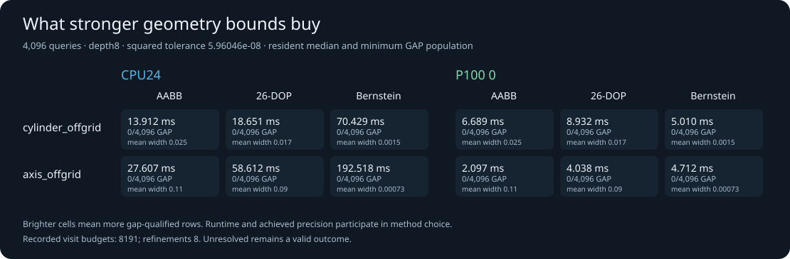

# Automatic conservative discovery on P100

The three-mode operation, exact-qualified caller and **354 completed native
comparisons** are delivered. The main field covers CPU24 and each P100 at
N=1,256,4096,65536, seven corpora and three methods. Separate depth sweeps
include CPU1; the controlled off-grid field currently covers CPU24/both P100s.
The remaining main scalar CPU field and six replacement scalar off-grid cases
continue as a follow-up, rather than delaying this qualified delivery.

For **65,536 coarse rational-cylinder queries**, Bernstein mode, depth8 and
squared tolerance 2^-24, seven-sample native medians are:

| Backend | Resident discovery | Cached-hierarchy host-to-host | Gap-qualified rows |
| --- | ---: | ---: | ---: |
| CPU, 24 requested workers | 1,255.98 ms | 1,235.17 ms | 65,536 |
| P100, device 0 | 34.75 ms | 41.05 ms | 65,536 |
| P100, device 1 | 34.70 ms | 42.16 ms | 65,536 |

Each P100 individually achieves **36.14–36.20× resident** and
**29.30–30.09× cached-host latency ratios** against this owned CPU24
implementation. Maximum squared bracket widths are 8.53e-14 on CPU and
7.55e-14 on GPU, below the requested 5.96e-8. These are separate timed calls;
their medians are not additive. This is a local untrimmed-patch query operation,
rather than a CAD modeling or topology speedup.


## Precision and method choice

The coarse cylinder has **60 distinct repeated targets**, with UV sites on the
depth8 subdivision boundaries. This alignment helps Bernstein's coefficient
bounds reach tight gaps. The finer odd/64 cylinder field has 1,024 distinct
targets repeated to N4096 and **zero gap-success rows for every method** at
depth8. Bernstein still reduces its mean squared bracket width from about
0.0248 to 0.00152. The off-grid axis field repeats 32 heights; its mean width
improves from 0.108 to 0.000732. All brackets remain qualified and unresolved
answers stay visible.



Depth8 is a resource default, rather than an accuracy or performance optimum.
In the P1000 depth study at N4096, diagonal 26-DOP already achieves all gaps
at depth0 in 0.214 ms. The cylinder-axis midpoint case, one target repeated
4,096 times, achieves all gaps with Bernstein at depth2 in 1.023 ms versus
7.915 ms at depth8. AABB suffices for the axis-aligned plane. Strong methods
therefore remain explicit choices, informed by precision and total cost.


At depth8, the native tree payloads are 40,884 bytes for AABB, 122,644 for
26-DOP and 2,044,004 for Bernstein. Host/device ownership and original controls
add memory beyond those payloads. Preprocessing builds outward intervals on
CPU for both backends, then uploads CUDA arrays. Observed hierarchy medians
can vary with shared-host conditions; their difference is not a hardware
lower bound. The exported reuse estimate includes hierarchy setup only and
compares independent medians. A zero estimated extra hierarchy cost does not
remove CUDA first use: the large-cylinder cases observed 295/461 ms context
first-use samples separately. Small Bernstein batches favor CPU24 here:
N1 takes 0.222 ms versus about 1.81–1.85 ms on a P100.

## Scope and reproduction

Owned C++17 CPU/CUDA, CUDA12.8.1/nvcc12.8.93, real sm_60 code, two individual
16 GB P100 PCIe cards and a dual Xeon E5-2697 v2 host with 24 physical cores.
G++13.3, CMake3.28.3 and CPython3.12.3. The host is shared, workers are not
affinity-bound and clocks/background activity are uncontrolled. CPU intervals
use RN plus nextafter; CUDA uses directed FP64 intrinsics. This is the current
owned baseline, rather than a CPU performance ceiling.

Each native case excludes a validated warm-up and retains seven samples.
Resident includes result allocation, traversal/refinement and synchronization.
Prepared download uses allocated host arrays. Cached-host includes query
snapshot/upload, discovery, download and native consumption, excluding retained
hierarchy setup, cleanup and Python. Profiled kernels use a separate context.
Input is 28 bytes/query and output 88 bytes/query across same-host RAM/VRAM;
these sizes do not describe network transfers. Every timed row checks an exact
dyadic analytic global bracket and exact binary gap. Descriptive witness checks
have a stated arithmetic allowance; exact original-UV upper qualification is
supplied separately by the Fraction corpus and actual caller.

[Qualification and 24,576 actual caller witnesses](QUALIFICATION.md) ·
[Independent retained-data review](../../papers/2026-10-14-discovery-performance-review.md) ·
[Figure/ratio/amortization scope](figures/FIGURES.md).

Raw fields:
[main samples](native-cpu24-gpu/samples.tsv),
[main summary](native-cpu24-gpu/summary.tsv),
[off-grid samples](native-offgrid/samples.tsv),
[off-grid summary](native-offgrid/summary.tsv),
[diagonal depth sweep](native-depth-diagonal/summary.tsv),
[axis depth sweep](native-depth-axis/summary.tsv).
Work histograms accompany each field. All initial scalar off-grid timings were
excluded conservatively after a data-copy completion was not awaited before
their start; originals are preserved privately and six controlled replacements
are running. Later CPU24/GPU samples were after observed copy completion.
No build, geometry test or data copy runs alongside the replacement/main scalar
trials. [Source](SOURCE_SHA256SUMS) and [binary identities](BINARY_SHA256SUMS)
identify the b9903a6 numerical/benchmark checkpoint; subsequent changes here
are documentation and artifact rendering.

From a qualified build, reproduce the delivered main field with a fresh path:

```sh
python3 benchmarks/discovery/run.py \
  --binary build/discovery-release/brepgpu_discovery_benchmark \
  --output-directory results/local-native-discovery \
  --cpu-threads 24 --cuda-devices 0,1 --repetitions 7
```

Use `--counts 4096 --corpora cylinder_offgrid,axis_offgrid` for off-grid data;
`--counts 4096 --corpora diagonal --depths 0,2,4` and
`--counts 4096 --corpora axis_midpoint --depths 0,2,4,8` for the depth studies.
Those sweep fields use CPU1/CPU24 and both cards. The main depth8 diagonal row
is retained once in the main field. [Operation/build/caller guide](../../docs/ITERATION_3.md).

The next measured work is shallower sufficient hierarchies and tighter
off-grid curved bounds, with setup, memory and achieved precision included.
The discovery kernel currently uses 254 registers, a 448-byte stack and zero
spills; mode specialization is another candidate to measure. Neither staging
queues nor a new dependency is assumed to improve this operation.
