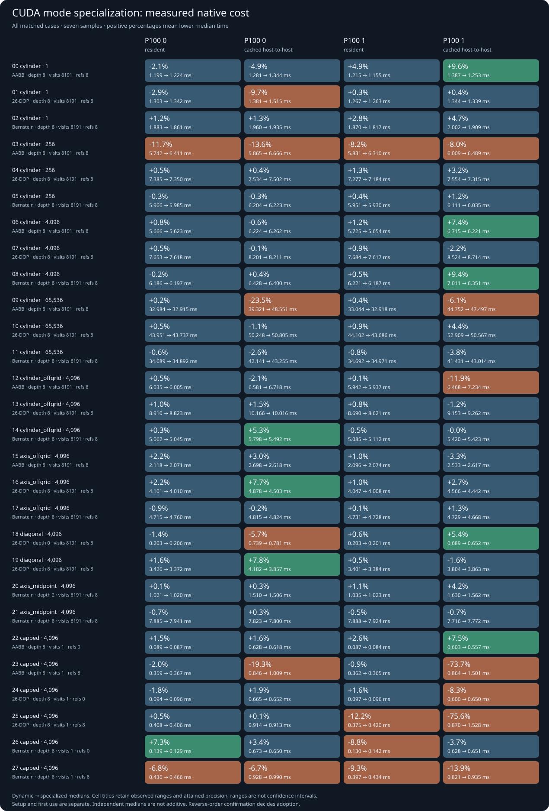

# CUDA mode specialization: qualified, not selected

**The product retains the qualified dynamic discovery kernel.** Three specialized
CUDA kernels reduced compiled register use but did not meet the predeclared
performance criterion on the two P100s. All geometry and output checks passed.
The experiment, raw data and candidate source remain available for study.

The candidate is [commit ba44794](https://github.com/antimeme-ai/BRepGPU/commit/ba44794):
one CUDA kernel template and immutable-mode host dispatch, with unchanged shared
arithmetic, cache layout, CPU core, native benchmark and public/private ABI.
The [reviewed plan](../../docs/CUDA_DISCOVERY_MODE_PLAN.md) required a matched
large-batch native-phase improvement of at least 5%, confirmed in reverse order
on both cards, without material confirmed regressions. It is an experiment
decision, not a CI timing assertion.

## Actual qualification

The original plugin passed the new three focused public tests on both cards
before the CUDA change. The candidate passed those tests under Compute Sanitizer
on each card: **zero errors and zero bytes leaked**. They exercise all modes,
empty/127/128/129/tail counts, invalid-row precedence and canonical NaNs, caps,
degree-zero/mixed controls, profile-on/off numerical bytes, retained children,
caller/worker device restoration and analytic ABI1/ABI2 smoke operations.

Each card's old/new capture contains **309 corpus rows in 132 total batches**,
including the focused callers. All output slabs and deterministic metadata/input
bytes are identical; profile durations alone are excluded and separately checked.
The unchanged independent Fraction qualifier checked **309 rows and 11,415
exported nodes per card, with zero violations** against the candidate.

[Original/candidate binary captures](qualification/identity/) ·
[Card 0 exact qualification](qualification/cuda-0/QUALIFICATION.md) ·
[Card 1 exact qualification](qualification/cuda-1/QUALIFICATION.md).
These finite checks target the promised unchanged operation; they are not a
theorem about every possible floating-point execution.

## What compilation changed

| Discovery kernel | Registers | Stack bytes | Spill stores/loads | Decoded SASS instructions |
| --- | ---: | ---: | ---: | ---: |
| Dynamic mode | 254 | 448 | 0 / 0 | 24,246 |
| Specialized AABB | 206 | 448 | 0 / 0 | 21,594 |
| Specialized 26-DOP | 254 | 448 | 0 / 0 | 22,932 |
| Specialized Bernstein | 210 | 448 | 0 / 0 | 22,812 |

Ptxas and the candidate ELF agree on register counts and stack size. ELF parameter
metadata places the bound-cache pointer at constant bank 0 offset 0x170; its
loads disappear from the AABB SASS. These are static compiled-code observations,
not dynamic work counts, occupancy measurements or performance wins. The common
projection and interval scratch remains; the ABI2 projection kernel retains
166 registers, a 224-byte stack and zero spills.

## Matched measurements and the decision

The full field is **28 conditions × two variants × two cards = 112 native
invocations**. Each repeated phase retains seven samples after its excluded
warm-up. Variant order alternates by stable case ID; cards run sequentially.
The same CPU core and benchmark bytes are staged beside each actual plugin.
Raw quality columns and work histograms match in every invocation.



No initial large-batch condition/native phase improves by at least 5% on both
cards. Resident timings are mostly close; host-to-host measurements have wider
variation. Six selected cases were repeated in reversed variant order on both
cards: **24 additional invocations**. All samples are retained, including
contradictory results and regressions.


Examples, shown as dynamic → specialized medians:

| Condition | Card | First resident run | Reversed resident run |
| --- | ---: | ---: | ---: |
| Cylinder, AABB, N256 | 0 | 5.742 → 6.411 ms | 6.401 → 5.761 ms |
| Cylinder, AABB, N256 | 1 | 5.831 → 6.310 ms | 6.325 → 5.750 ms |
| Capped cylinder, Bernstein, N4096, refs 0 | 0 | 0.139 → 0.129 ms | 0.141 → 0.131 ms |
| Capped cylinder, Bernstein, N4096, refs 0 | 1 | 0.130 → 0.142 ms | 0.154 → 0.189 ms |
| Capped cylinder, 26-DOP, N4096, refs 8 | 1 | 0.375 → 0.420 ms | 0.368 → 0.408 ms |

The N256 AABB sign reverses with order. The Bernstein cap-only improvement on
card 0 is accompanied by a regression on card 1. The last row remains slower
on card 1 in both orders. There is no confirmed matched benefit that meets the
plan, and there is a confirmed greater-than-5% resident regression. The source
and execution-host default plugin were restored to their original qualified
identities. No mixed dispatch or new scheduling policy was introduced.
The [restored-default manifest](restored-default.tsv) records the coordinator's
actual post-restoration checksum output. Independent
[qualification/resource](../../papers/2026-10-14-discovery-cuda-mode-qualification-review.md)
and [measurement/decision](../../papers/2026-10-14-discovery-cuda-mode-experiment-data-review.md)
reviews accepted the retained artifacts and scoped conclusions.

[Full comparisons](comparison/comparison.tsv) ·
[Reversed comparisons](confirmation/comparison.tsv) ·
[Initial ordering](comparison/order.tsv) · [Reversed ordering](confirmation/order.tsv) ·
[Condition recipe](comparison/cases.tsv) · [Binary provenance](comparison/provenance.tsv).
Per-invocation raw samples, summaries and work histograms accompany those files.

## Scope and reproduction

Resident means result allocation, traversal/refinement and completion/restoration.
Cached host-to-host includes query snapshot/upload, discovery, download and native
analytic consumption with retained hierarchy. The separately reported CUDA event
bracket may include a host submission gap; it is not pure device instruction time.
Setup, first use and cleanup retain their single/repeated phase definitions.
Independent phase medians are not additive caller timings.

This is the existing repeated-input geometry: 60 distinct coarse cylinder targets,
1,024 off-grid cylinder targets and 32 off-grid axis heights. Unresolved outputs
remain in cost/precision records. No precision improvement, arbitrary-target CAD
speedup or general verdict about specialization follows. Shared-host background
activity and clocks are uncontrolled; no owned build, copy, qualification or other
performance job ran alongside these trials.

CUDA12.8.1/nvcc12.8.93, real sm_60, G++13.3 and the unchanged numerical flags;
two individual 16 GB P100 PCIe cards on the existing dual-Xeon host. Read-only
binary inspection added pinned CUDA12.8.90 cuobjdump/nvdisasm to the isolated
toolchain; [acquisition identities](inspection-tools.tsv) record their archives.
Their intact archives, extractions and licenses are retained on the execution
host. No product dependency or GPU runtime/driver changed.

To reproduce, preserve the dynamic core/plugin/benchmark from the original
checkpoint, build the candidate CUDA plugin at ba44794, and stage each plugin
beside byte-identical preserved core/benchmark files. Run the actual tests,
capture comparison and exact qualifier before timing, as specified in the plan.

```sh
python3 benchmarks/discovery/compare_modes.py \
  --dynamic-binary context/staged-dynamic/brepgpu_discovery_benchmark \
  --specialized-binary context/staged-specialized/brepgpu_discovery_benchmark \
  --output-directory results/local-mode-comparison
python3 benchmarks/discovery/compare_modes.py \
  --dynamic-binary context/staged-dynamic/brepgpu_discovery_benchmark \
  --specialized-binary context/staged-specialized/brepgpu_discovery_benchmark \
  --cases 3,9,23,25,26,27 --reverse-order \
  --output-directory results/local-mode-confirmation
```

The next numerical proposal is the
[exact-extrusion separated bound](../../papers/2026-10-14-offgrid-separated-bounds-study.md),
which addresses an observed geometric relaxation. Its implementation and hardware
value remain future work.
