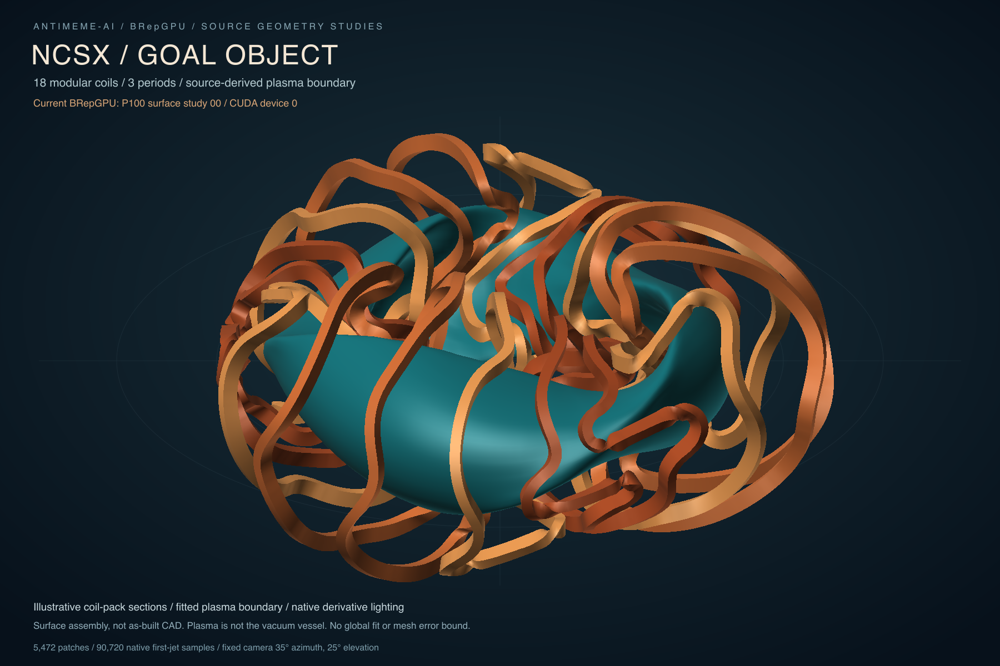

# NCSX rerun after the feature breadth sequence

2026-10-15. **No visual or geometric change from study00.** The fresh P1000
render, all90,720raw first jets, controls, patch layout, scene, recipe and
qualification records are byte-for-byte identical to the preserved baseline.
The CPU1 render also produces exactly the same geometry pixels. Recent
extrusion/revolution/fillet/offset work is not invoked by this NCSX display path.



## What was actually rerun

Same original scientific datasets, all Fourier modes/symmetry transforms,
18illustrative coil-pack envelopes, fitted plasma boundary,5,472patches,
90,720native first-jet samples and101,376display triangles. Camera35°azimuth/
25°elevation,1800×1200,240pixels/sourceunit,center(900,650),light/materials and
sampling remain unchanged. Plasma is not the vacuum vessel; no as-built CAD,
general NCSX solid topology or global fitting/mesh bound is established.

Before adding timing, git diff against study00 commit921ab6a showed no changes
to caller/display/binding. Both actual native library hashes match the baseline.
The only caller changes add timing spans and --threads(default1), passed to the
existing Engine. Fitting, queries, exact arithmetic qualifier, seam/source-fit
checks and display code are unchanged. The bounded plan and actual diff were
independently reviewed before the two serial fleet runs. No new dependency,
native build, product optimization or scene change was made.

One fresh qualified run per placement: P1000 and CPU1, both device0/threadsetting1.
Shared Linux x86_64/Python3.12.3, Tesla P100-PCIE16GB, driver580.178.04,
existing CUDA12.8.1/sm60 binaries. CPU1 means one configured native CPU thread;
GPU host configuration also uses1. These are two observations, with no repeats,
clock/affinity control or variability estimate. Timings are fleet-local; SSH and
result-file transfers are outside them. The original render had no timing
record, so these measurements cannot establish acceleration since study00.

## Matched current timing

| Actual wall | CPU1 | P1000 |
| --- | ---: | ---: |
| Synchronous native evaluation wrapper | 16.310ms | 1.430ms |
| Native setup through download/cleanup | 119.862ms | 570.840ms |
| CPU display render and writes | 9.479s | 9.125s |
| Exact CPU arithmetic qualification | 28.755s | 28.062s |
| Full qualified caller | 41.024s | 40.379s |
| Child process, including imports/startup/output | 41.15s | 40.52s |

P100 evaluation is11.4× faster in this one synchronous-wrapper observation.
That is not isolated kernel time or a stable throughput result. The cold native
aggregate is slower on P100: Engine setup/native-pin capture279.585ms, patch
setup91.623ms, query setup112.050ms and Engine cleanup68.370ms dominate the
1.430ms evaluation. CPU1 corresponding setup spans are3.751/44.749/46.037ms
and cleanup0.014ms. Download/source-metadata wall is8.147ms CPU1/16.597ms P1000.
Transfers/validation/allocation remain inside their actual enclosing wrappers;
no phase is presented as a profiled CUDA primitive.

The display aggregate is the unchanged CPU projection, shading, depth-buffer
triangle rasterization,PNG encoding and surface/scene/SVG writes. It is not GPU
rasterization or isolated raster time. Full qualified caller also includes source
loading/fitting, query preparation, native binding/status/finite checks, exact
Fraction qualification, seam checks, source-fit diagnostics, worldpoint/normal
preparation, artifact table/raw-jet writes and final source/native pin checks.
It excludes imports/argument parsing,the two new cost/placement metadata writes,
console output and final standalone SVG-to-PNG composition. Child-process wall
includes imports/startup/output. The shareable PNG was composed afterward with
existing rsvg-convert2.62.1; that asset conversion is outside both caller times.

Native aggregate overlaps individual native phases; full caller overlaps all
spans. Do not add those rows. CPU raster/qualification and uncontrolled shared
fleet variation dominate the full runs;40.379vs41.024s does not establish a
whole-render GPU speedup. [CPU spans](cpu1/costs.tsv), [P100 spans](p1000/costs.tsv),
[CPU process wall](process-cpu1.tsv), [P100 process wall](process-p1000.tsv).

## Direct output comparison and qualification

[Artifact comparisons](artifact-comparison.tsv) retain hashes for all nine
baseline/P100 artifacts:controls,patch layout,recipe,scene,qualification,rawjets,
transparent geometry PNG,labeledSVG and native library pins. All nine match
exactly. Timing/placement metadata is newly added. The caller pin changes only
for instrumentation; display matches the baseline's final render-sources.tsv
rather than its earlier pre-framing-correction display pin.

[Pixel comparison](surface-pixel-differences.tsv) reports0changed RGBApixels
out of2,160,000for baseline/P100 and P100/CPU geometry rasters. CPU scene/SVG
backend captions and placement metadata legitimately differ, recorded in
[cpu-placement-differences.tsv](cpu-placement-differences.tsv). Camera,materials,
input controls and patch/query layouts agree.

Both fresh runs independently passed the original exact Bernstein arithmetic
oracle at every actual supplied binary64 control/query, all816,480scalar position/
first-partial components. All native statuses are BG_OK and finite; sampled
neighbor seams remain exactly coincident. Direct limits stay normalized-local
position2^-40 and partial derivatives2^-30; seam limit2^-39.

| Maximum exact-control error | CPU1 | P1000 |
| --- | ---: | ---: |
| Position | 2.0296264668928643e-16 | 1.5092094240998222e-16 |
| First partial u | 4.3021142204224816e-16 | 2.6188271411183974e-17 |
| First partial v | 2.220446049250313e-16 | 5.360295540768334e-16 |

CPU and GPU raw outputs differ by at most2.220446049250313e-16(position),
4.3021142204224816e-16(du) and4.909267437014364e-16(dv) in the local frame.
[Actual difference counts/maxima](cpu-p100-jet-differences.tsv). Both remain
independently qualified; numerical parity is not the geometry oracle. These
small backend differences do not change any geometry raster pixel.

P100 source-fit diagnostics remain exactly the prior coil-centerline maximum
0.003887301573422884 and plasma maximum0.006217897392490993 in original coordinate
units. CPU values differ only in last bits. These are sampled fitting diagnostics,
not global error bounds or evidence of closer engineering-source agreement.
CPU native-library records contain only the core; P100 adds its CUDA plugin.
Full controls, actual raw jets, checks, recipes, scene and source/native hashes
are retained separately for each backend. Original baseline/hero assets remain.

## Reproduction and what would improve the next picture

Run from the Linux fleet checkout using the existing qualified native core:

```sh
PYTHONPATH=python BREPGPU_LIBRARY=build/pair-release/libbrepgpu.so \
  python3 examples/render_ncsx.py --backend cuda --device 0 --threads 1 \
  --output-directory results/local-ncsx/rerun-p1000
PYTHONPATH=python BREPGPU_LIBRARY=build/pair-release/libbrepgpu.so \
  python3 examples/render_ncsx.py --backend cpu --device 0 --threads 1 \
  --output-directory results/local-ncsx/rerun-cpu1
```

Every run preserves the same display scene and writes its own costs/placement
alongside original geometry/qualification artifacts. GNUtime measured full child
wall separately in this delivery. The actual new image was visually inspected
for framing,captions and coil/plasma crossings after composition.

The new narrow solid/feature constructors do not consume these fitted cubic coil
and plasma carriers. An actual NCSX modeling improvement requires connecting
broader imported/swept/trimmed geometry and topology to the scene, with the chosen
engineering revision for vessel,forms,ports/supports where available. Finer fits
or display grids would be separate named sampling changes, not an improvement
produced automatically by current kernel additions. Native residency and CPU
render integration are measured future candidates; this rerun changes neither.
Required community alpha qualification and reference issues43/48 remain open.


[Independent plan, instrumentation and saved-artifact review](../../papers/2026-10-15-ncsx-rerun-runtime-review.md)
accepted the actual numerical/image comparisons and timing scope. The freshly
composed shareable PNG also matches the original hero byte-for-byte.
