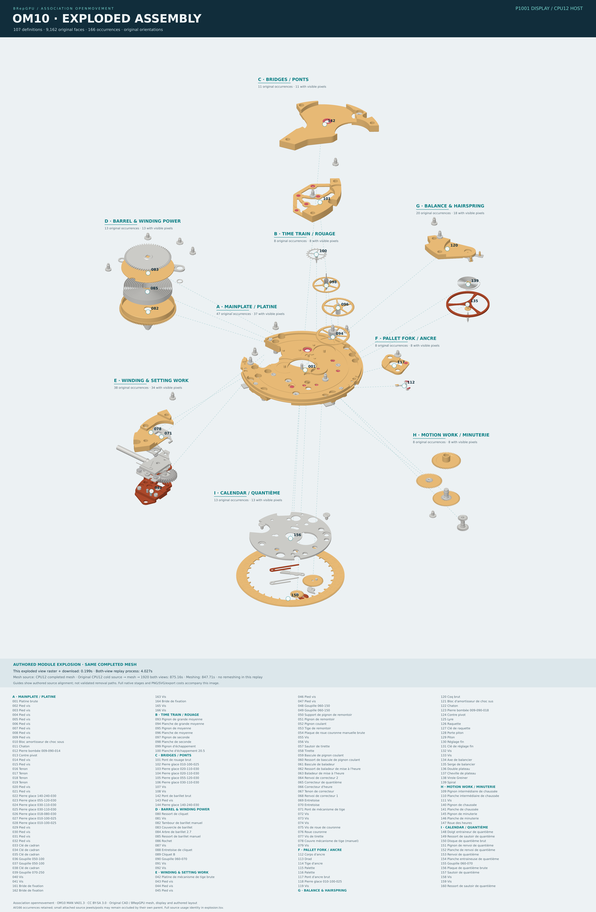
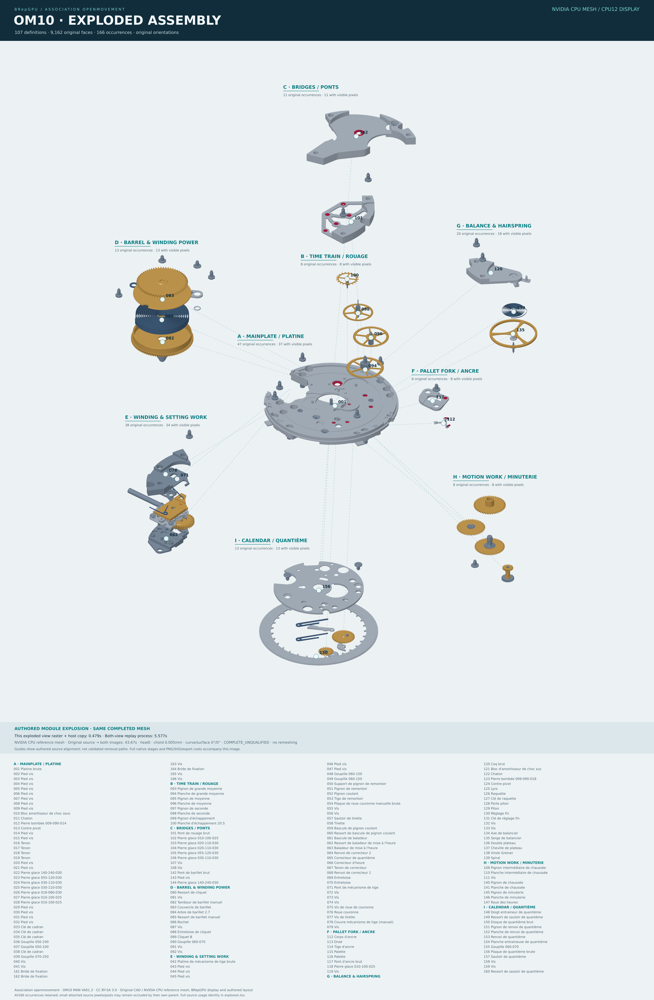

# OM10 exploded assembly diagram

The complete movement is separated into visible functional modules: mainplate,
train, bridges, barrel and mainspring, winding/setting work, escapement,
balance/hairspring, motion work and calendar. **All107 definitions,9,162 original
faces and166 occurrences remain.** Original geometry, orientations, placement
matrices, normals and materials are preserved. Only authored presentation
translations and cameras change. This is an explanatory illustration, not a
validated disassembly or maintenance sequence.

Download full size: [P1001 display](../../assets/om10/p1001-exploded-assembly-4k.png)
· [CPU12 display](../../assets/om10/cpu12-exploded-assembly-4k.png).
Each poster is3840×5871. The underlying native render is3840×4000 at2×
supersampling (7680×8000 internal); headers and the full166-name legend sit
outside those pixels. The actual ID buffers show all20 selected major parts and
150of166 occurrences. Sixteen small attached jewels/posts remain occluded;
they are retained, not omitted. Numbered markers use actual visible pixels.
Dashed guides show authored alignment with source positions, not removal paths.

The CPU and P100 replay **the same completed CPU12 mesh**. Their actual assembled
and exploded raw PNGs, scene, view bytes, translation manifest and visibility
tables are byte-identical. Poster headers and timing captions differ by backend.
Original cold meshing is not repeated or included in the new display figures.

| Actual measured scope | CPU12 | P1001 display / CPU12 host |
|---|---:|---:|
| Assembled raster + result download |1.821968s|0.231227s|
| Exploded raster + result download |0.421097s|0.198829s|
| Both-view native replay process |5.14s|4.02s|
| Source/index admission, layout and scene copy |11.269678s|11.032618s|
| Both PNG encodes |1.314155s|1.252280s|
| Actual-ID mask, visibility and guides |13.576433s|13.667918s|
| SVG composition |0.008983s|0.008756s|
| SVG rasterization |2.363776s|2.381637s|
| Complete new replay/export |33.882756s|32.599048s|
| Later caption-only export from the same pixels |5.022339s|4.793285s|

These are single observations, run serially on twelve physical CPU cores and
P100 device1. The raster sums include only disjoint projection, triangle setup,
binning, shading/resolve and download stages. Process and complete scopes contain
nested stages; do not sum the entire table. The later caption export explicitly
identifies CPU12 as the mesh source under both backend headers; it did not rerun
the native display. All stages, including that export, are in
[stages.tsv](stages.tsv). Actual process exit/wall/user/system/peak RSS are in
[processes.tsv](processes.tsv), with [metadata](metadata.tsv),
[visibility counts](visibility.tsv) and [input/tool pins](pins.tsv).

The original completed CPU12 cold source→mesh→1920both-view process took875.16s;
its meshing scope took847.712234s. Those earlier costs and the separate original
P100 run are retained in the [whole-watch report](../om10-watch-2026-10-17/REPORT.md).
This replay establishes no new meshing speedup or whole-watch quality proof.
Independent whole-watch distance/alpha qualification remains separate. The genuine NVIDIA reference diagrams below use the exact same layout and
cameras, with separate geometry and explicit qualification status.

## Genuine NVIDIA CPU reference geometry

Full size: [heal0](../../assets/om10/nvidia-heal0-exploded-assembly-4k.png) ·
[heal1](../../assets/om10/nvidia-heal1-exploded-assembly-4k.png).
These use genuine NVIDIA CPU tessellation and the existing BRepGPU **CPU12 raw
reference display**, not NVIDIA rendering or owned substitute triangles.
All107 definitions,9,162 original faces and166 occurrences are present. Every
existing physical shell/source-Euler check passes under both healing policies.
Both show all20 selected major parts and150of166 actual visible occurrences.

The named completed policy uses a **0.005mm chord request, curve angle0° and
surface angle0°**, with explicit periodic/plane representation preparation.
The status is **COMPLETE_UNQUALIFIED**: independent source-to-mesh distance
qualification was not performed. Zero means the angular constraints are ignored;
a nominal chord request and watertight shells do not prove a5µm error bound.
No matched-quality speedup or ratio follows from these times.

| Actual measured scope | NVIDIA heal0 | NVIDIA heal1 |
|---|---:|---:|
| Fresh source → both original labeled views |43.673684s|45.001245s|
| New assembled diagram raster + host copy |2.174333s|2.423830s|
| New exploded diagram raster + host copy |0.478745s|0.526561s|
| New both-view native CPU12 process |5.57s|6.11s|
| Source/pose/layout admission and scene copy |12.662045s|11.914418s|
| Both PNG encodes |1.257947s|1.261015s|
| Actual-ID mask, visibility and guides |13.325605s|13.251167s|
| SVG composition |0.008751s|0.008363s|
| SVG rasterization |2.669155s|2.706945s|
| Complete new diagram replay/export |36.140976s|35.871446s|

The first row is the original complete fresh reference pipeline, including
source import/preparation, NVIDIA tessellation, physical admission and the
original two views. Remaining rows replay its retained geometry into this new
3840×4000SS2 diagram; no new tessellation is included. Both operations ran serially
on twelve physical CPU cores. Nested stage scopes are not additive. See the
literal [complete outcomes](nvidia-reference-outcomes.tsv), every recorded
[original/new stage](nvidia-stages.tsv), actual new display
[process costs](nvidia-processes.tsv), [metadata](nvidia-metadata.tsv),
[visibility](nvidia-visibility.tsv) and [pins](nvidia-pins.tsv).

The exact166-row translation manifest, label word and BGVIEW bytes match the
owned CPU/P100 diagrams. Only the three explosion doubles per reference instance
change; all NVIDIA geometry, normals, physical keys, triangle face ordinals and
materials remain byte-identical to the retained reference scene. Its supplied
illustrative palette is retained, so its colors differ from the owned images.
Original placements match exact native-source composition. SDK face ordinals
are checked against actual staged `input_faces`; they are not forged into STEP
FaceIDs. Original coverage is retained separately through source inventory and
source-linked preparation history. Both reference scenes contain694,248 stored
normal corners and281,156 placed triangles. Heal0/heal1 assembled raw pixels
are byte-identical; their exploded raw pixels differ. Neither mesh is replaced
or normalized to manufacture agreement.

Retained unsuccessful policies remain unsuccessful: at25°/25°, both healing
policies exported all107 components but component1808 failed physical manifold
checks. A private advancing-front control was censored at180s with no result;
no advancing-front product route or repaired/fallback triangles were used here.
The successful0°/0° policy is a separately named outcome, not a relabeling of
those failures. All posters visibly state policy and qualification status.

## Reproduction and source

The layout is in [om10_explosion.py](../../examples/om10_explosion.py); the
[replay/export entry](../../examples/render_om10_exploded.py) consumes an existing
complete native model, its successful process report, pinned source-profile1
native display/API2 module and SVG exporter. It refuses to overwrite outputs.
Use `--help` for the actual arguments; geometry/display execution belongs on the
fleet. The separate [NVIDIA replay entry](../../examples/render_om10_exploded_reference.py)
consumes genuine completed external mesh bytes, not owned replacement triangles.

The scene-copy writer checks every byte except each instance's three explosion
doubles. Direct authored transport fixtures cover repeated prototypes, rotated
placements, exact geometry/material/normal preservation and missing/wrong
identities. Source graph and actual pixel inventories are admitted directly;
these are presentation checks, not another numerical mesh qualifier. The
[design and data interface](../../docs/om10-exploded-assembly-unit.md) records the
functional grouping and translation policy. Input source SHA256:
`c60675abe3314dca55a31da0406deef851e128e2ee8608536525f926f56d61e3`.

Original CAD: **Association openmovement**, OM10 MAN VA01.3,
[OM10 project](https://openmovement.org/project/om10/). Images are
[CC BY-SA3.0](../../assets/om10/LICENSE.md). Changes: BRepGPU owned mesh/display,
authored functional-module translations, oblique cameras, background-masked
alignment guides, labels, typography and timing panel. Original CAD bytes and
operational binary snapshots are not redistributed here.
