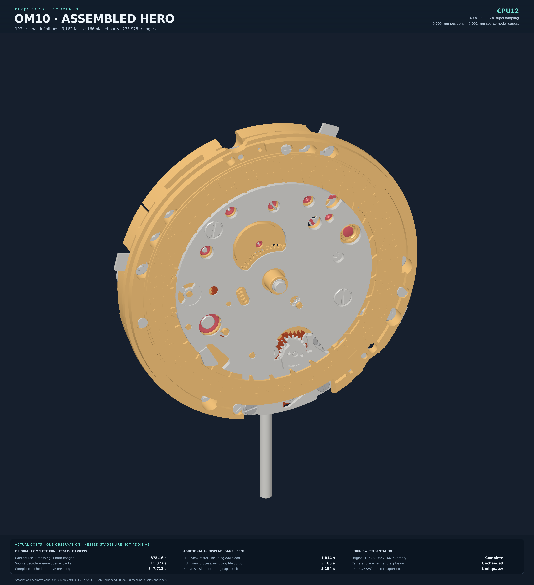
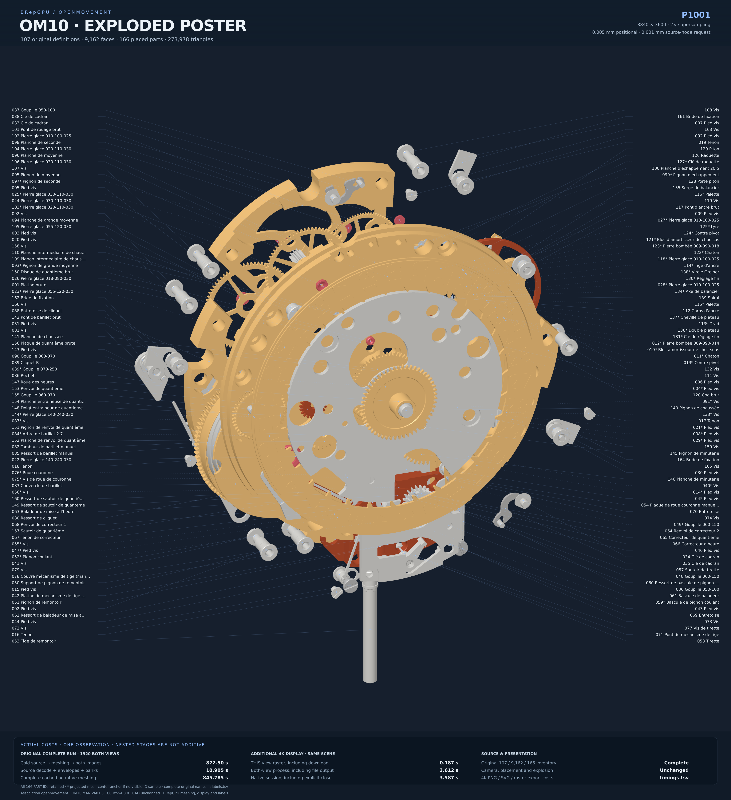

# The complete original OM10 movement

The original Association openmovement **OM10 MAN VA01.3** now completes through
the owned C++/CUDA cached-adaptive mesher and both native display backends:
**107 unique solid definitions, 9,162 original faces, 166 placed parts and
273,978 unique mesh triangles** (339,652 after placement). Both operations finish successfully and publish
the assembled image, exploded image and complete source-linked label legend.

| 4K assembled hero | 4K exploded poster, all 166 callouts |
|---|---|
| [](../../assets/om10/cpu12-assembled-hero-4k.png) | [](../../assets/om10/p1001-exploded-poster-4k.png) |

Download **3840×4200 PNGs**, each containing an actual 3840×3600 native render
with 2× supersampling, typography and timing panels outside the image:

| Backend | Assembled | Exploded, with labels |
|---|---|---|
| CPU12 | [Full-size hero](../../assets/om10/cpu12-assembled-hero-4k.png) | [Full-size poster](../../assets/om10/cpu12-exploded-poster-4k.png) |
| Tesla P100, CPU12 host | [Full-size hero](../../assets/om10/p1001-assembled-hero-4k.png) | [Full-size poster](../../assets/om10/p1001-exploded-poster-4k.png) |

[Complete original-name part legend](labels.tsv) · [Share notes and suggested caption](SHARE.md).
The original measured 1920×1800 outputs remain available:
[CPU assembled](../../assets/om10/cpu12-assembled-1920.png),
[CPU exploded](../../assets/om10/cpu12-exploded-1920.png),
[P100 assembled](../../assets/om10/p1001-assembled-1920.png),
[P100 exploded](../../assets/om10/p1001-exploded-1920.png).

Source design: [Association openmovement](https://openmovement.org/project/om10/).
Images and source-derived legend: [CC BY-SA 3.0](https://creativecommons.org/licenses/by-sa/3.0/).
BRepGPU supplies tessellation, illustrative materials, lighting, camera,
explosion and labels; see [attribution](../../assets/om10/LICENSE.md).
The explosion illustrates component positions; it is not a validated disassembly
sequence. The 4K poster uses an actual visible instance-ID sample when available;
otherwise an asterisk/dashed connector marks a projected stored-mesh center.
Each poster uses 117 sampled visible anchors and 49 marked center anchors.
Every source part remains in the scene and legend. Long displayed names are
shortened, with complete names in the legend. Original 1920 callouts use centers.

## Measured complete operations

Each cold process starts from the same extracted original-source snapshot,
constructs every required definition and both 1920×1800 views, writes PNGs and
metadata, closes the display and exits. The original STEP extraction is outside
these times. There is no return of a previously cached mesh.

| Scope, seconds | CPU, 12 workers | P100, 12 CPU workers |
|---|---:|---:|
| Source decode | 0.187481 | 0.178491 |
| Original envelopes and initial assembly | 9.771934 | 9.409517 |
| Source-bank compilation | 1.367625 | 1.316868 |
| Complete meshing | **847.712234** | **845.785060** |
| Scene construction | 12.088713 | 11.836033 |
| Presentation setup | 0.049070 | 0.059894 |
| Display create | 0.032058 | 0.000055 |
| Display upload | 0 | 0.011039 |
| Display evaluation | 0.003412 | 0.001177 |
| Assembled frame, including result download | **0.222594** | **0.046141** |
| Exploded frame, including result download | **0.114025** | **0.042798** |
| Assembled annotation / PNG | 0.000344 / 0.211114 | 0.000308 / 0.202761 |
| Exploded annotation / PNG | 0.001881 / 0.219914 | 0.001823 / 0.201196 |
| Display close | 0.013468 | 0.012708 |
| External process wall, both completed images | **875.16 (14m35s)** | **872.50 (14m33s)** |

These are single observations from simultaneous runs on separate physical CPU
sockets. They do **not** establish an overall GPU advantage. Display is faster
on P100; CPU work in the mesher dominates this complete operation. A CPU worker
count does not imply every stage uses all workers.

[All 889 recorded phase rows, CPU](cpu12-phases.tsv) ·
[All 889 recorded phase rows, P100](p1001-phases.tsv) ·
[Aggregate process and frame timings](timings.tsv) ·
[Original and losslessly compressed image hashes](images.tsv).

The phase files include each complete component, its boundary/face/contact/output
stages, and each frame's projection, setup, binning, shading and download.
Nested scopes overlap: adding all rows double-counts work. The on-image DISPLAY
caption includes shared create/upload/evaluate plus that image's render. Shared
startup must not be charged again when totaling both frames. PNG recompression
for publication preserves the exact decoded pixels and is outside the measured
native caller. Transfer counters describe host/device traffic, not network
transport to the rendering machine.

## Separately timed 4K renders and share-image export

The large images reuse each backend's completed, immutable scene. Saved camera
basis, center, source placements and explosion remain unchanged; image dimensions,
pixel centers and pixels-per-unit scale exactly by two. Native output is
3840×3600 at 2× supersampling (7680×7200 internal samples). The owned C++ display
renders actual stored XYZ and original source normals. This is a fresh render,
not an enlarged bitmap or another meshing run. Python performs external inventory
admission, PNG encoding and SVG composition; the existing isolated SVG rasterizer
produces the final 3840×4200 share canvas, without covering geometry.

| Additional operation, seconds | CPU12 | P100, CPU12 host |
|---|---:|---:|
| Assembled 4K raster, including result download | **1.813797** | **0.211462** |
| Exploded 4K raster, including result download | **0.712075** | **0.187036** |
| Both-view native display process, including raw file output | 5.163352 | 3.612285 |
| Additional inventory admission and preparation | 9.999840 | 9.967406 |
| Assembled PNG encoding | 0.459009 | 0.441673 |
| Exploded PNG encoding | 0.466583 | 0.467594 |
| Exploded callout layout | 1.533971 | 1.544963 |
| Assembled SVG composition / rasterization | 0.003494 / 1.541135 | 0.003815 / 1.142166 |
| Exploded SVG composition / rasterization | 0.007066 / 7.371677 | 0.007379 / 7.576900 |
| Complete additional admission, replay and share export | **27.416544** | **25.657952** |

The two 4K exports run serially on the same 12 physical CPU cores, CPU then P100,
with one observation each. Per-view raster time sums the five disjoint native
projection/setup/binning/shading/download stages. It excludes shared startup,
raw file output, PNG encoding and typography. Native process time includes file
output for both views and explicit close; its stages are nested. No fresh
source-to-both-4K-images meshing time was measured. The original cold 1920
process times printed on each poster remain explicitly separate.

All additional times, metadata, pins and original-to-poster label anchors:

| Backend | Native phases (milliseconds) | Export phases (seconds) | Process | Metadata | Pins | Images | Labels |
|---|---|---|---|---|---|---|---|
| CPU | [Stages](gallery-cpu12-native-timings.tsv) | [Stages](gallery-cpu12-export-timings.tsv) | [Process](gallery-cpu12-display-process.tsv) | [Export](gallery-cpu12-metadata.tsv), [native](gallery-cpu12-native-metadata.tsv) | [Pins](gallery-cpu12-pins.tsv) | [Hashes](gallery-cpu12-images.tsv) | [Anchors](gallery-cpu12-callouts.tsv) |
| P100 | [Stages](gallery-p1001-native-timings.tsv) | [Stages](gallery-p1001-export-timings.tsv) | [Process](gallery-p1001-display-process.tsv) | [Export](gallery-p1001-metadata.tsv), [native](gallery-p1001-native-metadata.tsv) | [Pins](gallery-p1001-pins.tsv) | [Hashes](gallery-p1001-images.tsv) | [Anchors](gallery-p1001-callouts.tsv) |

The [export utility](../../examples/render_adaptive_gallery.py) and
[reviewed plan](../../docs/adaptive-gallery-export-unit.md) reproduce this
presentation from completed native outputs. Original scene/view/label and tool
hashes are checked before and after; these are presentation/inventory checks,
not new geometric qualification.

## Source, implementation and checks

Both runs use the same original source and unchanged requested allowances:
**0.005 mm positional, 0.001 mm node/source**. Spatial values are already in mm.
Original occurrence matrices, faces and shared physical edge identities remain.
CPU owns exact predicates, domain/topology coordination, local CDT and precise
fallback. P100 performs numerical curve/surface/cap work and display; this is
selective acceleration of a native mesher, not a complete GPU B-rep kernel.
No OCCT or NVIDIA reference triangles enter the owned mesher.

The output inventory contains every original definition and face once. Both
runs test 2,218,277 final component-contact candidates with zero forbidden pairs.
This is a within-component mesh check, not an assembly collision test. Their
actual scene, view, label and face-index bytes agree. This checks inventory and
backend compatibility; agreement alone is not an independent geometry oracle.
The P100 records 465,553 curve device points / 420,028 curve bounds and final
cumulative surface counters of 215,809 points / 169,649 bounds / 229 cap facets.
CPU device counters are zero. Cumulative surface snapshots are not summed across
components. Actual P100 host→device / device→host bytes are 356,455,092 / 78,020,312
for curves, and 579,874,360 / 61,834,128 for surfaces. Maximum reservation-inclusive
run peaks are 8,357,302,903 bytes CPU / 8,752,509,773 bytes P100; these are distinct
from process RSS and CUDA driver/context memory.

Relevant authored and original-component source/facet/chain oracles, CPU/both-P100
ports, failure/publication checks, scoped sanitizers and actual-source reviews
are recorded in the [mesher plan](../../docs/ADAPTIVE_MESHER_PLAN.md) and unit
journals. The independent whole-watch original-source reader has **not** finished;
these images do not establish independent whole-watch geometric qualification.
[Required external community qualification before alpha](../../docs/ALPHA_QUALIFICATION.md)
remains non-green. This is a development rendering milestone, not alpha.

The final blocker was a local chosen-polyline crossing near a source-arc joint.
The constructor had requested every curved boundary interval, invalidating
completed neighbors repeatedly. It now retains the exact crossing witness and
requests a captured local interval. A generic three-point curvature estimate
guides the proposal; the existing exact domain and source-error guards decide
acceptance. The prior nesting fallback remains. Source names/IDs do not select
production behavior. See the [plan and actual regression](../../docs/adaptive-domain-local-recovery-plan.md).
Earlier failures and censored runs remain in the
[continuation journal](../../journal/2026-10-17-watch-render-continuation.md).

## External references

Both fresh genuine NVIDIA USD/BRep 1.0.0 CPU preparations have now run from the
original STEP: 12 workers, one inner thread each, both healing policies, requested
0.005 mm chord height and the completed native model's exact original placements,
cameras and explosion. Each attempts all 107 definitions and completes 103.

| Reference configuration | Definitions complete | Actual failed-attempt wall | Complete render time |
|---|---:|---:|---|
| NVIDIA, heal0 | 103/107 | 21.969470s | unavailable; no image |
| NVIDIA, heal1 | 103/107 | 87.466837s | unavailable; no image |

Both preparations fail on the same four definitions. The official OCCT-to-USD
bridge refuses multi-turn analytic trims requiring topology splitting on 1716
and 1811. Our strict output adapter refuses nontriangle polygons on 1797 and 1756;
its accepted polygon special case is an exact axis-extruded rectangle. These
are failures of this pinned import/export pipeline, not a demonstrated inability
of every NVIDIA API or a measured complete-render comparison. No owned triangles
replace missing reference output. Independent reference qualification and display
are not run after incomplete preparation. An orchestrator exit 0 means it recorded
the outcomes, not that either reference pipeline passed.

[Actual reference outcomes](nvidia-reference-outcomes.tsv) ·
[Preparation outcomes](nvidia-preparation-outcomes.tsv) ·
[All 107 heal0 definition outcomes](nvidia-heal0-definitions.tsv) ·
[All 107 heal1 definition outcomes](nvidia-heal1-definitions.tsv) ·
[heal0 runtime pins](nvidia-heal0-runtime-pins.tsv) ·
[heal1 runtime pins](nvidia-heal1-runtime-pins.tsv).
These new attempts supersede neither earlier failed observations nor the need
to improve reference coverage. They supply no whole-render speedup ratio.

### Focused NVIDIA pipeline recovery

The subsequent investigation corrects the two polygon cases through explicit
reference preparation. Their converted finite Plane patches omit original
boundary points by about2.4mm. The official converter estimates those ranges
from24 intervals per whole spatial curve; subsequent lazy UV generation on
the undersized patches produces comparable spatial disagreement. Changing
angular settings alone to the documented25/25 defaults does not fix it.

The new [plane-envelope preparation tool](../../docs/NVIDIA_REFERENCE_PREPARATION.md)
widens only Plane `face:range` entries using positive rational control hulls,
exact projection and outward rounding. Original support geometry, spatial
curves, topology and other typed USD values remain equal. The SDK, requested
.005mm chord and strict raw exporter are unchanged. No replacement triangles
or wider crossed-polygon admission are used.

| Definition, heal0 | Full preparation process | Full SDK producer process | Genuine triangles |
|---|---:|---:|---:|
|1756|.415431s|.662115s|9,004|
|1797|.416043s|.816550s|7,060|

These are separate serial single-definition processes starting from retained
converter-produced USD, with25/25 angular controls. Preparation is pinned to
one physical core; the producer has affinity to12 physical cores on one socket,
with OpenUSD/OMP thread limits1. These are not CPU1 performance comparisons.
STEP transfer and OCCT-to-USD conversion are excluded from these focused times.
Preparation process wall includes Python/package
startup; measured preparation bodies take.123385/.135537s. Producer process
wall includes plugin setup, input copying, import, tessellation, strict export,
writing and teardown. All stage rows and executable/source pins are retained:
[actual recovery times](nvidia-plane-recovery-times.tsv),
[runtime pins](nvidia-plane-recovery-pins.tsv). Nested stages and enclosing
process walls overlap and must not be summed.

Both definitions also pass the bounded heal1 controls with9,004/7,060 triangles.
All four outputs pass the existing closed physical-shell/source-Euler2 reader
and complete imported-face/normal/identity export gates. The same finite UV
trace drops the old millimetre discrepancy to1.3946e-5mm and3.8522e-14mm.
An independent translated rational-cylinder regression passes literal support,
source-attribute, shell and cylinder-equation checks. These checks do not
establish a whole-watch5µm distance certificate.

The two conversion refusals have a separate, diagnosed cause: missing source
pcurves and tolerant nominally full-period seams produce sampled angular spans
above the converter's fixed1e-5-radian excess cutoff, before SDK healing.
Guarded RAW preparation plus documented OCCT closed-face splitting gets a
named1811 derivative through the unchanged producer:117 original faces retained
through122 descendants,2,096 genuine triangles. The offending1716 cylinder
remains unsplit and unresolved. This derivative result is separate from the
original-input outcome; see the [periodic source/API diagnosis](../../papers/2026-10-17-nvidia-periodic-input-usage-diagnosis.md).

The historical103/107 preparations above remain unchanged. No complete107-case
run, complete NVIDIA image or new whole-render time is claimed by this focused
repair. The follow-up establishes a usable repair for both polygon cases and
the specific remaining import work, rather than a general NVIDIA kernel verdict.

The separate OCCT reference experiment completed 101/107 definitions in 15.22s;
the remaining six still failed after the reviewed source-UV preparation variant.
No complete OCCT image exists. See the
[explicit outcomes](../../journal/2026-10-17-occt-watch-reference.md).

## Reproduction and pins

The [native caller](../../docs/ADAPTIVE_MODEL_CALLER.md) takes a source snapshot
exported from the original STEP through the isolated, adopted OCCT bridge.
Original CAD bytes remain outside the repository; acquisition/restoration and
source attribution are recorded in the quarantine manifest and
[source note](../../papers/2026-10-15-om10-source-attribution.md).

```sh
brepgpu-adaptive-model --source original.bgsource --output new-cpu-result \
  --positional-mm .005 --node-source-mm .001 --threads 12 --face-owners 12 \
  --memory-mib 32768 --scratch-mib 256 --width 1920 --height 1800 --explosion 2

# Same options and source, new output directory; add for the P100 operation:
# --backend p100 --device 1 --cuda-module cap-module.so \
# --display-module libbrepgpu_om10_cuda.so
```

Hardware: two Intel Xeon E5-2697 v2 CPUs at 2.70 GHz, 12 physical cores/socket;
one Tesla P100-PCIE-16GB for the accelerated operation, driver 580.178.04,
CUDA 12.8.1 targeting sm_60. Each operation is pinned to a different 12-core
physical socket. Limits: 32 GiB global metered memory, 256 MiB per child exact
job; prepaid worker reservations also count toward the global limit.
External peak RSS is 1,987,632 KiB CPU / 2,072,772 KiB P100, a different scope
from reserved or device memory.

| Input or executable | SHA256 |
|---|---|
| Original STEP | `c60675abe3314dca55a31da0406deef851e128e2ee8608536525f926f56d61e3` |
| Native source container | `1174672845d4920b5aa719b2ddeac56c062535779caee36bcc94f911f30d30a4` |
| Native model executable | `9f7e9605f6fb7ef8c8bd99f48c7417449b556ad5d61402e5b277267303424cd2` |
| Geometry CUDA module | `5bf279895cf9710f4cc1496d9f25d10f46f6874e1d416446575db753efcde303` |
| Display CUDA module | `e87cbf89099f9785029fa4c52aa0012308e444f82e6363a45d8435cf2d007b36` |
| Actual scene, both backends | `84f1d64fe1930374273b79824843aa52899c2397dda5f40e84327c48fd0ee475` |
| Actual views, both backends | `c141b0f8e4d829a9cedfe8c4989ef904d72d08e637fdf543bf9ffb6de8d7c62d` |

Next required tranche: [genuine NVIDIA CPU reference backfill for every README scenario](https://github.com/antimeme-ai/BRepGPU/issues/63).
Mesher performance and presentation opportunities are retained in the
[return-pass notes](../../docs/ADAPTIVE_MESHER_RETURN_PASS.md).
