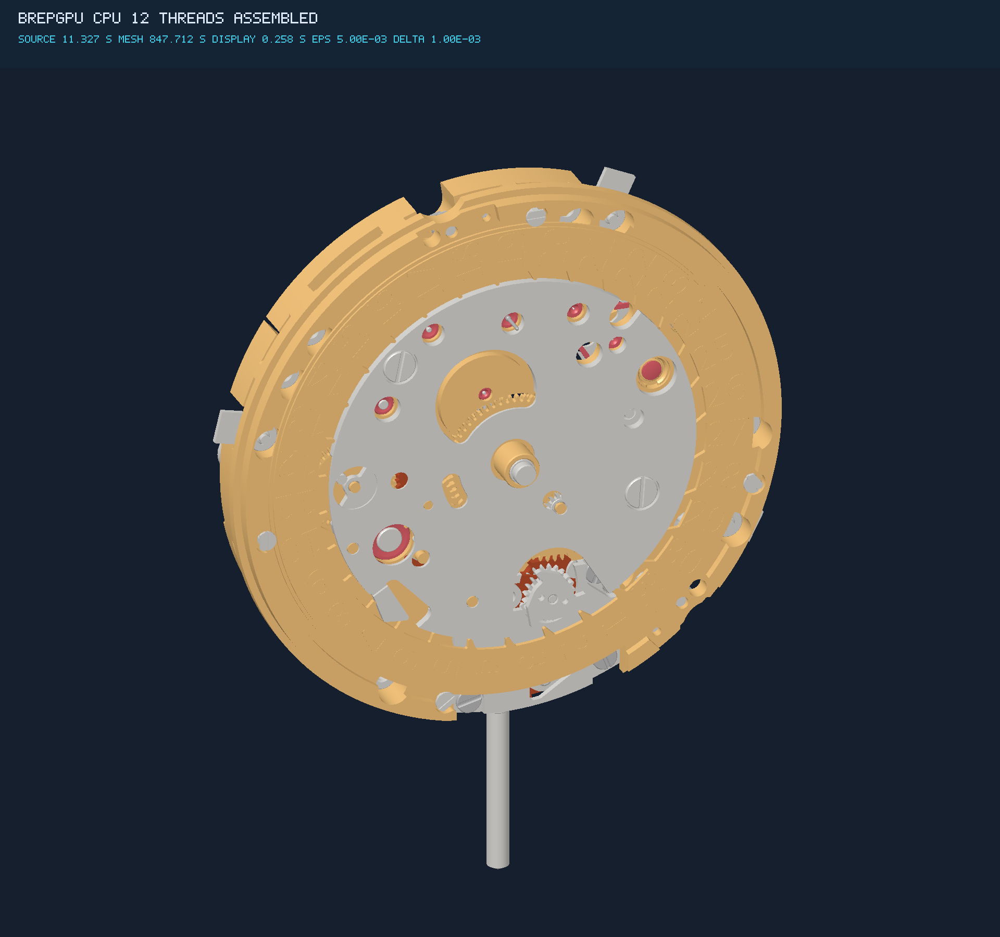
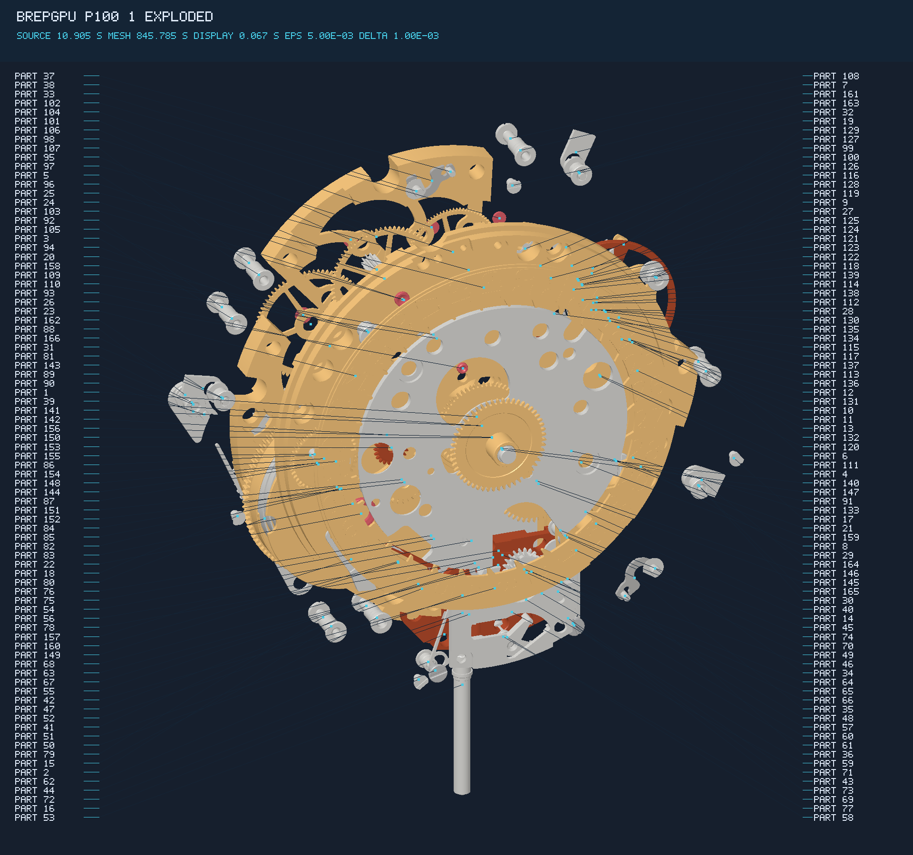

# The complete original OM10 movement

The original Association openmovement **OM10 MAN VA01.3** now completes through
the owned C++/CUDA cached-adaptive mesher and both native display backends:
**107 unique solid definitions, 9,162 original faces, 166 placed parts and
273,978 unique mesh triangles**. Both operations finish successfully and publish
the assembled image, exploded image and complete source-linked label legend.

| Assembled | Exploded, all 166 part callouts |
|---|---|
| [](../../assets/om10/cpu12-assembled-1920.png) | [](../../assets/om10/p1001-exploded-1920.png) |

[CPU assembled](../../assets/om10/cpu12-assembled-1920.png) ·
[CPU exploded](../../assets/om10/cpu12-exploded-1920.png) ·
[P100 assembled](../../assets/om10/p1001-assembled-1920.png) ·
[P100 exploded](../../assets/om10/p1001-exploded-1920.png) ·
[Complete part legend](labels.tsv).

Source design: [Association openmovement](https://openmovement.org/project/om10/).
Images and source-derived legend: [CC BY-SA 3.0](https://creativecommons.org/licenses/by-sa/3.0/).
BRepGPU supplies tessellation, illustrative materials, lighting, camera,
explosion and labels; see [attribution](../../assets/om10/LICENSE.md).
The explosion illustrates component positions; it is not a validated disassembly
sequence. Hidden parts remain in the scene and receive center-based callouts.

## Measured complete operations

Each cold process starts from the same extracted original-source snapshot,
constructs every required definition and both 1920×1800 views, writes PNGs and
metadata, closes the display and exits. The original STEP extraction is outside
these times. There is no return of a previously cached mesh.

| Scope, seconds | CPU, 12 workers | P100, 12 CPU workers |
|---|---:|---:|
| Source decode | 0.187481 | 0.178491 |
| Original envelopes and initial assembly | 9.771934 | 9.409517 |
| Source-bank compilation | 1.367625 | 1.316868 |
| Complete meshing | **847.712234** | **845.785060** |
| Scene construction | 12.088713 | 11.836033 |
| Presentation setup | 0.049070 | 0.059894 |
| Display create | 0.032058 | 0.000055 |
| Display upload | 0 | 0.011039 |
| Display evaluation | 0.003412 | 0.001177 |
| Assembled frame, including result download | **0.222594** | **0.046141** |
| Exploded frame, including result download | **0.114025** | **0.042798** |
| Assembled annotation / PNG | 0.000344 / 0.211114 | 0.000308 / 0.202761 |
| Exploded annotation / PNG | 0.001881 / 0.219914 | 0.001823 / 0.201196 |
| Display close | 0.013468 | 0.012708 |
| External process wall, both completed images | **875.16 (14m35s)** | **872.50 (14m33s)** |

These are single observations from simultaneous runs on separate physical CPU
sockets. They do **not** establish an overall GPU advantage. Display is faster
on P100; CPU work in the mesher dominates this complete operation. A CPU worker
count does not imply every stage uses all workers.

[All 889 recorded phase rows, CPU](cpu12-phases.tsv) ·
[All 889 recorded phase rows, P100](p1001-phases.tsv) ·
[Aggregate process and frame timings](timings.tsv) ·
[Original and losslessly compressed image hashes](images.tsv).

The phase files include each complete component, its boundary/face/contact/output
stages, and each frame's projection, setup, binning, shading and download.
Nested scopes overlap: adding all rows double-counts work. The on-image DISPLAY
caption includes shared create/upload/evaluate plus that image's render. Shared
startup must not be charged again when totaling both frames. PNG recompression
for publication preserves the exact decoded pixels and is outside the measured
native caller. Transfer counters describe host/device traffic, not network
transport to the rendering machine.

## Source, implementation and checks

Both runs use the same original source and unchanged requested allowances:
**0.005 mm positional, 0.001 mm node/source**. Spatial values are already in mm.
Original occurrence matrices, faces and shared physical edge identities remain.
CPU owns exact predicates, domain/topology coordination, local CDT and precise
fallback. P100 performs numerical curve/surface/cap work and display; this is
selective acceleration of a native mesher, not a complete GPU B-rep kernel.
No OCCT or NVIDIA reference triangles enter the owned mesher.

The output inventory contains every original definition and face once. Both
runs test 2,218,277 final contact candidates with zero forbidden pairs. Their
actual scene, view, label and face-index bytes agree. This checks inventory and
backend compatibility; agreement alone is not an independent geometry oracle.
The P100 records 465,553 curve device points / 420,028 curve bounds and final
cumulative surface counters of 215,809 points / 169,649 bounds / 229 cap facets.
CPU device counters are zero. Cumulative surface snapshots are not summed across
components. Actual P100 host→device / device→host bytes are356,455,092 /78,020,312
for curves, and579,874,360 /61,834,128 for surfaces. Maximum reservation-inclusive
run peaks are8,357,302,903bytes CPU /8,752,509,773bytes P100; these are distinct
from process RSS and CUDA driver/context memory.

Relevant authored and original-component source/facet/chain oracles, CPU/both-P100
ports, failure/publication checks, scoped sanitizers and actual-source reviews
are recorded in the [mesher plan](../../docs/ADAPTIVE_MESHER_PLAN.md) and unit
journals. The independent whole-watch original-source reader has **not** finished;
these images do not establish independent whole-watch geometric qualification.
[Required external community qualification before alpha](../../docs/ALPHA_QUALIFICATION.md)
remains non-green. This is a development rendering milestone, not alpha.

The final blocker was a local chosen-polyline crossing near a source-arc joint.
The constructor had requested every curved boundary interval, invalidating
completed neighbors repeatedly. It now retains the exact crossing witness and
requests a captured local interval. A generic three-point curvature estimate
guides the proposal; the existing exact domain and source-error guards decide
acceptance. The prior nesting fallback remains. Source names/IDs do not select
production behavior. See the [plan and actual regression](../../docs/adaptive-domain-local-recovery-plan.md).
Earlier failures and censored runs remain in the
[continuation journal](../../journal/2026-10-17-watch-render-continuation.md).

## External references

Both fresh genuine NVIDIA USD/BRep 1.0.0 CPU preparations have now run from the
original STEP: 12 workers, one inner thread each, both healing policies, requested
0.005mm chord height and the completed native model's exact original placements,
cameras and explosion. Each attempts all107 definitions and completes103.

| Reference configuration | Definitions complete | Actual failed-attempt wall | Complete render time |
|---|---:|---:|---|
| NVIDIA, heal0 | 103/107 | 21.969470s | unavailable; no image |
| NVIDIA, heal1 | 103/107 | 87.466837s | unavailable; no image |

Both preparations fail on the same four definitions. The official OCCT-to-USD
bridge refuses multi-turn analytic trims requiring topology splitting on1716
and1811. Our strict output adapter refuses nontriangle polygons on1797 and1756;
its accepted polygon special case is an exact axis-extruded rectangle. These
are failures of this pinned import/export pipeline, not a demonstrated inability
of every NVIDIA API or a measured complete-render comparison. No owned triangles
replace missing reference output. Independent reference qualification and display
are not run after incomplete preparation. An orchestrator exit0 means it recorded
the outcomes, not that either reference pipeline passed.

[Actual reference outcomes](nvidia-reference-outcomes.tsv) ·
[Preparation outcomes](nvidia-preparation-outcomes.tsv) ·
[All107 heal0 definition outcomes](nvidia-heal0-definitions.tsv) ·
[All107 heal1 definition outcomes](nvidia-heal1-definitions.tsv) ·
[heal0 runtime pins](nvidia-heal0-runtime-pins.tsv) ·
[heal1 runtime pins](nvidia-heal1-runtime-pins.tsv).
These new attempts supersede neither earlier failed observations nor the need
to improve reference coverage. They supply no whole-render speedup ratio.

The separate OCCT reference experiment completed 101/107 definitions in 15.22s;
the remaining six still failed after the reviewed source-UV preparation variant.
No complete OCCT image exists. See the
[explicit outcomes](../../journal/2026-10-17-occt-watch-reference.md).

## Reproduction and pins

The [native caller](../../docs/ADAPTIVE_MODEL_CALLER.md) takes a source snapshot
exported from the original STEP through the isolated, adopted OCCT bridge.
Original CAD bytes remain outside the repository; acquisition/restoration and
source attribution are recorded in the quarantine manifest and
[source note](../../papers/2026-10-15-om10-source-attribution.md).

```sh
brepgpu-adaptive-model --source original.bgsource --output new-cpu-result \
  --positional-mm .005 --node-source-mm .001 --threads 12 --face-owners 12 \
  --memory-mib 32768 --scratch-mib 256 --width 1920 --height 1800 --explosion 2

# Same options and source, new output directory; add for the P100 operation:
# --backend p100 --device 1 --cuda-module cap-module.so \
# --display-module libbrepgpu_om10_cuda.so
```

Hardware: two Intel Xeon E5-2697 v2 CPUs at 2.70 GHz, 12 physical cores/socket;
one Tesla P100-PCIE-16GB for the accelerated operation, driver 580.178.04,
CUDA 12.8.1 targeting sm_60. Each operation is pinned to a different 12-core
physical socket. Limits: 32 GiB global metered memory, 256 MiB per child exact
job; prepaid worker reservations also count toward the global limit.
External peak RSS is 1,987,632 KiB CPU / 2,072,772 KiB P100, a different scope
from reserved or device memory.

| Input or executable | SHA256 |
|---|---|
| Original STEP | `c60675abe3314dca55a31da0406deef851e128e2ee8608536525f926f56d61e3` |
| Native source container | `1174672845d4920b5aa719b2ddeac56c062535779caee36bcc94f911f30d30a4` |
| Native model executable | `9f7e9605f6fb7ef8c8bd99f48c7417449b556ad5d61402e5b277267303424cd2` |
| Geometry CUDA module | `5bf279895cf9710f4cc1496d9f25d10f46f6874e1d416446575db753efcde303` |
| Display CUDA module | `e87cbf89099f9785029fa4c52aa0012308e444f82e6363a45d8435cf2d007b36` |
| Actual scene, both backends | `84f1d64fe1930374273b79824843aa52899c2397dda5f40e84327c48fd0ee475` |
| Actual views, both backends | `c141b0f8e4d829a9cedfe8c4989ef904d72d08e637fdf543bf9ffb6de8d7c62d` |

Next required tranche: [genuine NVIDIA CPU reference backfill for every README scenario](https://github.com/antimeme-ai/BRepGPU/issues/63).
Mesher performance and presentation opportunities are retained in the
[return-pass notes](../../docs/ADAPTIVE_MESHER_RETURN_PASS.md).
