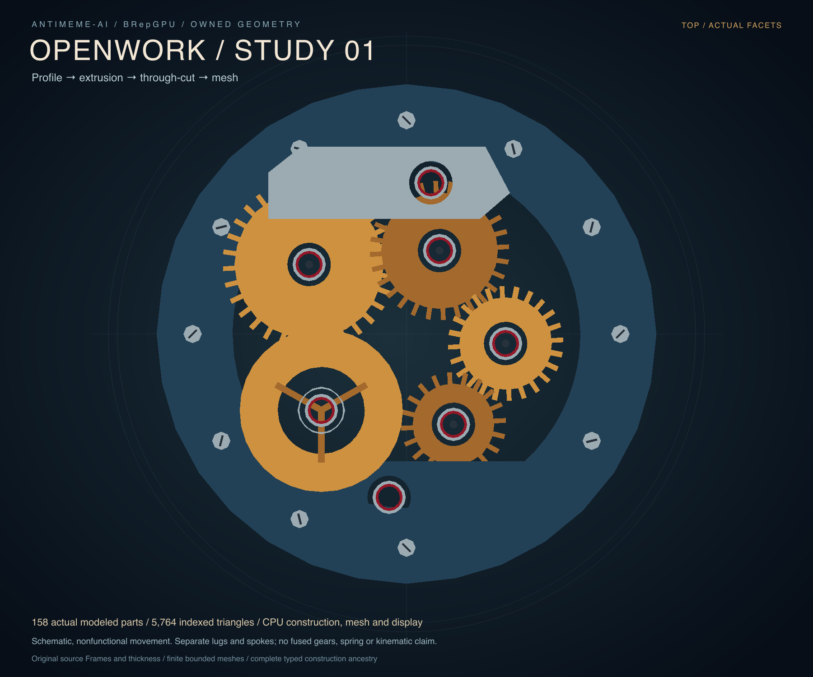

# Openwork study 01: an actual modeling chain


158 separately modeled solids, 23 with actual axial bores, produce 3,152 shared
mesh vertices and 5,764 indexed triangles. Every pierced part consumes its own
original profile → actual extrusion → actual cylinder difference → complete
bounded mesh. The other 135 parts are actual convex extrusions. All 158 actual
meshes passed their independent source/geometry/history/domain checks.

This original watch-inspired study is schematic and nonfunctional. The 104
radial lugs, three balance-like spokes, four posts and raised fastener stripes
are separate solids. They are not fused gears, machined slots or a simulated
mechanism. Tooth contact, interference clearance, gear ratios, springs,
escapement, dimensions and manufacturability are not established. Original
source Frames and thickness are displayed without geometric deformation.

The concrete kernel advance is [actual extrusion/bore composition](../../docs/FEATURE_BORE.md),
including off-center cuts, real trimmed caps and ordered source ancestry.
Every component was constructed separately, with no template/instance reuse.
World mesh tolerance is 1/256; actual approximation plus binary64 displacement
bounds meet it. Circular chords approximate analytic rims; triangle interiors
are not all exactly material-IN. This is one admitted bore family, not general
Booleans or a universal feature graph. NCSX remains the continuing fixed
comparison target, with its artifacts unchanged.

## CPU costs

The final caller executed serially on the existing fleet host. Construction,
meshing, source/history consumption, independent checking, export and display
are CPU work. No native/CUDA operation or device transfer participates.

| Scope | Seconds |
| --- | ---: |
| All source/profile/extrusion/cutter/bore construction | 8.719 |
| All complete meshes | 4.868 |
| All indexed geometry and actual source/history consumption | 6.581 |
| Construction through useful consumption, enclosing those three rows | 20.168 |
| Independent qualification of every actual mesh | 29.501 |
| Per-part filesystem exports | 6.600 |
| Aggregate filesystem exports | 0.039 |
| Oblique CPU display, including PNG/SVG writes | 10.017 |
| Top CPU display, including PNG/SVG writes | 10.292 |
| Full caller through final source check | 76.674 |

[Exact timing scopes](timings.tsv), [per-part stages](timings-parts.tsv) and
[caller scope](SCOPE.md) retain unrounded values and exclusions. Do not add the
enclosing construct-to-consumed row to its three constituent rows. Full wall
starts after imports/argument parsing and includes checks, exports and both
displays; it excludes final timing/SCOPE writes, shutdown, archive packaging and
standalone SVG composition. Rendering includes its PNG encoding and writes;
scene metadata writes follow that render scope. This is one final assembly
observation, with no variability or speedup claim. An earlier inspected render
revealed overlapping component surfaces and crowded framing; corrected source
placements/camera were rerun and independently checked before these final files.

Source/history consumption is already a material cost. Keep native ownership,
bulk reads, runtime retention and Python's role as measured return-pass topics;
this delivery performs no tuning or language migration.

## Inspect the output

- [Actual full assembly PLY](assembly.ply), [part/source inventory](parts.tsv)
  and [triangle-to-part/source-face map](triangle-parts.tsv).
- [Oblique SVG](hero.svg), [top SVG](top.svg), transparent actual-geometry
  [oblique PNG](hero-surface.png) and [top PNG](top-surface.png).
- [Camera/light metadata](hero-scene.tsv), [top metadata](top-scene.tsv),
  [materials](materials.tsv) and [51 actual source hashes](sources.tsv).
- [Complete per-part source/history/mesh archive](parts.tar.gz): all 2,224
  emitted part files, including original profile, actual intermediate extrusion,
  original cutter, final solid/control tables, immediate and composed history,
  mesh/corner/boundary records, independent outcomes and per-part PLY.

The archive preserves the emitted relative `parts/…` layout. From this results
directory, `tar -xzf parts.tar.gz` restores it. For an off-center cut, inspect
`parts/upper-bridge/`: original-profile.tsv, actual-extrusion.tsv,
original-cutter/, actual-result.tsv, immediate-history.tsv and
composed-history.tsv. Ordered cut/extrusion Origin maps remain explicit;
deleted and generating-only input dispositions remain inventoried.



## Direct checks and review

The initial two tests genuinely failed on the missing API before implementation.
The expanded final direct suite then passed all **17 methods in 36.865 s**.
One affected CPU compatibility run passed all **58 methods in 34.414 s**.
Tests cover original source/frame/UV and all six history kinds, off-center and
near-tangent admission, 3–32 vertex profiles, complete exact/rounded positive
domain chains, original shared boundary/seam/corner identity, closed physical
incidence/vertex links, budget failures and unchanged prior outputs. Selected
output corruptions attack those concrete fault classes; there was no mutation
campaign or broad certification rerun.

Independent design, plan, production and caller reviews accepted the bounded
implementation. Final saved source/history records and both actual images were
inspected; all 51 saved source hashes match the delivered code. Native libraries
are unchanged. External community alpha qualification and reference issues43/48
remain incomplete/open; this delivery makes no alpha-readiness claim.

## Reproduce

Run on the fleet from the repository root:

```sh
PYTHONPATH=python python3 -m unittest discover -s tests -p 'test_feature_bore*.py' -v
PYTHONPATH=python python3 examples/render_watch.py \
  --output-directory results/local-watch
```

The caller requires a new output directory and emits the full unarchived part
tree. Standard-library Python owns construction, output and CPU depth display.
Standalone presentation PNGs were composed with the existing `rsvg-convert`:

```sh
rsvg-convert -o hero.png results/local-watch/hero.svg
rsvg-convert -o top.png results/local-watch/top.svg
```

[Target/design notes](../../docs/WATCH_TARGET.md),
[horology sources and visual study](../../papers/2026-10-15-watch-visual-study.md),
[source/geometry study](../../papers/2026-10-15-watch-chain-geometry.md) and
[independent production review](../../papers/2026-10-15-watch-chain-production-oracle-review.md)
retain assumptions and review. No source watch CAD/image or new dependency was
adopted. Stop this bounded unit after publication and handoff.
